<p align="center">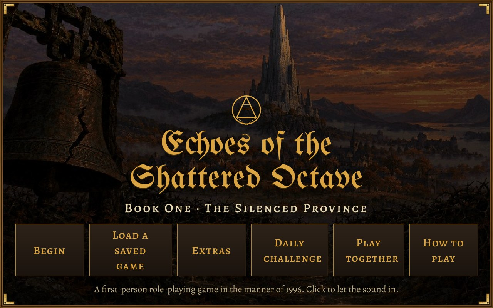</p>

# Echoes of the Shattered Octave · Book One

A first-person dark-fantasy RPG for the browser, made in the style of *The Elder Scrolls II: Daggerfall* and built on the *Echoes of the Shattered Octave* series bible.

<p align="center">
  <a href="https://dribblejerp-klunkdunker.github.io/echoes-of-the-shattered-octave/"></a>
  &nbsp;
  <a href="https://dribblejerp-klunkdunker.github.io/echoes-of-the-shattered-octave/?touch=1"></a>
</p>

<p align="center"><a href="https://dribblejerp-klunkdunker.github.io/echoes-of-the-shattered-octave/">dribblejerp-klunkdunker.github.io/echoes-of-the-shattered-octave/</a> · on a phone: <a href="https://dribblejerp-klunkdunker.github.io/echoes-of-the-shattered-octave/?touch=1">the same link with <code>?touch=1</code></a></p>

The game is published from `main` to GitHub Pages on every merge, so the link is always the current build. It installs as an app, keeps working offline, and "Play together" on the title screen lets a second player join from a phone.

Explore Oakhaven and the land past the Hedge, then sail the Drift-Kestrel to Whisper-Grove, the drowned marble capital of the Spectral Woods. Talk with townsfolk, take on quests and side quests, and trade with merchants. Fight Legionnaires, Proctors, golems, hounds and the Quiet. Keep the Narrow balanced, between the noise that brings the hounds and the silence that brings the Hush.

> The older copy at shattered-octavebook1.pplx.app is out of date and is not updated any more; use the links above.

## See it move

<table>
<tr>
<td width="50%">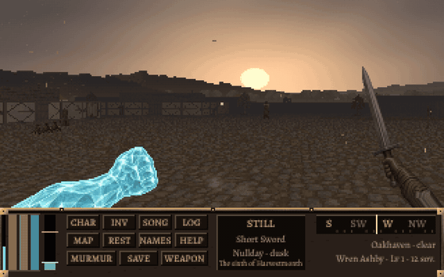</td>
<td width="50%">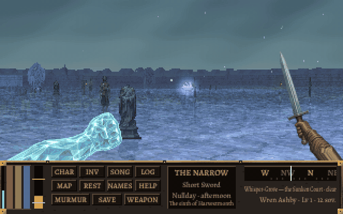</td>
</tr>
<tr>
<td>Oakhaven at sunset, inside the Hedge.</td>
<td>Whisper-Grove: the Sunken Court, the fountain and the Dawning Spire.</td>
</tr>
<tr>
<td>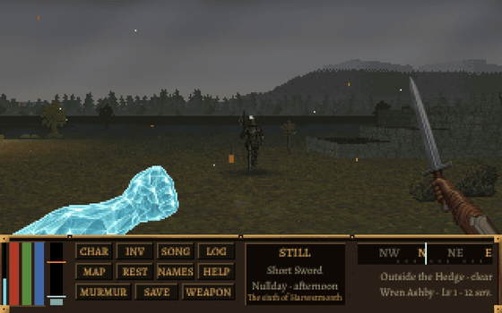</td>
<td>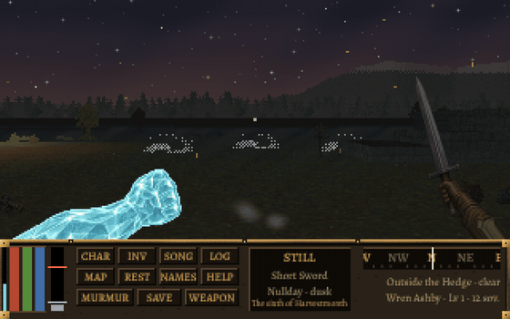</td>
</tr>
<tr>
<td>Swing the mouse to slash, chop or thrust; every blow makes the enemy recoil.</td>
<td>Songs are the magic. The Falling Fifth stops a hound pack in its tracks.</td>
</tr>
</table>

## Play together, or bring a companion

<p align="center">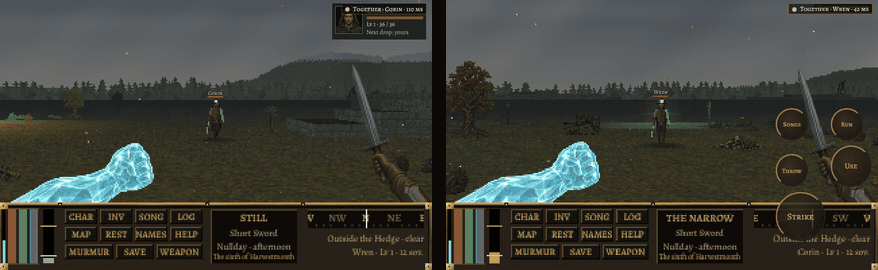</p>

**Play together.** A second player joins your world with a six-letter code, from another computer or a phone. Each sees the other's traveller and name, and you fight, share experience and travel together. Above, left: the host on a desktop. Right: the guest on a phone.

To play together, both players press **Play together** on the title screen: one hosts and reads out the code, the other types it in. The guest brings their own traveller, and what they earn goes home with them.

<p align="center">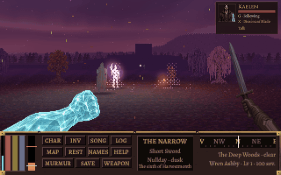</p>

**The party.** In Part Four, Kaelen or Lyra travels with you. G gives orders (follow, wait, keep quiet) and X uses their ability: here Kaelen's Dissonant Blade stuns a Legionnaire.

## Play on your phone

<table>
<tr>
<td width="62%">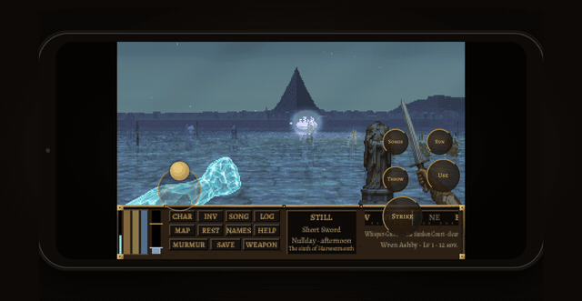</td>
<td width="38%" align="center"><a href="https://dribblejerp-klunkdunker.github.io/echoes-of-the-shattered-octave/?touch=1"></a></td>
</tr>
</table>

1. Open **[the phone link](https://dribblejerp-klunkdunker.github.io/echoes-of-the-shattered-octave/?touch=1)** on your phone, or scan the code above. The touch controls are there from the first frame.
2. Hold the phone sideways. Held upright, the game says so in the black band under the view.
3. Left thumb: the stick moves you. Right thumb: drag to look, tap to use or strike. Songs, Run, Throw, Use and Strike sit on the right.
4. To keep it, use your browser's *Add to Home Screen*. It then opens like an app, without the browser's bars, and plays offline.

The plain link works on phones too: a phone or tablet starts in touch mode by itself. The `?touch=1` link also turns the touch controls on for a touchscreen laptop. A mouse that moves hands control back, unless Options → Controls → Touch controls is set to On.

## New in this build: moving paintings, buildings with real shape, and the long road

*This is the work of pull request #119 (Phases 75 to 79). The play buttons at the top of this page open the game GitHub publishes from `main`, so they carry all of this from the moment that pull request is merged: **[play in your browser](https://dribblejerp-klunkdunker.github.io/echoes-of-the-shattered-octave/)** · **[play on your phone](https://dribblejerp-klunkdunker.github.io/echoes-of-the-shattered-octave/?touch=1)**.*

**Everyone moves.** Every person and creature keeps their painting and now walks, talks and strikes with real limbs.

<table>
<tr>
<td width="50%">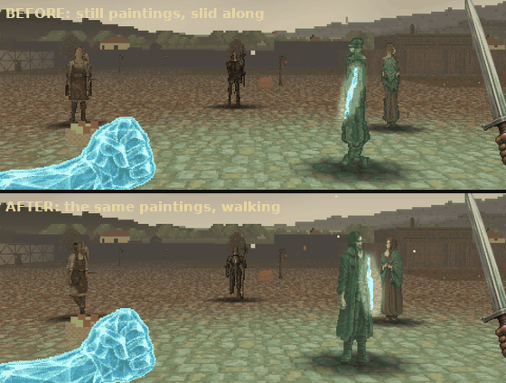</td>
<td width="50%">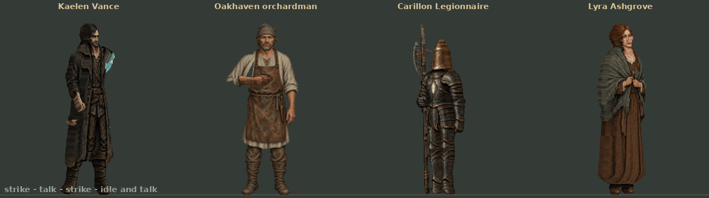</td>
</tr>
</table>

**Buildings with real shape, and every region builds differently.** Roofs with eaves, gables, upper storeys, dormers, chimneys and lit windows; rain stops at the roof. Oakhaven is timber and thatch, Port Cantabile is lime-wash and slate on its hill, Whisper-Grove is lilac marble, the Hollow is terraces, and Greenroot has its twisted spire.

<table>
<tr>
<td width="50%">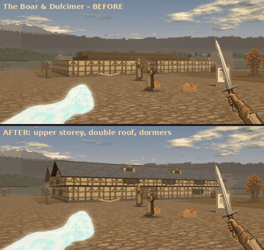</td>
<td width="50%">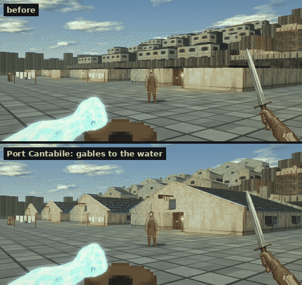</td>
</tr>
<tr>
<td>Oakhaven: timber, thatch and a jettied inn.</td>
<td>Port Cantabile: lime-wash, slate and hoists on the quay.</td>
</tr>
<tr>
<td>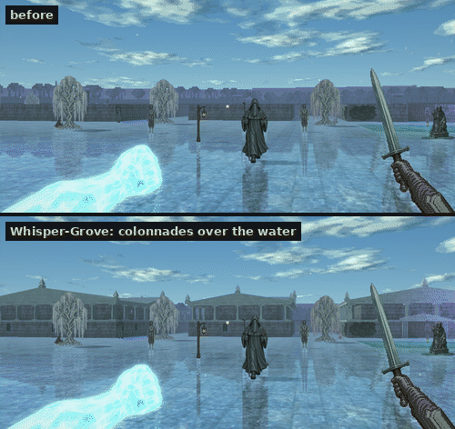</td>
<td>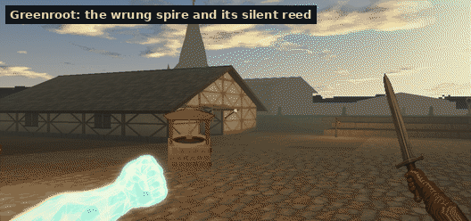</td>
</tr>
<tr>
<td>Whisper-Grove: lilac marble, lead and arches.</td>
<td>Greenroot: the twisted spire.</td>
</tr>
</table>

**And the six smaller places each build their own way too.** Stillwater Landing is black-tarred board under reed thatch, with no window on the lane side: every one looks at the water. The Low Rings are Oakhaven's drowned quarter, with a tide-line on every wall and one lit window. Wethercombe is flint under deep thatch, where even the yard walls wear a little thatched roof and a straw ram stands on the inn's ridge. Nothing on the Watch Downs has a roof at all. On Driftwood Cay the roof is roped down and weighted with stones against the wind. And the Flume, which nobody built, has ribs: living hoops grown over the water, with a bead of sap-light at each crown after dusk.

<table>
<tr>
<td width="50%">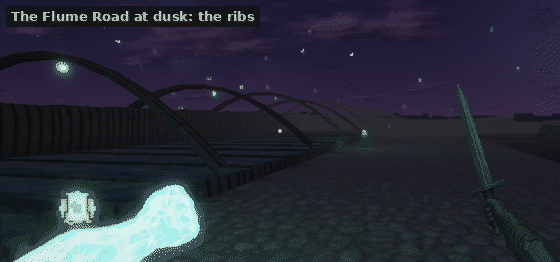</td>
<td width="50%">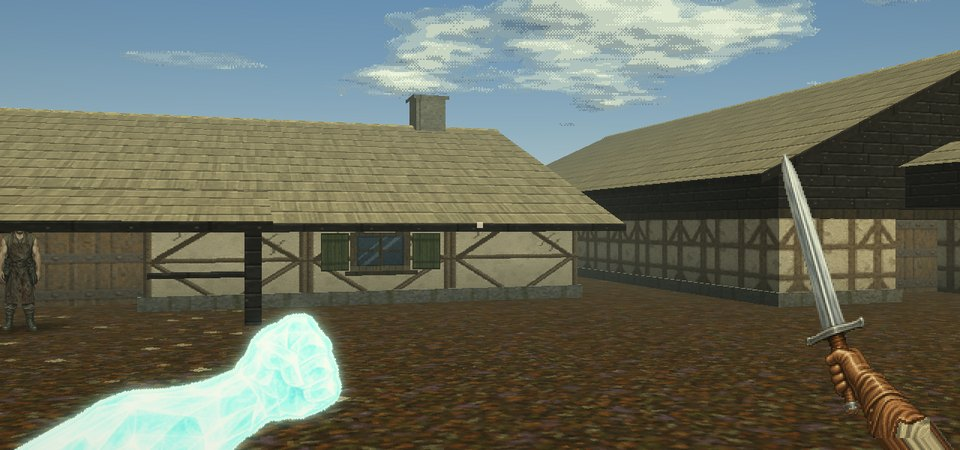</td>
</tr>
<tr>
<td>The Flume Road: the ribs, and their sap-light after dusk.</td>
<td>Stillwater Landing: reed thatch, tarred board, the lockkeeper's porch.</td>
</tr>
<tr>
<td>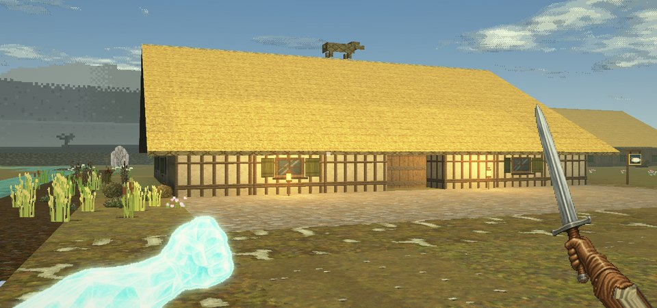</td>
<td>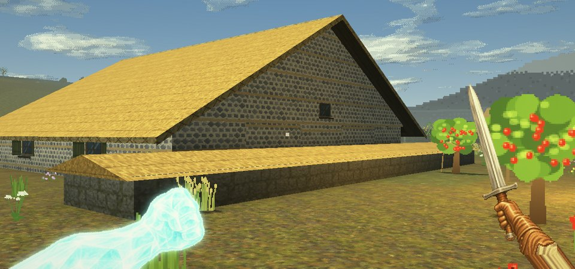</td>
</tr>
<tr>
<td>Wethercombe: the Bellwether, with a straw ram on the ridge.</td>
<td>Wethercombe: flint, thatch, and a thatched yard wall.</td>
</tr>
<tr>
<td>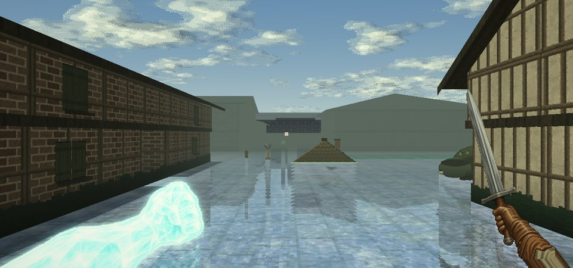</td>
<td>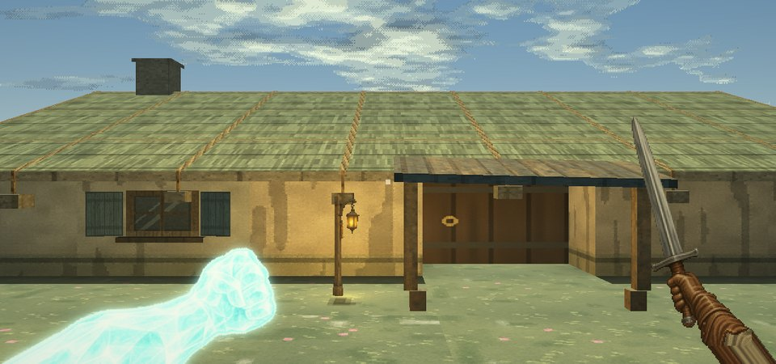</td>
</tr>
<tr>
<td>The Low Rings: upper floors out of the water, a tide-line on every wall.</td>
<td>Driftwood Cay: the roof roped down against the wind.</td>
</tr>
</table>

**The Greenroot road: a world that takes a while to cross.** The door that used to open straight onto Greenroot now opens on a road three stretches long, about six minutes at a walk: the Long Common, the middle stretch and Greenroot Wood. No stretch runs straight. Each has a lake, running water to cross, cliffs, a climb and a far skyline; something to find, someone to meet with a small task, and something that only happens at night or in bad weather. Travellers walk it. Old places off it are not empty. Under the ruined lych-house is a dungeon, Singers' Howe, with the Long Rest waiting behind a door that has no handle, and gear found nowhere else.

<table>
<tr>
<td width="50%">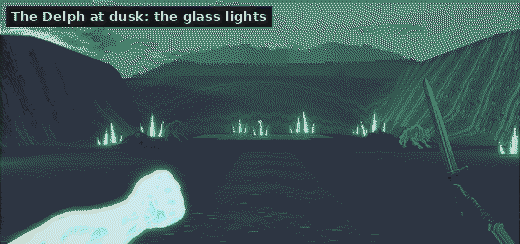</td>
<td width="50%">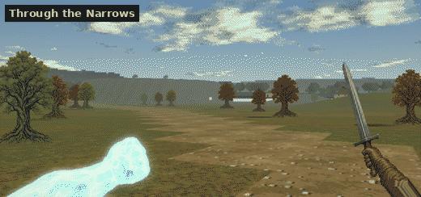</td>
</tr>
<tr>
<td>The Delph at dusk. Glass has come up through the rock, and it gives its own light.</td>
<td>Through the Narrows, with the Grey Teeth on the skyline.</td>
</tr>
<tr>
<td>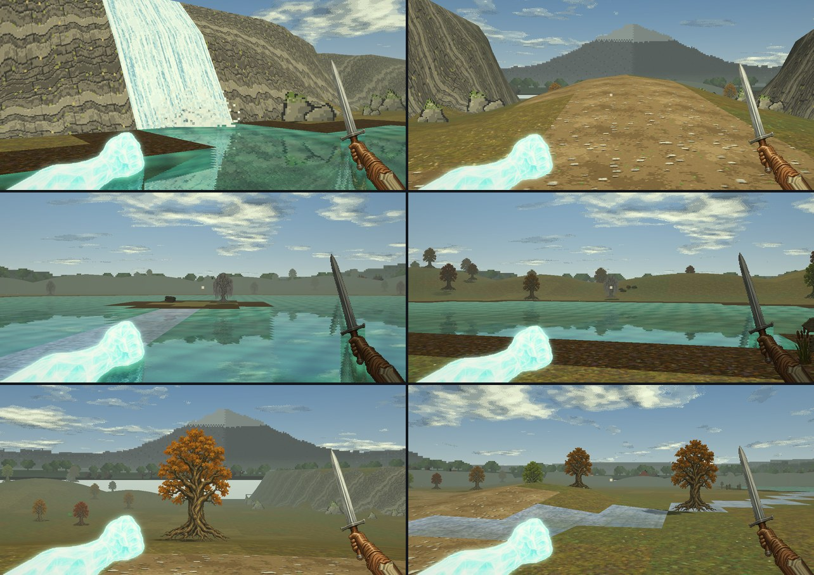</td>
<td>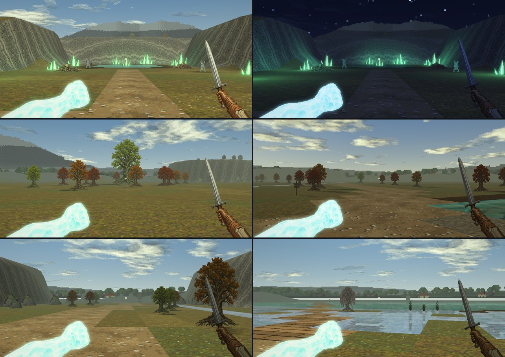</td>
</tr>
<tr>
<td>The middle stretch: the Leap, the Narrows, the eyot, the toll-house.</td>
<td>The Long Common and Greenroot Wood: the Delph, the Bell Oak, the Cleave, the fen.</td>
</tr>
<tr>
<td>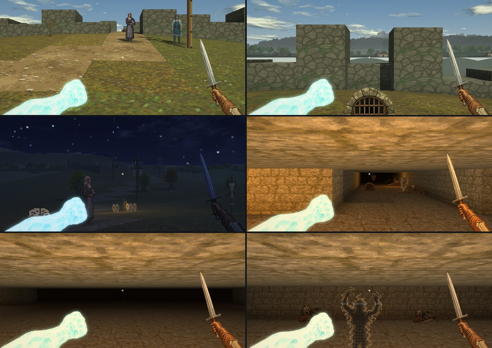</td>
<td>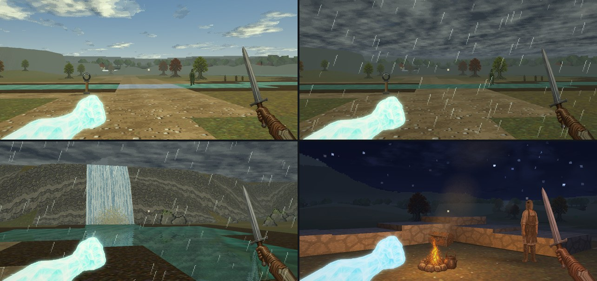</td>
</tr>
<tr>
<td>The lych-house, the explorers camped at it, and Singers' Howe beneath.</td>
<td>By hour and weather: the ford floods in rain, the Leap comes down in spate, a watch-fire burns at night.</td>
</tr>
</table>

<p align="center">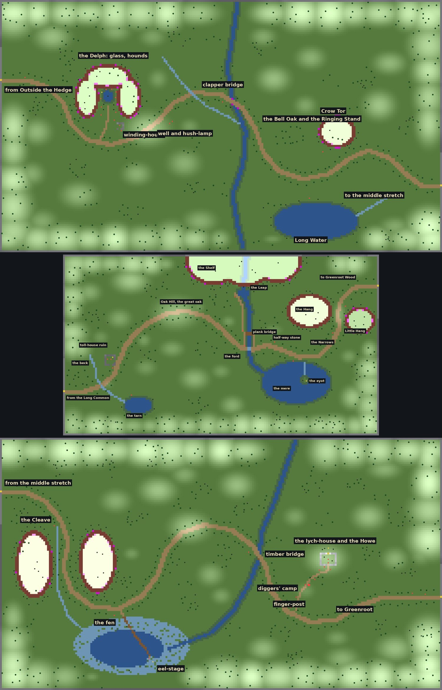</p>

**Every place where the map says it is, with finger-posts and notice boards (Phase 82b).** The travel map's paintings of the Reach and the Woods are now drawn in code from the places themselves, each laid where its gates put it, with the roads drawn between the gates, so every road leaves the way the map shows. A place you have not found is not drawn. Twenty-six finger-posts stand at every way out, in words, not numbers ("THE LEAP. Under it, smaller: GREENROOT, a day and a half."), and six towns have a notice board under its own small roof, with notices, lore and small tasks to take: set eel-traps before light at Stillwater, carry hurdles to the fold at Wethercombe, hang chimes on the Harbour's shrouds, take Rooke's tonic to the marked doors in the Hollow. The Malting yard's way back to the Court is now on its south side, where the map puts it. The text is for the owner's review: [`story/Game Layer/Phase 82b - New In-Game Text (for review).md`](story/Game%20Layer/Phase%2082b%20-%20New%20In-Game%20Text%20%28for%20review%29.md).

<p align="center">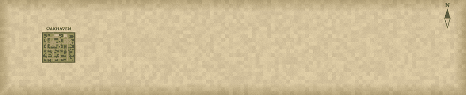</p>

<table>
<tr>
<td width="50%">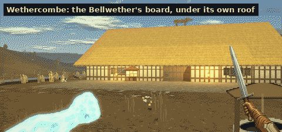</td>
<td width="50%">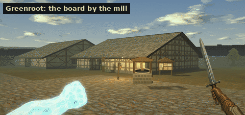</td>
</tr>
<tr>
<td>Wethercombe: the Bellwether's board.</td>
<td>Greenroot: the board by the mill, with nobody to read it.</td>
</tr>
<tr>
<td>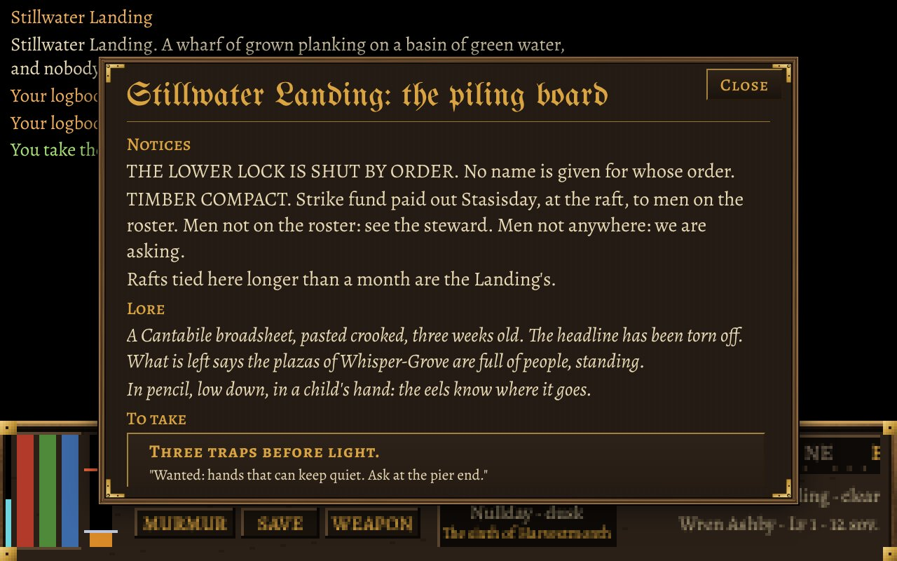</td>
<td>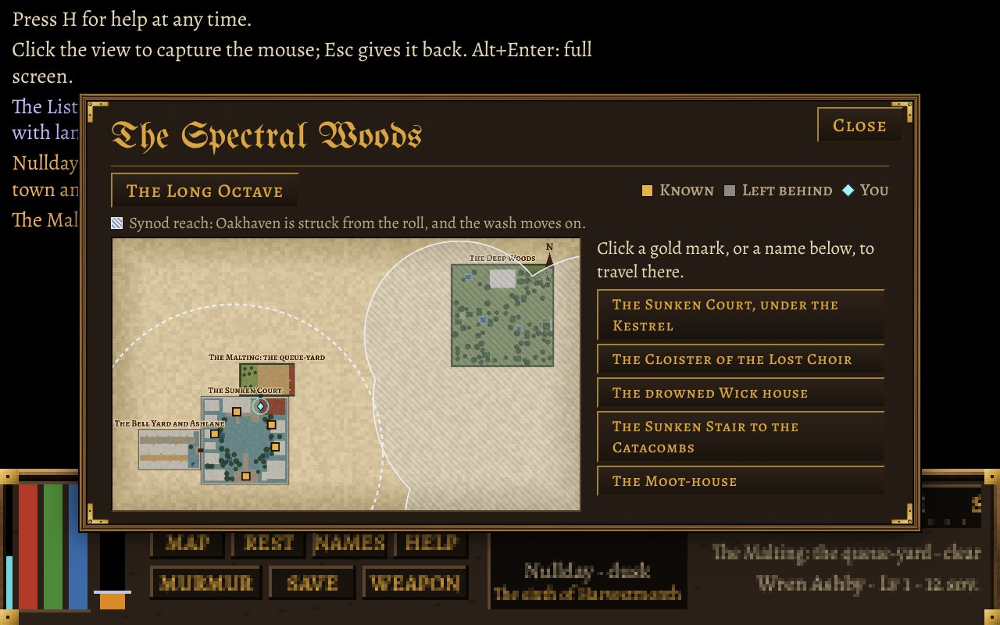</td>
</tr>
<tr>
<td>Reading a board: notices, lore, tasks to take.</td>
<td>The Woods: the Malting yard north of the Court, where its door is.</td>
</tr>
<tr>
<td>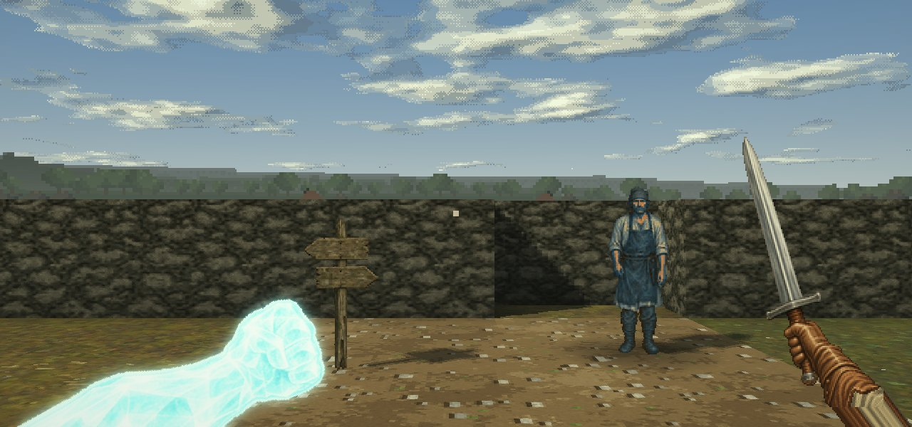</td>
<td>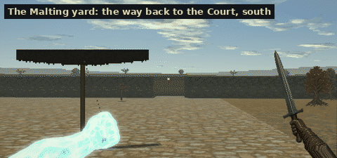</td>
</tr>
<tr>
<td>A finger-post inside the Long Common's west gate.</td>
<td>The Malting yard's way back to the Court, south.</td>
</tr>
</table>

**The Flume, down to Stillwater (Phase 83, road 1).** The lane off the Flume Road no longer drops straight onto Stillwater Landing: the road itself is there, in two stretches. On **the Stride** it winds down into Sallow Bottom, among alder and willow, and crosses the brook twice, while the Flume crosses the whole valley overhead in one straight line on grown trunks as tall as a church. After dark its sap-light runs in the channel, one green line from ridge to ridge. On **the Pound Stair** sixteen grown locks step down the hill, each with its square side-pound, and the road zigzags beside them. In rain the Stair "walks" and the low road goes under; afterwards the bottom pound stands empty a while and shows a grating. The lengthsman's three top gates have stuck: hum the Root at them in order, top to bottom, and don't ring the stakes. The text is for the owner's review: [`story/Game Layer/Phase 83 - New In-Game Text (for review).md`](story/Game%20Layer/Phase%2083%20-%20New%20In-Game%20Text%20%28for%20review%29.md).

<table>
<tr>
<td width="50%">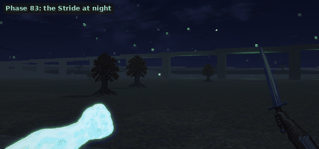</td>
<td width="50%">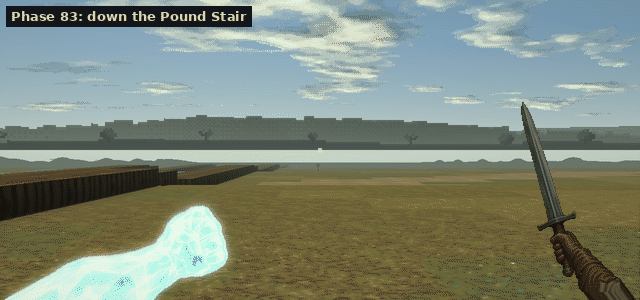</td>
</tr>
<tr>
<td>The Stride at night: the Flume's green line in the sky.</td>
<td>Down the Pound Stair.</td>
</tr>
<tr>
<td>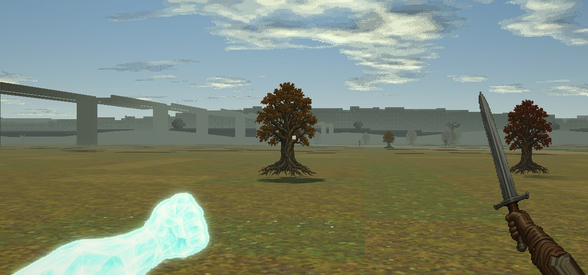</td>
<td>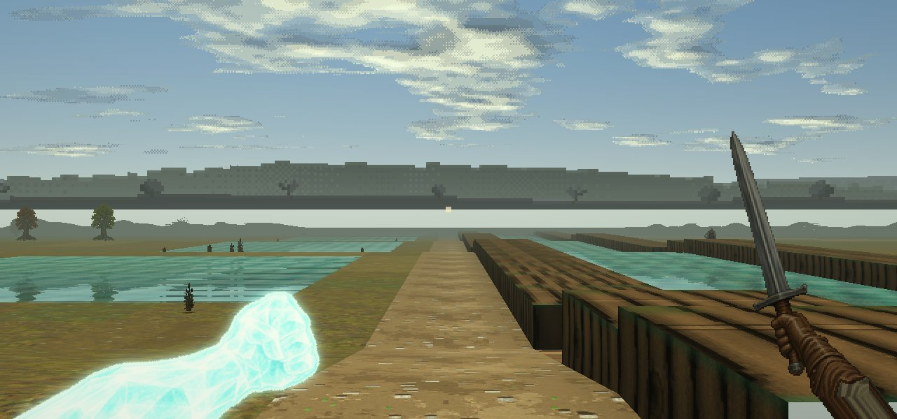</td>
</tr>
<tr>
<td>The Stride by day.</td>
<td>The Pound Stair: locks, side-pounds, and the road between.</td>
</tr>
</table>

**The drove road (Phase 83, road 3).** The stile in the Watch Downs' south hedge now opens on the drove road, in two stretches. **The Grey Wethers:** the road runs wide and green round the head of a dry valley and through a flock of grey stones lying in the grass like sheep lying down; every one gives a note when knocked, and in a high wind the whole flock sounds by itself. Past a dew-pond the returners, a family come out of the Hedge after two years, are camped with their handcart at the Three Pines; the old woman among them, a drover's daughter, asks you to strike the five raddled stones in the drovers' call. **The Hundred Hollows:** a holloway under hawthorn, then a down of grassed-over pits where hounds lie up after dark, one hollow still open chalk, and terraces down into Wethercombe; at dawn after a wet night, mist fills the combe. The text is in the same review file as road 1.

<table>
<tr>
<td width="50%">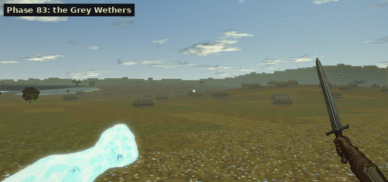</td>
<td width="50%">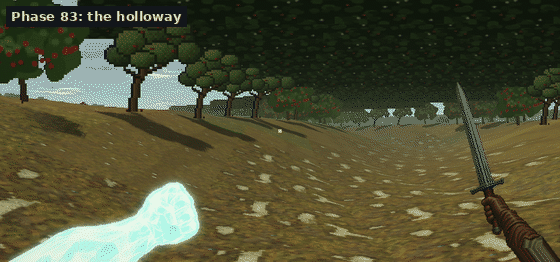</td>
</tr>
<tr>
<td>The Grey Wethers.</td>
<td>The holloway.</td>
</tr>
<tr>
<td>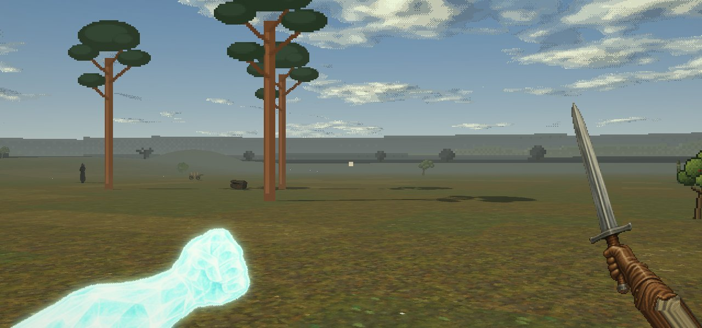</td>
<td>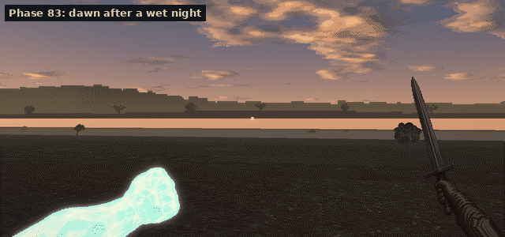</td>
</tr>
<tr>
<td>The Three Pines, the drovers' halt.</td>
<td>Dawn after a wet night: down into the mist.</td>
</tr>
</table>

**The trees, larger and of many shapes.** Every tree out of doors now grows to a height of its own kind's (an oak three to nearly six times a person's height, a beech or an ash over five, a hawthorn two or three), most of them middling and a few of them giants, and takes one of its own kind's shapes: spreading, stag-old, tall, leaning, wind-bent, the great field oak. By a house a tree grows only as far as there is room. The Options switch "Larger trees, of many shapes" puts them back.

<p align="center">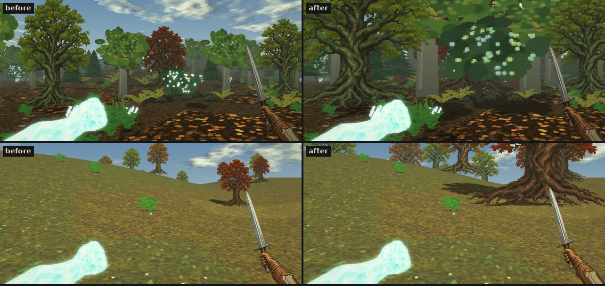</p>
<p align="center">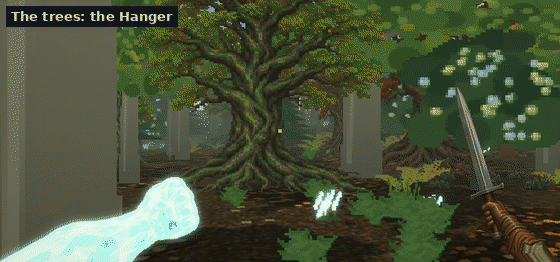</p>

**Ponies to ride, milestones, and the roads on the map (Phase 84).** Three stables hire a pony for a day (25 sovereigns, 10 back early): the North Gate in Oakhaven, the Bellwether's yard in Wethercombe and the drovers' pen on the Long Common. Each has three ponies in real horses' coats: roan, bay and black; dun, chestnut and palomino; dapple grey, skewbald and leopard-spotted. Pick one by her portrait. Stand by her and press **X** to ride: one and three-quarter times walking pace, a little higher, no bow from the saddle, thrown at the third hard blow. She will not go onto planks, down the Pound Stair, into the Deep Grove or indoors. Left alone she waits six hours, then goes home. A milestone stands by every finger-post; walk past one and the world map can send you there, along the roads, gate to gate. Long journeys stop the night at a halt unless you press on, and an ambush comes on the stretch where it happens.

<table>
<tr>
<td width="50%">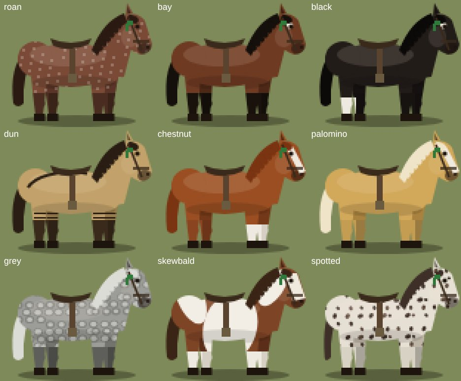</td>
<td width="50%">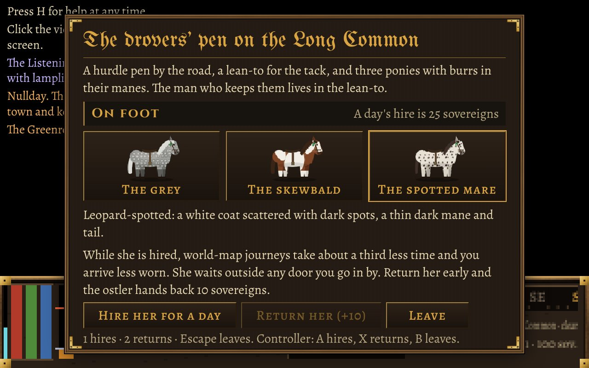</td>
</tr>
<tr>
<td>Nine coats, three to a stable.</td>
<td>Choosing at the drovers' pen.</td>
</tr>
<tr>
<td>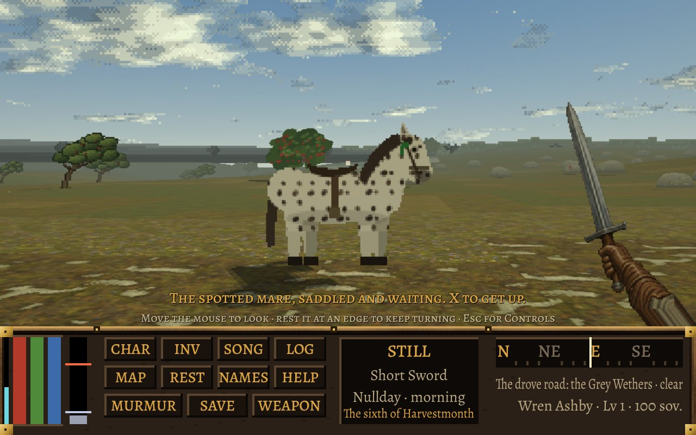</td>
<td>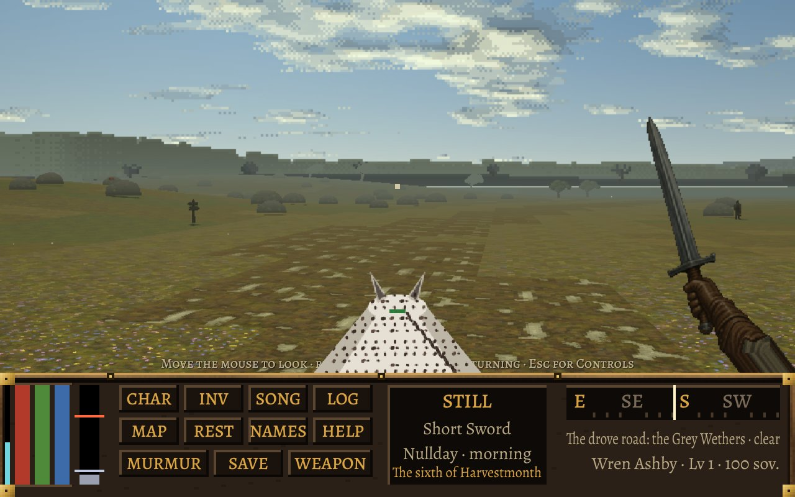</td>
</tr>
<tr>
<td>Saddled and waiting.</td>
<td>Riding the drove road.</td>
</tr>
</table>

**The Dry Flume (Phase 85).** Before the Flume was grown, it was built. An arch in a bank on the Stride's valley floor opens on the old stone conduit, dry for two hundred years and lit only by the living Flume's root where it has come down through the roof. Seven rooms: the adit, the conduit, the settling tanks (fret-crawlers in the silt), the wheel-pit (a sluice-gate over the ledge on a worn chain: wedge it or it comes down), the sump (when the Flume draws breath it fills to the roof and drains, so the causeway has to be timed), the pump-hall (iron galleries, the engine's beam, and under it the Standing Note, a mire-drone grown to the size of a cart), and the stair up to the Pound Stair's grating, bolted from below. On the engine-man's bench: the Lengthsman's Hook (it reaches, and it pulls) and Sluice-Boots (silent in water).

<table>
<tr>
<td width="50%">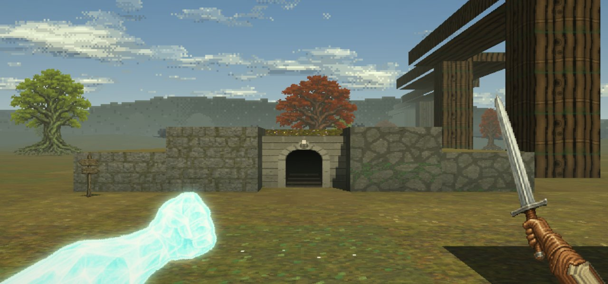</td>
<td width="50%">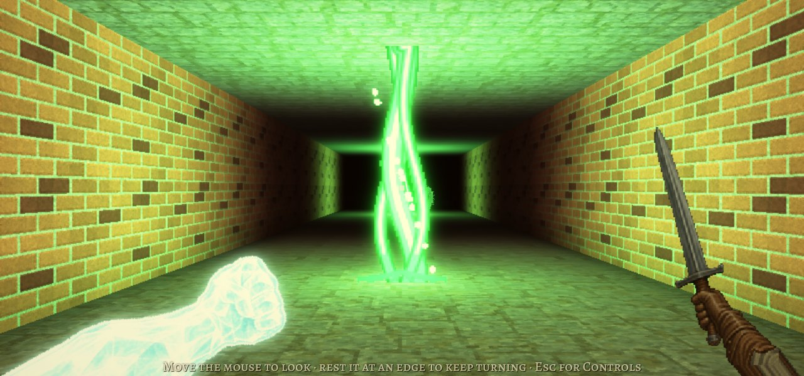</td>
</tr>
<tr>
<td>The arch on the Stride.</td>
<td>The conduit and the root.</td>
</tr>
<tr>
<td></td>
<td></td>
</tr>
<tr>
<td>The wheel-pit.</td>
<td>The pump-hall.</td>
</tr>
</table>

**The Antler Galleries (Phase 85).** The open hollow on the drove road goes down into an old flint-mine. Low white galleries run out from the shaft's foot, and the antler picks the miners left lie where they put them down, the further ones rooting and putting up new tines. It is still down there, and stillness is the Hush's: your lamp is the way through, filled and lit at the tallow-cups in the niches. Down a second shaft is the deep: a white forest of antler from floor to roof, the seam of black flint they dug for, and in the deepest gallery the Flint-Back, a fret-crawler grown white in the chalk. The Antler Pick (it breaks armour) and the Floorstone Knife (black flint, almost silent) are down there.

<table>
<tr>
<td width="50%"></td>
<td width="50%"></td>
</tr>
<tr>
<td>The galleries, by lamplight.</td>
<td>The white forest.</td>
</tr>
</table>

**The Sunk Lanes, the punt and Cross Pool (Phase 85).** Between Stillwater Landing and the Low Rings there is now a way of its own: old cobbles under a hand of water, boards from roof to roof, a hedge-bank, deep pools on either side. The punt-woman hires her punt for a sovereign; pole it over the deep to what the boards cannot reach. West of the Low Rings lies Cross Pool, the old town: the market cross under clear green water, lit from beneath after dark; the corn loft; the weavers' row, where a child's reed goes back on its hook; the Ladder's Foot, where Oakhaven can be heard over the Hedge; and on a still, clear night the kerbs of the old street rise as stepping stones.

<table>
<tr>
<td width="50%"></td>
<td width="50%"></td>
</tr>
<tr>
<td>The Sunk Lanes.</td>
<td>Cross Pool after dark.</td>
</tr>
</table>

**The Deep Grove (Phase 85).** A gap in the north side of Greenroot Wood opens on glades of dwarf oaks grown out of mossy boulders. The path is not the same way twice: in every glade one way sounds lower than the others (and says so in a caption). Follow the low note and the wood lets you in, to the Stool, the oldest tree, a ring of trunks round a hollow where something under the roots is sending in no key the Octave uses. Walk by eye and you are let out where you came in. Nobody is there. After dark the silent circle closes round you, and something waits at the gap.

<table>
<tr>
<td width="50%"></td>
<td width="50%"></td>
</tr>
<tr>
<td>A glade.</td>
<td>The Stool.</td>
</tr>
</table>

**Danger and reward on the roads (Phase 86).** The roads now change with the hour and the weather, the same way every time: the pack comes out on the Long Common after dark, the briar wakes in the rain and sleeps in snow, drones come up on the pound banks at night and in storm, the Hollows' dogs come out in mist. There are camps to clear (an Office survey camp, a Quiet Faith vigil, a hound den, a briar-bed; cold for a week once cleared, each with a crate), fires where you can sit until morning, and four keepers that come out only at their own hour: the Hiss, the Briar Queen, the Hollow Dog and the Sunk Bell. The people already on the roads pay for them, and for a week's work besides. An Office column walks one road a day, taking names; fighting it goes in the Office's book. Every notice board says what is on the roads today. Every line is [PROPOSED]: [`story/Game Layer/Phase 86 - New In-Game Text (for review).md`](story/Game%20Layer/Phase%2086%20-%20New%20In-Game%20Text%20(for%20review).md).

<table>
<tr>
<td width="50%"></td>
<td width="50%"></td>
</tr>
<tr>
<td>The Hiss, on the Long Common at night in the rain.</td>
<td>The Sunk Bell, in a storm.</td>
</tr>
<tr>
<td width="50%"></td>
<td width="50%"></td>
</tr>
<tr>
<td>The Office column, taking names.</td>
<td>The raft-hands' fire: sit until morning.</td>
</tr>
</table>

**Gear, matching sets and the first-person view (Phase 87).** Every weapon in your hand is painted in code, its own shape from the world it comes from: a bell-ringer's hammer, a tuning-fork spear, a quarry-hand's night-shift sledge with a Consortium tag and a red rag, a barrow's leaf-blade, a slab of knapped flint. Every piece you wear belongs to one of fourteen matching sets (Tanner's Row, the Hedge-weavers' Hush, the Synod Registry and Arsenal, the Carillon Legion, the Office's Proctors, the Cantors, the Siphon Corps, the Consortium Works, the Free Captains, the Drovers, the Barrow-Wardens, the Flume, the Old Reach): three pieces give a small bonus, the whole set its own. There is a sixth slot for a cape, fifty-two new pieces, six new ranged weapons with their own shot, and every calling starts in its own clothes with its own weapon. Every line is [PROPOSED]: [`story/Game Layer/Phase 87 - New In-Game Text (for review).md`](story/Game%20Layer/Phase%2087%20-%20New%20In-Game%20Text%20(for%20review).md).

<table>
<tr>
<td width="50%"></td>
<td width="50%"></td>
</tr>
<tr>
<td>Seven of the fourteen sets, front and back.</td>
<td>The other seven.</td>
</tr>
<tr>
<td width="50%"></td>
<td width="50%"></td>
</tr>
<tr>
<td>Every ranged weapon, painted in code.</td>
<td>The harpoon gun, on the harbour.</td>
</tr>
<tr>
<td width="50%"></td>
<td width="50%"></td>
</tr>
<tr>
<td>The new pieces in the pack.</td>
<td>The Works pavise.</td>
</tr>
</table>

**Weight, knocks and following (Phase 88).** Blocking costs fatigue, and with none left you cannot raise your guard. An enemy chasing you comes through the door after you. The weapon in your hand lags behind a turn and settles with its weight (a maul more than a knife). The shield jolts when you block and keeps its scratches and dents until you rest. The swing you drag is the swing you see, whatever the weapon. Every line is [PROPOSED]: [`story/Game Layer/Phase 88 - New In-Game Text (for review).md`](story/Game%20Layer/Phase%2088%20-%20New%20In-Game%20Text%20(for%20review).md).

<p align="center"></p>

**The whole continent (Phase 89, approved by the owner on 14 Nov).** All eight realms and the Organum, with as much lore about the places and the people as the books and bibles hold, and a great deal more marked [PROPOSED] where they are thin: five realms the game does not have yet (the Dawning Heights, Cinderhold, the Iron Peaks, the Shifting Dunes, the Rift), built in the spirit of Elden Ring and Dark Souls, with four great places in each (the city's heart, a huge underground, a spire, a magical place), a named keeper for each, lamps to rest at, shortcuts that loop back, and a cost for dying (the Piece). Each realm's great city is laid out by its own note with the owner's Cymatic City Engine. Nothing is built yet; the layouts of every place come next. [`story/Game Layer/Phase 89 - The Continent (lore and great cities, for ruling).md`](story/Game%20Layer/Phase%2089%20-%20The%20Continent%20(lore%20and%20great%20cities,%20for%20ruling).md).

<p align="center"></p>

<p align="center"></p>

**Every place, drawn as a plan (Phase 90, approved by the owner on 14 Nov).** Before any graphics: each great place room by room (lamps, the keeper's arena, the shortcut loop back to the first lamp, and what does not open), each great city at walking scale (500 steps across) with the heart's way in, and the Organum's 712 pipes set where the eight figures cross. 33 new great places, 258 rooms, 69 lamps, 65 smaller places sketched. [`story/Game Layer/Phase 90 - The Layouts (for ruling).md`](story/Game%20Layer/Phase%2090%20-%20The%20Layouts%20(for%20ruling).md).

<table>
<tr>
<td width="50%"></td>
<td width="50%"></td>
</tr>
<tr>
<td>The Heights' great places, room by room.</td>
<td>Port Cantabile at walking scale.</td>
</tr>
</table>

<table>
<tr>
<td width="50%"></td>
<td width="50%"></td>
</tr>
<tr>
<td>The eight cities, each from its own note.</td>
<td>Sol-Luminary, read as the face of a city hung on a mountain.</td>
</tr>
<tr>
<td width="50%"></td>
<td width="50%"></td>
</tr>
<tr>
<td>Cinderhold: eight fall-roads to the Great Beat.</td>
<td>Fortis: a square pit of terraces.</td>
</tr>
</table>

**The Souls rules, first in the Reach (Phase 91).** Lamps to rest at: stand by one and it is lit; use it and you are whole again, the place's ordinary foes get up where they first stood (its keeper too, once it has been down a week), and the game is saved. Five so far: the Antler Galleries' shaft foot and floorstone seam, the Dry Flume's adit and stair foot, and the Deep Grove's gap in Greenroot. Die in one of those places and you wake by the last of its lamps you lit. **Your Piece:** the coin you carried and what you had learned toward your next level wait where you fell, humming your note, seen only close as a lilac wisp; stand there and it comes home; die again first and it is gone. Gear is never lost. Two shortcuts opened from the far side: a chimney from the Flint-Back's den up to the shaft's foot, and an iron door barred on the Dry Flume's pump-hall side, so nobody has to time the sump twice. The hour-bead (120 sovereigns, one at a time) undoes a death on the spot; the hour-merchants who sell it come with the Dunes. Options: **Souls rules** (On; Off keeps the old cost of five coins).

<table>
<tr>
<td width="50%"></td>
<td width="50%"></td>
</tr>
<tr>
<td>A lamp, lit, at the Galleries' shaft foot.</td>
<td>Your Piece, where you fell.</td>
</tr>
<tr>
<td width="50%"></td>
<td width="50%"></td>
</tr>
<tr>
<td>The chimney: tied off from below until you climb it from the den.</td>
<td>The iron door, barred on the pump-hall side.</td>
</tr>
</table>

**The Dawning Heights, part three: the Pilgrim Chain and the Altar (Phase 95).** An iron stair from Bardo's winch-room goes up to the old robing-room under the seventh anchor-house, where Perpetua Lisle keeps four hundred pilgrims' robes nobody wears. In a robe, the two Flambeaux at the winch let you out of the mouth onto the Pilgrim Chain: a kilometre of black link across the gulf, wholly in the Bleach, which takes you by the hour (worst by day, thinnest in the dead hour before dawn). The Tiers' rule is the way across: "Walk in the shade of the one ahead of you. If there is no one ahead of you, run." The Altar's clerics go out and back under black canopies; the cage, "the only roof on that whole chain" (Book Two), stands at the half-way mark; past it the Flambeaux of the Chain walk each in the shade of his own glass-fire. At the far end Brother-Captain Aurel Sant holds the great steps, and his fire is the only shade in the fight; when it goes out he kneels. From the Altar's rim you see the Altar and the Eye and never set foot there. Three lamps, the cage as a shortcut, and a seventeenth gear set (`js/pilgrim95.js`, `test/pilgrim95.test.js`).

| | |
|---|---|
|  |  |
|  |  |
|  |  |

**The Dawning Heights, part four: the smaller places (Phase 96).** Each was read against the books before it was built, and the books changed every one. The Basilica school meets in a black room on the shade side of the iron wall, because the bench under the east window is in the sealed nave (`js/school96.js`). The plan's "Bell Yard" is the book's black square before the Basilica's west end, where the bell in the black tower silences the Tiers level on level (`js/blacksquare96.js`). Sun-Peak Vigil is a mountain house of twelve who keep a bell, with Abbess Coriel, who helps completely and will not be thanked (`js/vigil96.js`); below it the Chalk Cliffs, where shadow remnants climb at dusk and the Vigil's bell is the only thing that works (`js/cliffs96.js`). Three planned places were not built because the books do not allow them (the nine anchor-houses, the cloud deck, the valley farms), and the White Mile waits for the owner's ruling.

| | |
|---|---|
|  |  |
|  |  |
|  |  |

**The Dawning Heights, part five: the White Mile (Phase 97).** The owner chose the book's own mile. A doorway in the top wall of the Tiers leads into a gutted house, "a dark room with nothing in it", and a ladder goes up through its roof to a walkway of black planks where the shade stops "straight as a ruled line". Past the line everything is white, and the light takes you unless you cross "from shadow to shadow, the way you cross a river on stones": least in the dead hour before dawn, most by day, slower with black cloth round the face and black gloves on. Offerings lie on the line and are never taken. On the third tier the Unison walks its street, forty in four ranks of ten; they hear noise and nothing else, and they cannot be fought. On the fourth is the old Glassmarket, whose people still stand among the stalls, white and thin enough to see through: "Don't touch them." Across the market's widest gap, by night, the Tallyman counts them, and gives the eighteenth gear set, the Scavenger's Blacks. A drop-line let down from a noble garden is the short way back (`js/whitemile97.js`).

| | |
|---|---|
|  |  |
|  |  |
|  |  |

**Read aloud, pointed at, and marked (Phase 97).** "Read everything aloud" speaks every line of the game in the device's voice, for a player who cannot read: F2 on and off, F3 or `[` says it again, F4 or `]` reads the whole screen (`js/reader97.js`). The compass shows quest markers as gold diamonds and side-quest markers as pale blue discs, and points at the door toward one on another map (`js/compass97.js`). Any place you read or hear of is marked on its map with a small picture of its kind (`js/places97.js`). Oakhaven's houses stand taller, with front doors over a person's head (`js/eaves78.js`).

| | |
|---|---|
|  |  |

**What was owed (Phase 98).** The last two of the first week's first-person paintings are painted in code, like every weapon since Phase 87: the bare fist, raised where a blade's hand is and wearing what you wear; the glass arm, raised on the left, where that arm is, its azure planes drawn one by one; and the two open hands a Song is cast from, the light between the palms. The hand that is not striking rests low at its own side, and a fist goes straight out (`js/fp87.js`, `js/body21.js`). The Reach's two keepers now leave what every keeper leaves, a trophy and one piece of gear in their realm's look, once: the Flint-Back a shell-plate and the Ridge-Flint, the Standing Note its reed and the Beam-Key (`js/keepers98.js`).

| | |
|---|---|
|  |  |
|  |  |
|  |  |

**Every person speaks (Phase 102).** All 170 people's greetings and topic answers are spoken, 1,138 lines in voices of their own: Kokoro, rendered ahead of time, so nothing runs in your browser and it plays the same on a phone. Stage directions are not read, the silent stay silent, and General Ward's iron-cant is said aloud by Ninety-Four. Options > Graphics & access > Voices turns it off or down to grunts. Record: [`story/Game Layer/Phase 102 - Every person's dialogue, voiced (for review).md`](story/Game%20Layer/Phase%20102%20-%20Every%20person%27s%20dialogue%2C%20voiced%20(for%20review).md).

**The Continental Rift, part one: Null-Watch (Phase 100).** The Kestrel flies two days east to the wall at the edge of the land: obsidian, lead and cable, a brass battery on every tower, and everybody on it talking, because on this wall the ones who go quiet are the ones who go. You are given a subject at the talk-roster and keep it up with the Murmur (N); stop for eight seconds and you walk for the edge, unless a manned battery rings its bell for you. In Magazine Four a Legionnaire has been saying three lines of a cradle-song for nine days, and cannot be put down by blows: find the fourth line and say it. Three talking-posts (the Souls rules), the battery rail as the shortcut, and the Watch's Issue, the nineteenth set. Record: [`story/Game Layer/Phase 100 - The Continental Rift, part one (text for review).md`](story/Game%20Layer/Phase%20100%20-%20The%20Continental%20Rift%2C%20part%20one%20(text%20for%20review).md).

| | |
|---|---|
|  |  |
|  |  |
|  |  |

**The five old failing checks (Phase 99).** Five test suites had been failing since before Phase 96; four of the five were faults in the game. Joining a friend's game, a guest builds the host's whole world first and is silent while it does: the host took that for a lost connection, dropped the newcomer and took them back a few seconds later at its heels. A newcomer now has 15 seconds, and a guest whose connection really drops comes back where they stood. The guest sees one moored Kestrel, not two; being a guest writes nothing in your own save. A save is the same with "small life" on or off again (the docked ships were only in the world when its pictures were loaded). The picture sheets are packed tighter, and the logbook's sketch check reads every journal entry again. Running every suite afterwards found three more: the save-file loader's limit (512 KB) was under the size of the game's own uncompressed save and is now 2 MB; a place reached by the travel chart is marked without a word; and the map screen's list of places no longer pushes "Clear marks" out of view. Nothing was added to the world. Record: [`story/Game Layer/Phase 99 - The five old failing checks (for review).md`](story/Game%20Layer/Phase%2099%20-%20The%20five%20old%20failing%20checks%20(for%20review).md).

| |
|---|
|  |
|  |  |

**The Dawning Heights, part two: the Anchorage (Phase 94).** A low iron door by the goods-cage's top leads into the inside of Sol-Luminary's frame, where the nine chains that hold the city come down through it "like the bones they are" (Book Two). Winchmaster Bardo (World Bible Vol II) keeps his winch there, with the tally of his nineteen lost men cut in the housing. You walk down the seventh chain itself, link by link, over its well. The nine chains toll one after another in a bell-ringers' change, and a card shows the row: when the seventh speaks, a link under you throws you and a pin holds you. Below are the tolling gallery, seven Glass-Grown who are never fought, the keel-weights of white stone, and the Winch-Deep, where the Nineteen still haul at the old capstan and make you weigh four times what you weigh. Three lamps, a shortcut cage, and a sixteenth gear set, the Chain-Yards (`js/anchorage94.js`, `test/anchorage94.test.js`). The book changed this place's plan: it had been drawn as shafts in the mountain, and Book Two has no rock under the city.

<table>
<tr>
<td width="50%"></td>
<td width="50%"></td>
</tr>
<tr>
<td>Down the seventh bone. The card shows the change.</td>
<td>The tolling gallery: all nine bones through one floor.</td>
</tr>
<tr>
<td width="50%"></td>
<td width="50%"></td>
</tr>
<tr>
<td>Winchmaster Bardo and the tally of nineteen.</td>
<td>The Nineteen, at the old capstan.</td>
</tr>
<tr>
<td width="50%"></td>
<td width="50%"></td>
</tr>
<tr>
<td>The Glass-Grown, facing up toward the Spire.</td>
<td>The keel-weights.</td>
</tr>
</table>

**Flying and fighting in the air (Phase 93).** A long flight on the Kestrel's map table can be met in the air. It is chance, as in the books, and a switch in Options turns it off. An Office courier-cutter, the lead-grey forty-footer from Book One ch. 21, hunts her by its listening-horn. On the way to the Heights a Church packet may cross her course instead and carry word of her ahead, or a squall line may throw her about. The Kestrel stays unarmed, as the book leaves her. You work her stations in first person: you ask Vane for a height at the wheel, lash the hold so nothing knocks, help Pennick patch a weeping tank, hood the lamps, and throw weight over the side. The flight card shows height, lift, noise and the horn's four states. If the horn turns and the cutter comes down your line of sound, the grapnels come over the rail and four proctors with them. Cut the chains (three blows each) or fight. She is never lost: the worst is a forced landing and a repair. The way south to the Heights crosses the Valley of Velocity, where a weeping tank's jet pushes her round. The horn's states come from the owner's Forge engine (`js/air93.js`, `test/air93.test.js`).

<table>
<tr>
<td width="50%"></td>
<td width="50%"></td>
</tr>
<tr>
<td>The horn turns; the cutter comes down the line of the sound.</td>
<td>Grapnels at the rail, and four proctors down the line.</td>
</tr>
<tr>
<td width="50%"></td>
<td width="50%"></td>
</tr>
<tr>
<td>A Church packet: its lookout has a glass on you.</td>
<td>The squall line.</td>
</tr>
</table>

**The Dawning Heights, part one: the Umbral Tiers (Phase 92).** The Kestrel's table now flies south to Sol-Luminary, the city that hangs from Mount Lumina on nine chains. Her ladder lands you on the Keel Docks, and the Umbral Tiers climb from there up the mountain's face to the Basilica's black wall, where the light stops. The ground plan is cut straight from the Cymatic City Engine's 528 Hz city: its streets are the walkways, its bold nodal lines the chain-walks, its buildings the hanging houses, and everything else is two thousand feet of dark air. Walk in the shade: patches of the Bleach eat at you, the chain-walks jerk on the chains' beat (stand still and you hold on), and the gulf is a long way down. Three shade-lamps to rest at; the Lamplighter of the Seventh Chain holds the hanging square with glass-fire; the seventh chain's goods-cage, knocked loose from the top, is the shortcut back to the docks. The Umbral folk speak in the Narrow and sell boots, a shade-cloak, a scavenger's cloth-pole and the only mirror in the Tiers, under a cloth.

<table>
<tr>
<td width="50%"></td>
<td width="50%"></td>
</tr>
<tr>
<td>The Kestrel at the Keel Docks.</td>
<td>The Lamplighter on the hanging square; the Bleach over the line.</td>
</tr>
<tr>
<td width="50%"></td>
<td width="50%"></td>
</tr>
<tr>
<td>A shade-lamp at the cobbler's, fourth tier.</td>
<td>The plan, cut from the 528 Hz city.</td>
</tr>
</table>

**What comes next: the world plan.** The Greenroot road is the first of seven. The plan for the rest, for the owner to rule on, is [`story/Game Layer/Phase 81 - The World Plan.md`](story/Game%20Layer/Phase%2081%20-%20The%20World%20Plan.md): three countries with the *Drift-Kestrel* between them, six more roads, and four big places off them (a dungeon, a mine, a drowned old town and a wood where the path is never the same way twice). Each road is drawn from a real country with one wonder added. Nothing on this chart in ochre or red is built yet.

<p align="center"></p>

More pictures of this build: [`screenshots/eaves78/`](screenshots/eaves78) and [`screenshots/eaves82/`](screenshots/eaves82) (every region's buildings), [`screenshots/paintfolk76/`](screenshots/paintfolk76), [`screenshots/walls77/`](screenshots/walls77), [`screenshots/road79/`](screenshots/road79), [`screenshots/world81/`](screenshots/world81).

## The world

<table>
<tr>
<td width="50%"></td>
<td width="50%"></td>
</tr>
<tr>
<td>Whisper-Grove, the drowned capital, in the afternoon light.</td>
<td>Oakhaven at the Listening Hour.</td>
</tr>
<tr>
<td></td>
<td></td>
</tr>
<tr>
<td>Port Cantabile, beyond Book One.</td>
<td>The ring of lamps in the Deep Woods: Lyra sings, and it comes in on the harmony.</td>
</tr>
</table>

<p align="center"></p>
<p align="center"><i>A painted card for each area as you arrive.</i></p>

## Maps

<table>
<tr>
<td width="50%"></td>
<td width="50%"></td>
</tr>
<tr>
<td>The automap (M) draws what you have walked and stamps doors, quest givers, shops, danger, bosses and traps.</td>
<td>The world map (T): click a gold mark to travel. Journeys take time, and the road can be dangerous at night.</td>
</tr>
</table>

<p align="center"></p>
<p align="center"><i>The Long Octave: the eight realms around the Organum. Book One is the Reach and the Spectral Woods.</i></p>

## Mechanics

<table>
<tr>
<td width="50%"></td>
<td width="50%"></td>
</tr>
<tr>
<td>Eight attributes, skills and level-ups. Your glass arm creeps as you use it.</td>
<td>Songs cost voice, and every one makes noise. F1 to F4 cast them.</td>
</tr>
<tr>
<td></td>
<td></td>
</tr>
<tr>
<td>Pick pockets from behind, with the odds shown before you try.</td>
<td>Synod Clerk Robes fool distant patrols. Up close they look harder.</td>
</tr>
<tr>
<td></td>
<td></td>
</tr>
<tr>
<td>Break the law and the watch comes: pay, serve the sentence, bribe, threaten or run.</td>
<td>Weather walks the world clock. A storm hides you from sight and makes the road slow and loud.</td>
</tr>
</table>

## The story and the interface

<table>
<tr>
<td width="50%"></td>
<td width="50%"></td>
</tr>
<tr>
<td>The story follows the book. At the Cloister porch the fog speaks in voices you know.</td>
<td>Conversations in the Daggerfall manner: tone, topics, rumours and directions.</td>
</tr>
<tr>
<td></td>
<td></td>
</tr>
<tr>
<td>The logbook keeps every thread, each with an ink sketch.</td>
<td>Five armour slots on a paper doll you can turn.</td>
</tr>
</table>

## What's in Book One

- **Four parts of the book.** Oakhaven inside the Hedge, the Greening and the escape on the Drift-Kestrel, Whisper-Grove and its catacombs, and the coda in the Deep Woods and the Mausoleum of Chords. The main story, "The Rite", runs alongside side quests.
- **The Rite, played** (Book One ch. 9–10). Walk with the column under the Pure Note while the town hums the Root note; stand in the Inquisitor's eyeline at the needle; keep the Factor's lenses on you while Kaelen undoes eight bolts; sing the falling fifth with Lyra; and spend Aldric's sixty seconds on the names of the men at the pumps.
- **The Greening, walked** (Book One ch. 11). Follow Lyra down into the drowning town; walk the line behind her circle of stillness from the well-head to the square, pulling people out of doorways and keeping the hounds off its tail; sing Orla down in her tree, or hold the square with Rooke; and stand at the North Gate while the Hedge calls the town by its dead and Ada Pellow answers.
- **Ash in the Hold, played** (Book One ch. 13). One night aboard the Kestrel between Parts Two and Three: the field hospital, the slate, Hob at the fourth hour, the seams before dawn, Tobiah at first light, the calling-song, and the names on the beam.
- **The forty-one nights** (Book One ch. 1 and 3). Find Lyra on the stone behind the cooperage at the dead hour, talking to the Hedge in her father's voice, and decide what to do about it.
- **The Church comes up the road, played** (Book One ch. 7). At sunrise on Dawnday, stand in the North Gate's gatehouse with Old Harrow while the Inquisitor, the choir and the Flambeaux come in singing; hear the herald read the warrant in the square, watch two Legionnaires take their places beside Lyra, and overhear Kaelen tell Ignatius Crane that it let go because they held. From then on the Pure Note hums over the town until the Rite.
- **Tamsin Reed and "Tell Mam"** (Book One ch. 5 and 7). The Legionnaire at Depot Three: fight it, take it by the bell (glassed), or read it its name (archivist); send her over the slag-slope or leave her for the Factor to find. At dawn the clearing says her name back. In Part Three, Sable reads her entry, and her mother is the woman with the jugs on the Bell Yard.
- **The slate and the bells** (Book One ch. 5 and 7). Talk where a Legionnaire can hear and you choose to say it aloud or write it on the slate. Factor Vosk walks her line every morning and hears back what the bells heard: her prices rise, Depot Three gets a second guard, and at the Rite her eye is already on you.
- **Manifest** (Book One ch. 16). In the Kestrel's hold Sable reads Vane three of the one thousand three hundred and forty-two: Corwin Aye, Mirren Salk, Annet Sowerby. "You are not lost. You are filed."
- **Cargo night** (Book One ch. 8). On Driftday night, keep the paymaster's clerk talking while Mags hides the Carders, and put your boot over a child's; at the dead hour Vane opens the third crate (WG-41,004), the engineer's slate says eighteen with the long gun over the side, and somebody tells Annet she is going home.
- **Tobiah's book and the Stage Nine kit** (Book One ch. 5). Tobiah carries K. Vance's book and asks according to your calling; after the Church comes he shows you the collar, the wire and the needle curved like a new moon.
- **The eight men at the pumps** (Book One ch. 19). In the Malting's archive the Arbiter tells you where they are: third shelf, grey spine. Tear the page out, and they go into your ledger.
- **The queue at the Malting** (Book One ch. 18). Reach people four days out of the Greening, sitting on the benches Sable designed under a board that says RELIEF STATION. Walk in the front with her and watch a pressing, go round to the kiln end, or walk the line telling people what is in the first room before the clerk notices.
- **A town that lives its day.** Oakhaven's people keep the hours: loaves sold in the square, washing hung, apples picked and pressed, shutters mended, garlands hung for the harvest, children playing Hush. They whisper as you pass, answer when you speak to them, go indoors at dusk, and leave the night to the watch.
- **The small places keep the hours too.** Wharf hands, an eel-catcher and Tobit Dree's buyers of news at Stillwater Landing; a salvager in the Low Rings; the Bell Yard's Hollows on their loops until they drift into the Sunken Court at dusk; the Hollow carrying water and airing blankets, and going indoors when the Grafters' wagon comes; and the quarry shifts crossing on the track outside the Hedge at six.
- **The Reedside Conservatory** (R5). Through the back of Ilse Brennan's Reading Room: the reed-hall where Lyra learned the tending note at eight, Ilse's line on the slate board, the reed-rack of four hundred pegs and forty reeds, and the reed orchard against the Hedge, where Cantors hum into the oldest tree on the Longest Night.
- **Hearthday at the Boar, played** (Book One ch. 4). Davin Hale stands up and sings; get the children behind the bar while Vane counts to ten, and when the hounds turn toward a child, decide who will be the loudest thing in the room.
- **The water-meadow, played** (Book One ch. 6). Crawl through the culvert after Lyra at the Listening Hour, whistle the falling fifth at the shape in her father's stoop until it learns it, and watch Old Tam walk out singing.
- **The Grafters' Rootday round, played** (Book One ch. 3). On Rootday morning walk the Hollow door to door with Surgeon-Grafter Rooke and a voiceless Lyra: Hob Wendle's toes under the hush-saw, Pim's hands under the lens, Orla Hale in her rooted chair, the green mark on her door, and Lissa Merrow on her step with her tin cup.
- **Grab the Line, played** (Book One ch. 12). Haul the Kestrel's winch drum with Mags while Vane counts the town onto the deck, or load the line with the Governor in the mud; meet the jitter at the rail; and stand through the count to ten while the line snags in a crown.
- **Still more small canon touches** (Book One). Walk Kaelen's charcoal clamps for coin and listen for the one that goes quiet; whistle the falling fifth in fog to find your companion (and hear what else has learned it); a sermon that comes round to the Consecrated; and a margin in your Ledger, where Sable will not let you comfort yourself.
- **More small canon touches** (Book One). The Hedge humming "Apples in the Rain", off-key on the fourth bar; a pebble that makes no sound at all in a hound's bed; Legionnaires at the greened quarry's gate with grass through their pewter feet; the reds that were redder once; and Hetty Bram's eyebrows: a drink at the Boar is a silent nod, and no toasts.
- **The town under the Pure Note, and a Cantor's costs** (Book One). Once the Church has come, wet cloth on the windows, wool in ears, children crying in the lanes, and short nights in Oakhaven under the note; a flat palm lifted at you when you are getting loud; a Cantor's clay jar for humming the tending note into the body; and the root-hair in the palm after a large mending, the blood slightly green.
- **The herald and the temptation, played** (Book One ch. 24). On Part Four's last morning, measure the tideline with Kaelen on the keel-block, stand in the ring while a herald reads the writ of grace, follow Kaelen and Lyra into the trees for "I'm taking it" (and see, grey, the thread where he does), and stand at Lyra's shoulder while she answers.
- **Ten Heartbeats, played** (Book One ch. 21). Out of Whisper-Grove eleven hundred pounds over: heave the water over the side, pack the crates in the hold like glass while the Office cutter's listening-horn hunts the murmur, and keep still for ten heartbeats while it goes over at three hundred feet. Then the grapnel, the proctors, "Don't cut it!", the willow-crown, and the courier made of light.
- **The Prologue, "The Cracked Bell", as an extra** (Book One, Prologue). From the title screen's Extras: be Solenne Aubade on the risers of the Siphon Foundry on the three hundredth sunrise of the Rite, with the wire in your throat, word for word from the book, until the Spire lets go.
- **Echo I, "The Thread Where She Answered", as an extra** (Book One, Echo I). From the title screen's Extras, in grey: the Tide-Weaver shows you the thread where Lyra went out on the forty-second night. Sit on the stone behind the cooperage and say no eleven times, word for word from the book, and then walk what comes back home in her boots.
- **Small canon touches** (Book One). The words of Hymn 9 when the Aegis is sung down; the Synod clerk's "Dissonant: self-inflicted. No further action." in the Gazette; the dead Queen's decree on the well-house, the paste still wet; Vane's "Forty-eight." to the hold at night; and OK-114, twice painted over, on the Kestrel's bow.
- **The epigraphs, as documents** (Book One). Nineteen of the chapter epigraphs lie where the book says they come from, to pick up and read word for word: Tobiah's battered K. Vance at the quarry, Catalogue Circular 12, Tobin's notebooks on Lyra's shelf, the Rubric in the chapel once the Church has come, the bill of lading in the Kestrel's hold, Form 9 and the archive's carriage notes and requisitions at the Malting, the Arbiterium's cover-sheet, the Free Captains' handbill, and the herald's writ. None appears before its chapter.
- **The Narrow.** Noise brings the hounds and silence brings the Hush. Sneak, wear a Synod disguise, pick pockets, hide bodies and throw distractions, under Oakhaven's law and its watch-house gaol.
- **Combat** with directional mouse swings, parries and blocks. Swords, axes, maces, spears, a steam-maul, a glass-shot pistol and a crossbow; armour across five slots.
- **Songs,** a magic system built on the Octave, cast with both hands raised.
- **Kaelen and Lyra,** who travel with you, talk on the road, flinch, limp and sing.
- **A world that moves:** weather and a sky on the world clock, smoking chimneys, crows, swinging bells, rising portcullises and water that reflects.
- **The Library of the Reach:** 65 books from inside the world, in four libraries.
- Loot tables for enemies and 50 strongboxes hidden around the world.
- An original orchestral score and recorded voices, a French translation, accessibility options, photo mode, a speedrun timer and data-only mod dungeons.
- Save slots, save codes and save files; offline play once installed; two-player co-op; a desktop build.

The full list is in **[docs/features.md](docs/features.md)**. Every milestone, with the pictures that shipped with it, is in **[docs/gallery.md](docs/gallery.md)**.

## Play locally

The game is plain HTML, CSS and JavaScript, with no build step. Serve the folder with any static web server:

```bash
# from the repository root
python3 -m http.server 8000
# then open http://localhost:8000 (or http://localhost:8000/?touch=1 to try the touch controls)
```

Opening `index.html` straight from disk usually works too, but some browsers block audio or file loading on `file://`, so a local server is the safer choice.

### Refresh the README pictures

With a local server running, and Playwright's Chromium and `ffmpeg` installed:

```bash
PREVIEW_URL=http://127.0.0.1:8000 node tools/readme/capture.js            # everything
PREVIEW_URL=http://127.0.0.1:8000 node tools/readme/capture.js phone ring  # just these
python3 tools/readme/qr.py                                                 # the QR code (needs segno)
```

If Playwright is installed outside this repository, set `PLAYWRIGHT_MODULE` to its module path. The script stages each scene with the game's own functions on a fresh disposable game and steps the loops frame by frame, so they come out smooth on any machine. It writes to `screenshots/readme/` and saves nothing. Look at every picture after a run. The older feature captures in `docs/gallery.md` come from `node test/screenshots.js` and the per-phase tests.

The game's fonts are bundled in `fonts/`, so captures render in the intended typefaces without any system fonts or network access.

### Host it on GitHub Pages

Go to **Settings → Pages** and set **Source** to "GitHub Actions". The workflow in `.github/workflows/pages.yml` publishes the game on every push to `main` (it checks the offline file list first; after changing game files, run `node tools/pwa/precache.js`). This repository is published at [dribblejerp-klunkdunker.github.io/echoes-of-the-shattered-octave](https://dribblejerp-klunkdunker.github.io/echoes-of-the-shattered-octave/).

## Controls

| Action | Input |
|---|---|
| Move | W A S D · Shift runs · Caps Lock toggles always-run |
| Look | Click the view to capture the mouse, then move it freely (Esc gives it back; Options → Controls → Capture mouse turns this off) · without capture, move over the view and rest at a side edge to keep turning · right-drag · Q and arrow keys · Z levels your gaze |
| Full screen | Alt+Enter, or Options → Controls → Full screen |
| Attack | Left-click to thrust · hold and move the mouse to slash or chop · wheel or 1–9 changes weapon · F raises your guard: a quick parry turns a blow aside, a held block halves it |
| Use / Talk | E or Space, or click a bright name under the crosshair (the crosshair is the centre of the view, so look up or down to aim at something above or below you) |
| Pickpocket | Face a nearby Oakhaven adult, P to inspect · touch Purse / controller Y · Enter/Space or A attempts, Escape or B leaves |
| Disguise | Wear Synod Clerk Robes in Inventory · Y / touch Cover / controller Back shows status · Enter/A wears or removes, Escape/B leaves |
| Stables | Face the stable sign by the North Gate · 1/A hire for a day · 2/X return her · Escape/B leave |
| Law & Arrest | 1/A pay fine · 2/X enter prison · 3/Y bribe (Personality) · 4/Back threaten (Strength) · 5/Escape/B refuse and flee with grace · Prison: 1/A serve remaining sentence, 2/X pay, Escape/B return to cell |
| Bodies | Face nearby remains, G / touch Body / controller left-stick click · Enter/A drag or drop, H/X conceal at a recess, Escape/B leave |
| Distractions | Aim, then O / touch Throw / controller right-stick click · 1/A stone, 2/X empty bottle, Escape/B cancel |
| Songs | Tab opens the song-book · F1–F5 cast · N murmurs |
| Panels | I inventory · C character · L logbook · M map · T world map and travel · R rest · K ledger · Esc options and save |
| Journey needs | Esc options → Journey needs toggles hunger and sleep; switching it on starts you fed and rested |
| Hardcore | Esc options → Hardcore run asks to confirm; one save for the run, and death ends it |
| Weather | No input: the sky changes with the world clock, and C names it, its strength and how long it has left |
| Lantern | U lights or puts out your lantern (it matters most indoors and at night) |
| Graphics | Esc options → Graphics & access: Original / Low / Medium / High, resolution 1x/2x, view distance, particles, upscaling, CRT curvature |
| Camera feel | Esc options → Graphics & access: Head bob Off/Gentle, Reduce motion, No flashes |
| Reading | Books and notes open full screen · ← → or PgUp/PgDn turn pages · + and − change the text size · touch arrows / controller shoulders or d-pad · Escape/B closes |
| Sound | V sound on/off · B music on/off · Esc options → Graphics & access → Voices: Voiced (default), Voiced + read aloud, Grunts, Off |
| Score | Esc options → Graphics & access → Score: Original (the recorded soundtrack, default) or Extended (adds composed area, boss and story-theme recordings) |
| Accessibility | Esc options → Graphics & access: text size, reduce motion, no flashes, high contrast, sound captions, language |
| Photo mode | \\ (backslash) or Esc options → Graphics & access → Photo mode · drag/arrows look, Q/E tilt, W A S D or wheel move a few paces · Save picture exports a PNG · Escape leaves |
| Speedrun timer | Esc options → Graphics & access → Speedrun timer: real and game time, with splits at each story milestone |
| Statistics | Esc options → Graphics & access → Statistics |
| Mod dungeons | Esc options → Mod dungeons: import, enable and play data-only mod dungeons, or build one in the dungeon editor (see docs/mods.md) |
| Touch | Left thumb stick moves, right thumb drags to look, tap to use or strike · Songs, Run, Throw, Use and Strike buttons on the right · a phone or tablet starts with these, and the `?touch=1` link starts them on any touchscreen |

## Project layout

docs/             features.md (everything in Book One), gallery.md (each milestone), desktop.md, mods.md
tools/readme/     capture.js renders this page's pictures and loops from the game; qr.py draws the phone QR code
```
index.html        entry point
css/style.css     Daggerfall-style interface
js/assets.js      embedded textures, sprites and weapon art
js/data.js        canon: classes, NPCs, quests, items, weapons, armour, merchants, loot
js/maps.js        districts, interiors and dungeons
js/engine.js      raycaster renderer (flat path, and the relief path with per-pixel depth)
js/audio.js       sound effects and music director
js/grove.js       Part Three: Whisper-Grove story logic
js/coda.js        Part Four: the Deep Woods and the Mausoleum of Chords
js/wilds.js       Part Four: the Quiet Faith and the Arbiter's search party
js/party.js       Companions (prototype): Kaelen and Lyra
js/anim.js        Procedural animation and weather particles
js/travel.js      World map and travel
js/gfx.js         shared graphics switches for the modules below
js/sky.js         night stars, painted panoramas, Kestrel flyovers
js/post.js        soft fog, area mist, bloom, colour grades (post-processing)
js/water.js       water reflections and ripples
js/decals.js      wall decals and close-range detail
js/ceilings.js    painted ceilings
js/scenery.js     route-safe props (barrels, carts, statues, graves, bones)
js/flora.js       swaying, player-reactive grass and reeds
js/directions.js  procedural side and back views for enemies
js/lighting.js    emissive glow, dark interiors and the lantern
js/pathing.js     enemies route around cliffs, crags and terraces
js/presets.js     Original/Low/Medium/High presets, Graphics options, CRT
js/creature-life.js  enemy idle fidgets, alert startles, run strides
js/enemy-fx.js    hit flinches, Requiem shatter, Brood-Mother shedding
js/telegraphs.js  casting tells and collision-safe spawn entrances
js/fp-hands.js    first-person draw/holster/switch, casting and climbing hands
js/fp-feel.js     head bob, landing dip, hit shake, deafness, the Hush
js/doors.js       swinging doors, chest lids, levers
js/reading.js     full-screen held books and notes
js/companions.js  Kaelen and Lyra: hit reactions, limp, Root-note hum and pose, song rings, camp loops
js/townsfolk.js   talking gestures, daily routines, work loops
js/smalllife.js   crows, rats and the cat; the moored Kestrel; glinting Light-glass
js/firesmoke.js   chimney, campfire and golem smoke; splashes; torches and braziers
js/windbells.js   wind on signs and banners, area leaves, swinging bells
js/gates.js       rising gates and portcullises, the quarry cave-in
js/frames.js      carved-wood frames, brass corners, blackletter headings, font credits
js/icons.js       item icons and the painted paper doll
js/portraits.js   mood portraits in conversation
js/logmap.js      logbook sketches and automap stamps
js/screens.js     area loading cards, death and ending illustrations
css/fonts.css     the bundled fonts (fonts/, SIL Open Font License)
js/rumours.js     tavern rumours and the Synod Gazette
js/couriers.js    letters from the people you helped
js/dreams.js      rest dreams and Light-glass memory echoes
js/tobin.js       Tobin's journal pages and the logbook tracker
js/epilogue.js    Kaelen and Lyra epilogues; Organum, Iron Peaks and Rift teasers
js/spatial-audio.js  positional sound with wall muffling; rain, willow wind, thunder
js/voices.js      procedural grunts, the Voices setting; the in-game credits
js/voice-acting.js  plays the recorded lines in voices/ (manifest js/voice-lines.js; built by tools/voices/)
js/score.js       Extended score: recorded area, boss and story pieces (music/extended/, made by tools/music/), procedural fallback
js/ripples.js     directional on-screen sound ripples
js/painted.js     paintings in img/painted/ (made by tools/art/) with the procedural pictures as fallback
js/playtools.js   photo mode, speedrun timer, statistics
js/access.js      Accessibility block and the translation catalog (locales/)
js/mods.js        data-only mod schemas (schemas/), validator, Mod dungeons, dungeon editor
js/touchlink36.js the phone link: ?touch=1 (or a phone) starts the touch controls; the "turn sideways" hint
desktop/          Electron desktop shell and packaging (docs/desktop.md)
js/game.js        game logic, UI, combat, dialogue, trade, saving
music/            soundtrack (MP3)
img/              portraits, title, map and ending art
screenshots/      pictures: readme/ for this page (tools/readme/), the rest for docs/gallery.md
```
