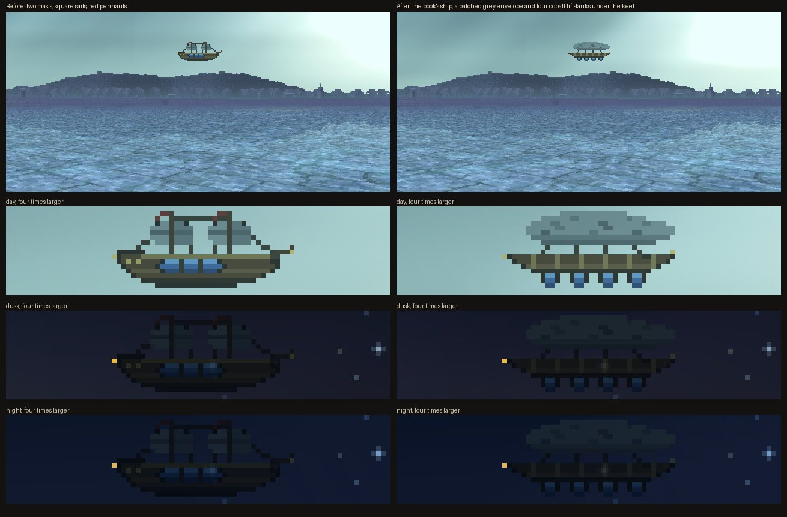
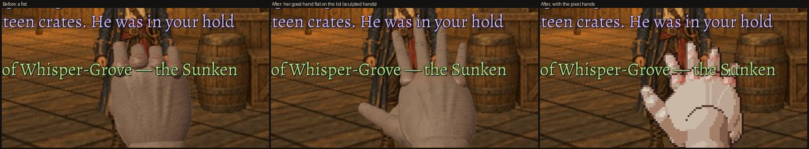

# Cheap wins of 26 Nov 2026

The owner, 26 Nov, 7:28 am: "I'm going to install it on my phone this morning and want some cheap wins that I can look at and test." And at 7:31 am: "take care of the cheap wins yourself". Each win below is small, was written test-first, and adds no new in-game line (so there is no French to add). This record grows as each win lands.

## 1. In a hero's boots, the bar names the hero

**What you see.** During the six moments of Phase 125b (Kaelen's needle, Vane's hold, Lyra's bolts and rope, Sable's names, the coda) the bottom bar used to keep showing your own traveller's name, level and purse. It now shows whose boots you stand in: Kaelen Vance, Lyra Ashgrove, Captain Vane or Sable. When the moment ends the bar is your own again.

**How.** `js/boots125.js` gives each hero a name and answers `BOOTS125.hudName()`; `js/game.js` asks it when it draws the bar. With "In their boots" switched off the answer is always nothing and the bar is exactly as before.

**Lore.** The names are the books': Kaelen Vance, Lyra Ashgrove and Sable throughout Book One; Vane is "Captain Vane" in the telling (Book One, full manuscript l. 1307). Nothing invented.

**Test.** `test/boots125.test.js` check 4b, written first and seen failing. 71 of 71.

## 2. The Kestrel in the sky is the book's ship

**What you see.** Once in a while a skyship crosses the sky over the Spectral Woods and the Deep Woods (Options: "Flyovers"). It had been drawn as a sea-ship in the air, with two masts, square sails and red pennants. The book's *Kestrel* has none of those. She is now drawn as the book has her: a patched grey envelope over the hull, rigging lines down to an oak hull with brass ribs, a gun mount forward, lanterns at bow and stern, and four cobalt lift-tanks under the keel. The same drawing serves both views (the classic view and the 3D view's sky).

**Lore.** "It was small for a skyship, sixty feet perhaps, brass-ribbed and oak-planked, with a patched grey envelope and four lift-tanks slung beneath her keel glowing the faint cobalt of drift-glass." (Book One, full manuscript l. 674; `Chapters/02 Charcoal and Glass.md:114`.) Book Three has her with "her patched bag and her three tanks" (`Book Three/Part Two Ch5-8.md:19`): that is later, after a tank is lost. The game shows Harvestmonth 419, so she has four. The "mast-ladder" of Books Three and Four is the mooring mast's ladder, not a mast on the ship. Phase 123's mooring mast in the quarry already drew her this way; the sky had been left behind.

**Not done, noted.** The tanks do not yet glow after dark (they dim with the rest of the ship). The book says they glow. That needs a small change in both views' drawing and is left for the roads phase.

**Test.** `test/sky.test.js`: a new check on the drawing itself (no mast or pennant cells, one envelope above the hull, four tanks below the keel and none above it), written first and seen failing. One older check was taught: "the flight fades in at its start" had counted how many pixels changed, and at that instant the ship is half off the screen's edge, so it was really measuring which half of the old drawing was fuller. It now measures how strongly each pixel changes (about a twentieth of mid-flight), which is the fade. Suites run: sky, phase2, presets, creatures, smalllife, mast123, callings126, and light21 alone. All green.

## 3. Sable's good hand lies flat on the lid

**What you see.** In Sable's boots in the hold (the three names) her hand was drawn as a fist at the bottom of the view. It is now an open hand laid flat, the back of the hand up and the fingers apart, in both sets of hands (the pixel hands and the sculpted hands). With plain hands (both switched off) nothing is drawn there, as before.

**Lore.** "She put her good hand flat on the lid" (Book One, full manuscript l. 4518); the book does not move it while she reads the names. Her other arm is the "broken wing" (l. 4600).

**How.** One new hand picture, a hand at rest: `PIXELHANDS110.restArt` and `restHand` (the open hand the Songs already use, turned to lie flat, the wrist bent so the forearm falls down the view), the same pose handed to the sculpted hands (`PIXELHANDS110.poses('r', ...)`, `BODY21.sculptRest`), and `js/boots125.js` asks for it where the pose is the lid. Any later scene can use it.

**Not done, and why.** Kaelen's needle is still the plain right hand with the copper wire running from it to the needle. A pinch is a different hand again (finger and thumb together), in two styles, and is not a cheap win. It is left for the hands' next piece.

**Tests.** `test/pixelhands110`: a new check (the picture's size, at least four fingers standing apart where a fist has none, drawn when the switch is on and not when off, the same open right hand given to the sculpted hands). `test/boots125` 10c: in the names an open hand is drawn and no fist. Both written first and seen failing. Suites run: pixelhands110 (alone), pixelhands111, sculpted112, hands122, body21, fp-hands, fp-feel, boots125, strangers125, and light21 alone. All green.

## 4. Faces for the crowds: the rule (nothing to see until the faces are painted)

**What it is.** A townsman, a mourner or one of the Umbral folk is one entry in the game that stands in many places, so giving that entry a face of its own (as Phase 124 does for a named person) would give the whole crowd one face. A crowd now has a list of faces (`FACES124.POOL` in `js/faces124.js`), and each of its people shows one of them by a fixed rule, never by chance: where that person's home stands among the others of the same entry on the map (north to south, then west to east), stepped on by a number made from the map's and the entry's names, so two maps do not open on the same face. The same person shows the same face every time and in every save. Same switch as the other faces ("Faces of their own"); off, every talk window is what it was.

**What you see today.** Nothing: the list is empty until the crowds' faces are painted. The prompts for them are already written (`tools/faces/PROMPTS.tsv`, the rows whose id ends in `#1`, `#2`, ...: six townsmen, six townswomen, five Umbral folk, the road-walkers, the Hollows' loops, the mourners, the night-hummers, the Watch's watchers and mast-crew, the Flambeaux of the winch). One painted face for a crowd changes many people at once, so tonight's batch paints townsmen and townswomen first.

**Lore.** None touched: no name, age or look is set by this. The faces themselves follow the prompts, which were checked against the books when they were written (Phase 124's prompts record).

**Test.** `test/own124.test.js`, a new check written first and seen failing: an empty list changes nothing; three men of one crowd show three faces; the same faces when asked again, when the map's list is in another order, and after one of them has walked; a person with a face of their own keeps it; the switch off gives the borrowed face; `Math.random` is never asked; every row's files exist, are 96 by 96 and are in `sw.js`. Suites run: own124, skin124, portraits, companion-talk. All green.

## Still to come

- The crowds' faces themselves, painted a batch a day (the rule is in).
- A pinch for Kaelen's needle.
- Stronger sights on a phone, only if the owner finds them too faint.
