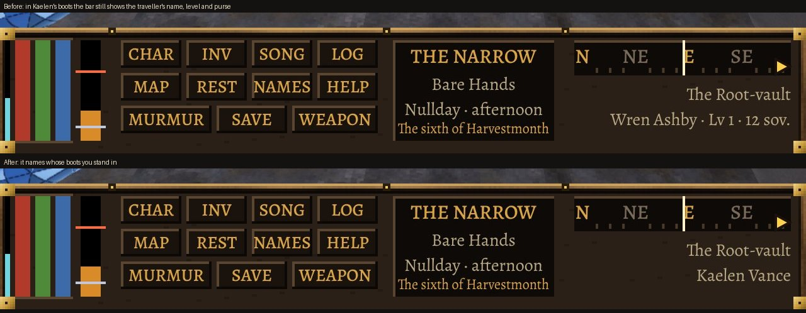
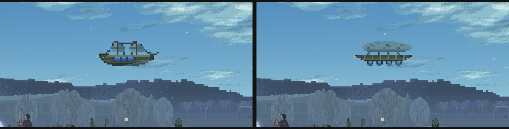

# Cheap wins of 26 Nov 2026

The owner, 26 Nov, 7:28 am: "I'm going to install it on my phone this morning and want some cheap wins that I can look at and test." And at 7:31 am: "take care of the cheap wins yourself". Each win below is small, was written test-first, and adds no new in-game line (so there is no French to add). This record grows as each win lands.

## 1. In a hero's boots, the bar names the hero

**What you see.** During the six moments of Phase 125b (Kaelen's needle, Vane's hold, Lyra's bolts and rope, Sable's names, the coda) the bottom bar used to keep showing your own traveller's name, level and purse. It now shows whose boots you stand in: Kaelen Vance, Lyra Ashgrove, Captain Vane or Sable. When the moment ends the bar is your own again.

**How.** `js/boots125.js` gives each hero a name and answers `BOOTS125.hudName()`; `js/game.js` asks it when it draws the bar. With "In their boots" switched off the answer is always nothing and the bar is exactly as before.

**Lore.** The names are the books': Kaelen Vance, Lyra Ashgrove and Sable throughout Book One; Vane is "Captain Vane" in the telling (Book One, full manuscript l. 1307). Nothing invented.

**Test.** `test/boots125.test.js` check 4b, written first and seen failing. 71 of 71.

## 2. The Kestrel in the sky is the book's ship

**What you see.** Once in a while a skyship crosses the sky over the Spectral Woods and the Deep Woods (Options: "Flyovers"). It had been drawn as a sea-ship in the air, with two masts, square sails and red pennants. The book's *Kestrel* has none of those. She is now drawn as the book has her: a patched grey envelope over the hull, rigging lines down to an oak hull with brass ribs, a gun mount forward, lanterns at bow and stern, and four cobalt lift-tanks under the keel. The same drawing serves both views (the classic view and the 3D view's sky).

**Lore.** "It was small for a skyship, sixty feet perhaps, brass-ribbed and oak-planked, with a patched grey envelope and four lift-tanks slung beneath her keel glowing the faint cobalt of drift-glass." (Book One, full manuscript l. 674; `Chapters/02 Charcoal and Glass.md:114`.) Book Three has her with "her patched bag and her three tanks" (`Book Three/Part Two Ch5-8.md:19`): that is later, after a tank is lost. The game shows Harvestmonth 419, so she has four. The "mast-ladder" of Books Three and Four is the mooring mast's ladder, not a mast on the ship. Phase 123's mooring mast in the quarry already drew her this way; the sky had been left behind.

**Not done, noted.** The tanks do not yet glow after dark (they dim with the rest of the ship). The book says they glow. That needs a small change in both views' drawing and is left for the roads phase.

**Test.** `test/sky.test.js`: a new check on the drawing itself (no mast or pennant cells, one envelope above the hull, four tanks below the keel and none above it), written first and seen failing. One older check was taught: "the flight fades in at its start" had counted how many pixels changed, and at that instant the ship is half off the screen's edge, so it was really measuring which half of the old drawing was fuller. It now measures how strongly each pixel changes (about a twentieth of mid-flight), which is the fade. Suites run: sky, phase2, presets, creatures, smalllife, mast123, callings126, and light21 alone. All green.

## Still to come

3. Faces for the crowds: each person in a shared crowd picks one of several painted faces by a fixed rule, never by chance.
4. Proper open-hand poses for Kaelen's needle and Sable's hand on the lid (owed from Phase 125b).
5. Stronger sights on a phone, only if the owner finds them too faint.
