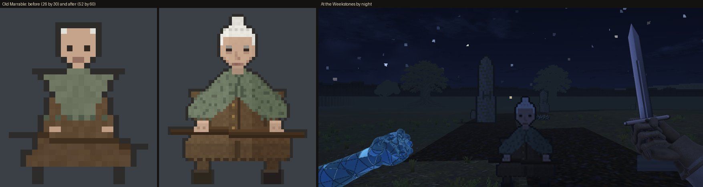
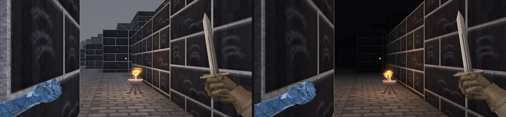

# Phase 128a: the roads filled, part one (record)

26 Nov 2026. The pieces of Phase 128 that need no ruling (see `Phase 128 - The roads filled (findings and options, for ruling).md`, section 3), built one at a time by the Commander at the owner's word ("take care of ... 5, 6 and 7", 26 Nov, 7:31 am). This record grows as each lands. Every new in-game line has its French in `tools/i18n/p128-roads.tsv`.

## 1. Old Marrable drawn again (built)

**What you see.** The Fold's lamp-teller at the Weekstones (by night only) was 26 by 30 pixels, the smallest person in the game, a block with two dots for eyes. She is drawn again in code at 52 by 60: white hair drawn back into a knot, a face with brows, eyes, a nose and a mouth, the shawl crossed on her breast with its folds and fringe, the drover's coat and its three horn buttons, both hands on the stick across her knees, the lap of the coat, the boots. She is the same height in the world, with four times the pixels, and the 3D view's sharpening (Phase 107) doubles that again close up. She still sits and does not walk: the moving-paintings rig needs a standing figure.

**Lore.** She is the game's own (Phase 113c; in no book). Her look was set there: "a drover's coat, a shawl over it, a stick across her knees, white hair". Nothing new is claimed.

**Test.** `test/fold113.test.js`, two checks written first and seen failing: twice the size and the same height in the world; white hair, a face with two eyes, the shawl, the coat, both hands on the stick across her knees. Suites run: fold113 (47 of 47), paintfolk76 (she is still one of the people who stand still). Green.

## 2. The brazier at the foot of Tower Six (built)

**What you see.** On the wall of the Null-Watch, in the lane at the wall's foot below Tower Six's battery, an iron brazier stands lit, by day and by night. Looked at, it says: "A brazier at the foot of Tower Six, the coals banked. The battery crew come down to warm their hands at it." [PROPOSED wording]. It blocks nobody's way.

**Lore.** "She burned it in the brazier at the foot of Tower Six, where the battery crew warmed their hands between Refusals." (Book Three, Part One l. 1842.) The brazier, the tower and the crew's habit are the book's; the scene around that line (who burns what) is Book Three's own, in Ashfall, and is not shown or hinted. The game's line does not use the word "Refusal": the dawn Refusal is Phase 114's to bring in.

**How.** A new file for the roads' wayside things, `js/roads128.js` (`ROADS128.dress(map)`; it adds each thing once, by rule, to the map's own list, as the Fold's stones were added). The brazier is placed on the first open cell west of the tower that has the wall beside it. No switch: it is a thing of the world. No random number.

**Test.** `test/roads128.test.js`, written first and seen failing (8 of 9 red): one brazier on the wall; on open ground at the wall's foot, below the battery; lit, in nobody's way, one of the map's own things; dressing the map again adds nothing and asks no random number; French for every line; `js/mast123.js` still the last script. Suites run: roads128, rift100, tip113, stores113, story-i18n, own124, callings126, strangers125, text121, mast123. All green.

## Still to build in 128a

- The mail-cart and its carter on the Long Common (Book One, full manuscript l. 2622).
- An errand for Abel Sedge: turf for the clearing's charcoal clamps (Book One l. 604, 608).
- The grass tufts drawn again at twice the size.
