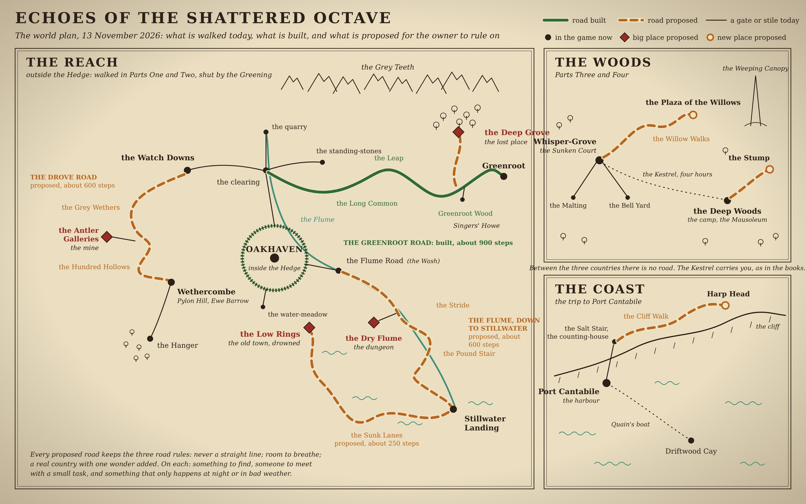

# Phase 81: the world plan

*Written 13 Nov 2026 for the owner's ruling. Nothing here is built. The chart is `screenshots/world81/world-plan.jpg`.*

**Approved by the owner, 13 Nov 2026 ("approve all").** Every recommendation in the twelve questions at the end stands as written, so everything marked [PROPOSED] below is now ruled: it is what the later phases build. The marks are left in place to show what was invented. Two things follow from the recommendations as worded: the Dry Flume is built with its older stone conduit (question 7); and the woman in the doorway is seen and not heard until the owner gives her four words (question 9).

## How to read this

The owner asked for a very large map that takes a while to cross, with roads that are never straight, room to breathe, and each stretch drawn from a real country with one wonder added. The Greenroot road (Phases 79 and 80) is the pattern: about 900 steps in three stretches, about six minutes at a walk.

This plan covers everything else. There is one page for each road and one for each big place. Each page says:

- **Joins:** which two places in the game it goes between.
- **Canon:** what the books and bibles already say, which the road must keep.
- **Real country:** the real landscape it is drawn from.
- **The wonder:** the one fantasy element.
- **The road:** its shape and length.
- **The three kinds of thing:** something to find; someone to meet, with a small task; something that only happens at night or in bad weather.
- **Off the road** and **danger.**
- **Invented:** everything on the page that is [PROPOSED].

The questions for the owner are collected at the end, each with a recommendation, so one answer can settle the lot.

## One correction to the roadmap

The roadmap entry for this phase named "the ways into the Deep Woods and to Whisper-Grove" and "the shore road to Port Cantabile". Neither exists in the books. The Woods are another province and the Coast is across the sea; the party reaches both by the *Drift-Kestrel*. The game already does the same (the map table, and the four-hour hop between the Sunken Court and the Deep Woods camp).

So the world is **three countries, each walked inside itself, with the Kestrel between them:**

| Country | When it can be walked | What is planned |
|---|---|---|
| The Reach, outside the Hedge | Parts One and Two. The Greening shuts it. | Three roads and four big places. Most of the work is here. |
| The Woods | Parts Three and Four | Two short roads to landmarks the owner ruled reachable on 22 Oct. |
| The Coast | The trip to Port Cantabile | One cliff-top walk. |

Two rules from the owner's rulings of 22 Oct shape every page. **Nothing new joins Oakhaven**: the Hedge is a story boundary. **A new road only goes between two places that are already joined**, or to a dead end off a place the player can already reach. The Greenroot road was built that way (it was put between the clearing and Greenroot, which were already joined), and so is everything below.

---

# The Reach

## Road 1. The Flume, down to Stillwater

**Joins:** the Flume Road (the Wash) and Stillwater Landing. Today a lane joins them in one step: "A lane cut down through the hedge. Plank marks in the mud: barrows, going down."

**Canon:** the Flume is a living aqueduct of grown wood that pumps water uphill and holds one low vowel, heard three kilometres out (Vol I, Vol II). Stillwater Landing is the river port at the Flume's lower lock: a smugglers' town, where Reach timber leaves for Fortis and Cantabile broadsheets come in; the lockkeeper sells the same news to six parties (Vol II). The Timber Compacts are one strike from revolt. Briar-sprites in the verge; ringing timber draws hounds; the Flume over-pumps and surges (Vol II hazard table). Ennis Crowle keeps bees on the Flume road (Vol V).

**Real country:** canal country on a hillside. The lock flight at Caen Hill in Wiltshire, where sixteen locks go straight down a hill with a square side-pond beside each one; and the Pontcysyllte aqueduct in Wales, a water channel carried across a valley on tall piers, called "the stream in the sky".

**The wonder:** the water goes *uphill, overhead*. The Flume crosses a whole valley on living trunks as tall as a church, and the road goes down underneath it. At night the sap-light runs in the channel, so the Flume is one green line drawn across the dark from ridge to ridge, and the lit water throws moving green light on the road below.

**The road:** two stretches, about 600 steps.
1. **The Stride** [PROPOSED]. The road leaves the Wash and winds down into a wet valley, Sallow Bottom [PROPOSED], between alder and willow, crossing a brook twice. The Flume strides straight over it on its trunks. It is the only straight thing in the country, and it is in the sky; the road never is.
2. **The Pound Stair** [PROPOSED]. The Flume comes down to the Landing by a flight of sixteen grown locks, each with its side-pound: sixteen square pools stepping down the hill like a giant's stair. The road zigzags down beside them, crossing by the lock gates.

**To find:** a timber raft wedged in a side-pound for two years, with Compact chalk-marks and something under its deck. Ennis Crowle's far skeps, in bee-boles (niches in a wall, as real beekeepers built). A gauging stone cut with the Flume's height year by year, and the last few marks each higher than the one before.

**To meet:**
- A **lengthsman** [PROPOSED], the Compact's keeper of the Stair. *Small task:* the gates have stuck since the lock was chained. Hum the Root note at three gates in the right order, top to bottom, to let a raft down, without ringing a stake. (The game already has "sing it the root. Grown wood remembers one note.")
- A **broadsheet-runner** [PROPOSED] coming up from the Landing with Cantabile papers under her coat.
- **Two raft-hands walking home** [PROPOSED]: the rafts go down by water, the crews come back on foot.
- A **Synod gauger with a measuring chain** [PROPOSED], polite, writing down how much the Flume is over-pumping, and not saying why.

**Only at night or in bad weather:** at night, the green line and the moving light. In rain and storm the Flume over-pumps: the Stair "walks", water coming down pound by pound, and the low road is shut, so the traveller takes the high path along the pound-banks. When a surge has passed, the lowest side-pound stands empty for a while and shows a grating nobody sees at other times (see the Dry Flume).

**Off the road:** the valley floor under the Stride, and the door of the Dry Flume.

**Danger:** briar-sprites in the verge, mire-drones in the pounds, hounds if you ring the timber. Danger 1.

**Invented:** the Stride, the Pound Stair, Sallow Bottom, the four people, the raft, the bee-boles, the gauging stone.

---

## Road 2. The Sunk Lanes, and the Low Rings as the old town

**Joins:** Stillwater Landing and the Low Rings, which today are one step apart.

**Canon:** the Low Rings are one of Oakhaven's four quarters: "flooded lower city, abandoned since the Flume began over-pumping" (Vol II). The Ladder is the terraced market up the river bluff above it. In the game the Low Rings have roofs and upper floors standing out of knee-deep green water, boards laid roof to roof, mire-drones in the lanes, and a hidden household who never left.

**A standing contradiction this page can settle.** The bible puts the Low Rings inside Oakhaven; the game reaches them from outside the Hedge. Proposed answer [PROPOSED]: *when the Hedge was planted in 417 it was run along dry ground at the foot of the Ladder, and the drowned quarter was left outside it.* The water-gate at the Ladder's foot is grown shut. That keeps the bible, the game, and the rule that nothing new joins Oakhaven.

**Real country:** the Norfolk Broads, which look like natural lakes and are in fact medieval peat-diggings that flooded; and the drowned villages under reservoirs, such as Mardale Green under Haweswater, whose walls and bridge come back up in a dry summer.

**The wonder:** the water is clear and green and lit from underneath by the Flume's sap-light, so at night you walk the boards over a whole street that can be seen below you, kerbs, doorsteps and the market cross, as plain as through glass.

**The road:** one stretch, about 250 steps, **the Sunk Lanes** [PROPOSED]. It is not a road but a way: causeway, then boards from roof to roof, then a hedge-bank, bending round open pools. Short on purpose, because by canon the Low Rings are close to the town.

**The Low Rings grown.** Today the map is 38 by 30 with five barred buildings. As the old town it becomes about three times that each way, with streets to cross by the roofs: **Cross Pool** [PROPOSED] (the market cross, under water); the counting-house and the chandler's loft (already there); a corn loft; a row of weavers' garrets joined by one long board; and the **Ladder's Foot** [PROPOSED], the grown-shut water-gate, where Oakhaven can be heard over the Hedge and not reached.

**To find:** the cashbox the looters left "for being too heavy". Reeds still hung over drowned doors, each tuned to a child (canon: a birth is announced by hanging a tuned reed above the door).

**To meet:**
- A **punt-woman** [PROPOSED] who ferries along the Lanes. *Small task:* she has fished up a child's reed and wants it hung back over the right door. The reeds on the row are each a different note, and one hook is bare.
- **Two salvagers** [PROPOSED] working the garrets by boat, who are the "explorers" of this country. They do not care for company.
- The hidden household stays hidden, as now.

**Only at night or in bad weather:** at night, the lit street under the boards. On a still clear night the Flume's note falls and the water drops a hand: the kerb-tops come up as stepping stones to a house that cannot be reached at any other time. In storm the water rises, the boards float loose, and the mire-drones come out of the lanes.

**Danger:** mire-drones; deep water blocks. Danger 1, 2 in storm.

**Invented:** the Sunk Lanes, Cross Pool, the Ladder's Foot and the planting of the Hedge along it, the corn loft and garrets, the punt-woman and her task, the salvagers.

---

## Road 3. The drove road

**Joins:** the Watch Downs and Wethercombe. Today a stile in the Downs' south hedge drops straight into the combe, "down a drove-road" that is not there to walk.

**Canon (ruled):** the Watch Downs and everything on them: the Long Down and its beacon, Hedge Knoll, the Scar with flint "like knuckles", the sheepfold, the dew-pond, the boundary stones, the hawthorns, the finger-post, and "There are no sheep. The turf is short anyway, as if it remembers them." The sheep were shorn for the Hedge in 417, kept inside it, and eaten; nothing took them. The first Downs map stays danger 0, "the quiet way in". Wethercombe, the Bellwether ("Eight hundred sheep a fair-day went past that door"), Pylon Hill, Ewe Barrow and the Hanger are built and were [PROPOSED] in Phase 22.

**Real country:** the chalk downs of Wiltshire and Berkshire: the Ridgeway; holloways, old roads worn so deep between their banks that the hawthorn meets overhead; wide green drove roads with a clump of pines to mark each night's halt; and Fyfield Down, where hundreds of grey sarsen stones lie scattered in the grass. Shepherds called them **grey wethers**, because from a distance they look like a flock of sheep lying down. Wethercombe could have been named for them.

**The wonder:** **the Grey Wethers** [PROPOSED]. On the down where the flocks used to lie there is a flock of stones, and in the Reach everything rings. Each stone has its own bell-note when it is struck. The drovers tuned their bell-wethers to them. In a high wind the whole flock sounds, faintly, by itself: a hillside of stone sheep with bells on, and no sheep anywhere.

**The road:** two stretches, about 600 steps.
1. **The Grey Wethers.** From the stile the drove road is wide and green, a hundred sheep abreast, swinging round the head of a dry valley, through the stones, past a dew-pond and the **Three Pines** [PROPOSED] at the drovers' halt.
2. **The Hundred Hollows** [PROPOSED]. The road narrows into a holloway, a green tunnel under hawthorn, and comes out on a down that is all grassed-over pits, a hundred of them, like a field of giant thumb-prints. Then down by terraces into Wethercombe.

**To find:** a pinfold (the pound for strays) with a tally-stick still in the wall. A drover's cache under the middle pine. The one hollow that is not grassed over (see the Antler Galleries).

**To meet:**
- **Returners** [PROPOSED]: a family with a handcart, come out of the Hedge after two years to see what is left of their farm. Tamar Farrant was the first back; these are the next. They are the travellers of this road, and the reason it has anyone on it.
- An **old woman among them** [PROPOSED] who was a drover's daughter. *Small task:* she cannot climb to the stones. Strike five of the Grey Wethers in the order of the drovers' call, which she hums for you, so she can hear it once more. Strike them carelessly and it is only noise, and noise brings hounds.
- A **furze-cutter** [PROPOSED] cutting faggots for the beacons (the game already has the furze woodpile and the three fold-fires).

**Only at night or in bad weather:** in wind, the Wethers sound. At night the three beacons, once lit, show from the road as three fires on three hills. At dawn after a wet night the combe fills with mist and the road runs above a white sea with the hilltops standing out of it like islands (this happens on real downs, and is worth a GIF).

**Off the road:** the Hundred Hollows, and under them the mine.

**Danger:** the first stretch is quiet, like the Downs. Hounds den in the Hollows after dark. Danger 0 on the first stretch, 1 on the second.

**Invented:** the Grey Wethers and their notes, the drovers' call, the Three Pines, the Hundred Hollows, the pinfold, the returners, the old woman and her task, the furze-cutter.

---

## Big place 1. The dungeon: the Dry Flume

**Where:** under the Stride, off Road 1.

**Canon it leans on:** the Flume is grown, not built, and Oakhaven's halls were "trained over two centuries" (Vol II). Nothing says what carried the water before.

**The idea** [PROPOSED]**:** before the Flume was grown, it was *built*. The old stone conduit still runs inside the ridge, dry for two hundred years: a tunnel, settling tanks, a wheel-pit, a pump-hall with iron galleries. The living Flume's root has come down through its roof and hangs in the dark like a lit green vein.

**Real country:** Roman aqueduct tunnels, and the great Victorian pumping stations (Crossness in London, called a cathedral of ironwork).

**The wonder:** the living root lighting the dead works; and when the Flume surges above, the water in the sump climbs *up* the walls, so rooms flood from the floor to the roof and drain again, and the way through has to be timed.

**What it holds:** six or seven rooms, traps of the place itself (a sluice that drops, a floor that floods), mire-drones in the sump, hush-moths drawn to the root-light, and a named keeper in the pump-hall. Special gear in a different line from the Howe's staff and gloves: a **lengthsman's hook** (a long boat-hook: reach, and it pulls) and **sluice-boots** (silent in water) [PROPOSED].

**The biggest invention in this plan.** It adds a piece of history: that there was a built Flume before the living one. If the owner would rather not add that, the same dungeon can be the Flume's own *root-works*, with no older conduit.

---

## Big place 2. The mine: the Antler Galleries

**Where:** under the Hundred Hollows, off Road 3.

**Canon it leans on:** chalk and flint on the Downs (ruled). The Chalk Ram was cut "before anyone wrote anything down" (Phase 22). In the Reach growth has lost its stop: "wounds close over splinters and keep closing" (Vol I). Too still brings the Hush; hush-moths eat the light first.

**Real country:** Grime's Graves in Norfolk, where more than four thousand years ago people sank more than four hundred shafts through chalk to a seam of black flint and dug low galleries out from the bottom of each with picks made of red-deer antler. From above it is a field of hollows. The picks are still found lying where they were put down.

**The wonder** [PROPOSED]**:** in the Reach, the antler picks that were left in the galleries *grew*. They took root in the chalk and branched, slowly, ever since. The deepest galleries are a white forest of antler, floor to roof, in white chalk walls. It is the only white place in the game.

**How it plays:** a mine is still, and stillness is the Hush's. Light is the way through: lamps carried from niche to niche, chalk walls that throw the light a long way, and moths that come for it. Low, branching galleries; a shaft to climb; the flint seam at the bottom.

**What it holds:** hush-mites in numbers, hush-moths, and something denned in the deepest gallery. Gear: an **antler pick** and a **floorstone knife** (black flint, very quiet, very sharp) [PROPOSED].

---

## Big place 3. The old town: the Low Rings

On Road 2's page, because the town and its road are one piece of work. It is the one big place that needs nothing invented to exist: the books already drowned it.

---

## Big place 4. The lost place: the Deep Grove

**Where:** a gap in the north side of Greenroot Wood (the third stretch of the Greenroot road).

**Canon:** "The oldest iron-boughs, pre-Orthodoxy. No path leads in that is the same way twice" (Vol II). Under it is something from the First Cycle that was transmitting "long before the Synod learned how" (Vol I, marked a secret). Scene hook: "The path changes behind them. Something under the roots is transmitting, and it is not in any key the Octave uses." The silent circle: the iron-boughs go quiet in a widening ring round a stranger, and everything for two kilometres knows where you are.

**Real country:** Wistman's Wood on Dartmoor, where dwarf oaks grow out of moss-covered boulders and every branch is furred green; and the oldest coppice stools, single trees that have been alive for a thousand years or more as a ring of stems round an empty middle.

**The wonder:** the canon one. The path is not the same way twice. You cannot find the middle by looking. You find it by ear, walking toward the lower note.

**How it plays:** the wood is a few glades whose ways out change each time you take them (worked out from the hour and how many times you have come, never from chance, so it is the same for two players and for the tests). Follow the note and the glades lead inward; walk by eye and they lead you out at the gap you came in by. In the middle stands the oldest tree, **the Stool** [PROPOSED]: a ring of trunks round a hollow. Stand in it and you hear what is under the roots. **Nothing opens.** What is down there belongs to a later book, as the Conservatory's old stair does.

**To find:** carters' marks cut by people who came in and the dates they came out, some of them wrong. **To meet:** nobody. That is its unique thing: it is the one place on any road with no one in it. **At night:** the silent circle closes round you, and the ring can be heard closing.

**Danger:** nothing attacks in the Grove. What the circle calls is waiting at the gap when you come out.

**The risk, stated plainly:** the release notes call this the highest design risk of any place, because a wood that rearranges itself can be only annoying. It should be built last of the four and cut if it is not a pleasure.

**Invented:** where the gap is, the glades, the Stool, the carters' marks.

---

# The Woods

Both roads here are short on purpose. Whisper-Grove is the series' central atrocity ("should be written as such", Vol I), so nothing on these roads is a treasure hunt.

## Road 4. The Willow Walks, to the Plaza of the Willows

**Joins:** the Sunken Court and a new dead end, the Plaza. The owner ruled on 22 Oct that the "broken colonnade and marble spires" on Whisper-Grove's skyline are to become reachable, from Whisper-Grove only.

**Canon:** silver weeping willows standing in phosphorescent pools, lilac mist at ground level, marble plazas "looted monthly by crews who have learned not to speak near the residents" (Vol I). Seventy-four thousand Unstrung, each with a loop. The Plaza of the Willows: 204 loops in Sable's Ledger in Harvestmonth 419, and the woman in the doorway on the north side, grey dress, apparent forty. Her loop was nine words in 416 (the first three were struck out and lost; the six that were kept are "— and I'll fetch the other one."), four in Harvestmonth 419 and two on 19 Frostmonth. A boy of about twelve sits with his back to the fountain; in Harvestmonth his loop is "four, and then we go" (Book Four). Since the Silencing the Memory Anchor has been reciting the names of all 74,000, in order, beginning with Halder Wick (Vol V). On 20 Frostmonth the Choir-That-Eats takes the Plaza (Book Four).

**Real country:** flooded cypress forest with boardwalks, like Caddo Lake in Texas; the stepped lakes and plank paths of Plitvice in Croatia; and the Canopus at Hadrian's Villa, a long pool with a broken colonnade round it.

**The wonder:** the canon one, made audible. At night on the Walks you can hear a voice from the Canopy, a long way off, saying names, one after another, in order.

**The road:** one stretch, about 300 steps, **the Willow Walks** [PROPOSED]: marble causeway half under water, bending from pool to pool, through **the Long Colonnade** [PROPOSED] and out into the Plaza. The Plaza is its own small map: the doorways, the people in them, the willows.

**To find:** nothing to take. Things to read: a looters' tally scratched inside a doorway; the mark where a salvage crew stopped and went back.

**To meet:**
- A **junior Veil scribe** [PROPOSED] with a list. *Small task:* stand at three doorways and count the words of each loop for the Ledger. It is done by standing still and quiet, which in the Woods has its own price.
- **A salvage crew of three** [PROPOSED] who speak only by signs. They are this country's "explorers", and the player is free to think what they like of them.

**Only at night or in bad weather:** the names. In mist the Walks can only be followed by the pool-light.

**Danger:** what already walks the Grove: proctors, and the Hush. Danger 1.

**What is not shown:** the Choir. This is the Plaza *before*; a reader of Book Four will know what they are looking at.

**Invented:** the Willow Walks, the Long Colonnade as a name, the scribe and the crew.

## Road 5. To the Stump

**Joins:** the Deep Woods camp and a new dead end. Ruled reachable on 22 Oct, from the Deep Woods only; "what the stump was is up to whoever builds it".

**Canon:** the Deep Woods by the Mausoleum of Chords, where the Kestrel came down (Book One, Part Four). On the skyline: snow-shouldered far hills, black forest, a broken tower stump.

**Real country:** old-growth forest with fallen giants, as at Białowieża in Poland, and the broken round towers of Ireland.

**The wonder:** the view. Climb what is left of the stair and for once the Woods are seen from above: the mist lying lilac on the forest like a sea, and the Weeping Canopy standing out of it a kilometre high.

**The road:** one stretch, about 250 steps, winding between fallen trunks the size of houses and round two pools.

**To find:** the stair. **To meet:** one of the camp's own people, come up to look north. **At night:** the Canopy's own light.

**What the tower was** [PROPOSED]**:** nobody says, because nobody remembers. In a country that has lost its memory, a tower no one can name is truer than a tower with a history, and it leaves the answer to a later book.

**Danger:** hounds, as in the Deep Woods now.

---

# The Coast

## Road 6. The Cliff Walk

**Joins:** the top of the Salt Stair and a new dead end, the headland.

**Canon:** the sixth landing is the top of the Stair; "beyond it there was only the cliff-top, a yard of wet flags with the wind going over it", and the counting-house (Book Two). The Coast is strung with "acoustic carillon rigging: vast harp-strung masts that convert wind into usable charge" (Vol I). The sea changes key with the tide. Velocity has gone wrong: "A raindrop takes three days to fall", and children "are taught never to run on open deck, because a running stride is where velocity most likes to misbehave" (Vol I). Nobody sleeps ashore. The town is unburned in Book One; the Burning is 15 Frostmonth.

**Real country:** the cliff paths of Cornwall and the Cliffs of Moher; and the Singing Ringing Tree on a Lancashire moor, a tower of steel pipes that the wind plays.

**The wonder:** the canon one. **When it rains on the cliff, the rain hangs.** The drops stand in the air, each one falling over days, and you walk through them and leave a tunnel your own shape behind you.

**The road:** one stretch, about 300 steps, along the cliff edge, round two coves, out to **Harp Head** [PROPOSED], where a carillon mast stands strung like a harp against the sky.

**To find:** a spy-glass seat cut in the rock, and what has been scratched there by people watching for a ship.

**To meet:**
- A **mast-tuner** [PROPOSED] at the Head. *Small task:* hold the tuning line while a string is set. Do not run.
- A **broadsheet stringer** [PROPOSED] with a glass, counting sails for the papers.
- **Children playing Slow** [PROPOSED], the game of who can cross the yard last.

**Only at night or in bad weather:** the hanging rain. In a gale the mast sounds one key over the whole harbour. At night, the Stair below as a thread of lamps.

**Danger:** none that bites. Danger 0. The cliff, and running: a running stride near the edge may go wrong, as the books say it does.

**Driftwood Cay** is left as it is. It is a burying-ground, and it is quiet on purpose.

**Invented:** the Cliff Walk, Harp Head, the three people, the game of Slow, the spy-glass seat.

---

# Sizes, and the order to build in

| Road | Stretches | Steps | Big place off it |
|---|---|---|---|
| The Greenroot road (built) | 3 | about 900 | Singers' Howe (built) |
| The Flume, down to Stillwater | 2 | about 600 | The Dry Flume (dungeon) |
| The Sunk Lanes | 1 | about 250 | The Low Rings (old town) |
| The drove road | 2 | about 600 | The Antler Galleries (mine) |
| The Deep Grove | (off Greenroot Wood) | | The Deep Grove (lost place) |
| The Willow Walks | 1 | about 300 | The Plaza of the Willows |
| To the Stump | 1 | about 250 | |
| The Cliff Walk | 1 | about 300 | |

With these the walked roads go from about 900 steps to about 3,200.

**Order.** The Reach first, because it is where the player spends Parts One and Two and it has all four big places. Then the Coast. The Woods last: Part Four is the end of the game, and its roads get the least use.

- Phase 83 (by hand, as patterns): the Flume down to Stillwater; the drove road.
- Phase 85 (the big places): the Dry Flume; the Antler Galleries; the Low Rings and the Sunk Lanes; the Deep Grove last.
- Phase 87 (from this plan, with the road builder): the Cliff Walk; the Willow Walks and the Plaza; the road to the Stump.

**Mounts (Phase 84)** follow from the country: a pony for the Greenroot road and the drove road, which will not go onto planks, down the Pound Stair or into the Grove; and a **punt** [PROPOSED] for the Sunk Lanes.

---

# Questions for the owner

Each has a recommendation. "Approve all" takes every recommendation as written. **The owner approved all twelve on 13 Nov 2026.**

1. **Three countries, the Kestrel between them; no walking road from the Reach to the Woods or the Coast.** *Recommend: yes.* It is what the books do.
2. **Road 1:** the Stride and the Pound Stair, water going uphill overhead, gates that open to the Root note, and the four people. *Recommend: yes.*
3. **The Low Rings and the Hedge:** that the Hedge was planted along the foot of the Ladder in 417 and the drowned quarter left outside it. This settles a contradiction between the bible and the game. *Recommend: yes.*
4. **The Low Rings grown into the old town,** about three times the size each way, with the Sunk Lanes leading to it. *Recommend: yes.*
5. **Road 3:** the Grey Wethers as ringing stones, the Hundred Hollows, and returners as the people of the road. *Recommend: yes.* It adds nobody the sheep ruling forbids.
6. **The Antler Galleries:** antler picks that grew into a white forest. *Recommend: yes.* It is the Reach's own law, applied to something very old.
7. **The Dry Flume:** that a built stone Flume came before the living one. *Recommend: yes, but it is the largest invention here.* The fallback is the living Flume's root-works, with no older conduit.
8. **The Deep Grove:** entered from Greenroot Wood, found by ear, and nothing opens. *Recommend: yes, built last, and cut if it is not a pleasure.*
9. **The woman in the doorway.** In the game's month her loop is four words long. The books give the six words kept from 416 and say it was four in Harvestmonth, but not which four. *Recommend: the owner gives the four words; until then she is seen across the Plaza and not heard. The boy by the fountain can be heard, because the book gives his: "four, and then we go".*
10. **The Stump:** left unnamed, because nobody remembers. *Recommend: yes.*
11. **The Cliff Walk and the hanging rain.** *Recommend: yes.*
12. **A punt on the Sunk Lanes** as part of mounts. *Recommend: yes.*

Still waiting from before: the Long Rest (the Howe's keeper: its name and numbers); and whether the Greenroot road gets a new recorded piece of music or a procedural one.
