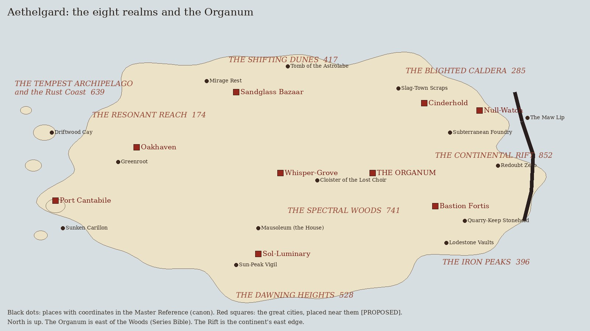
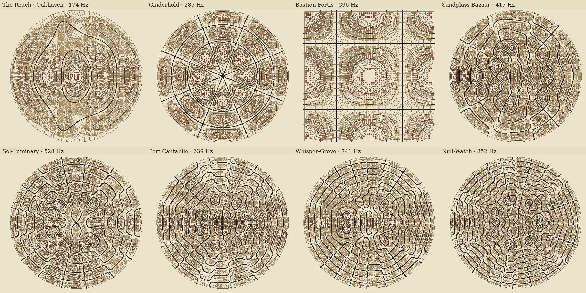
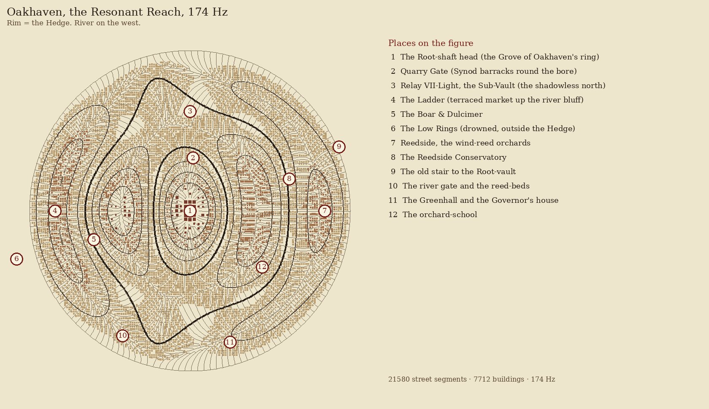
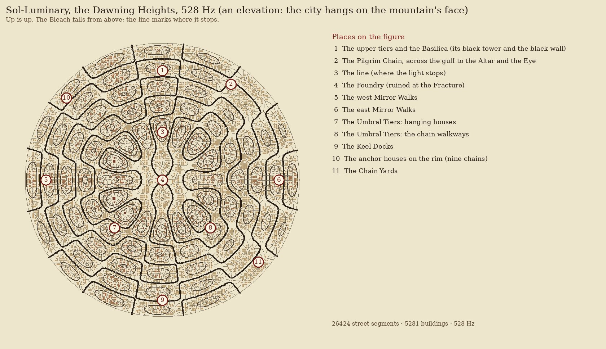
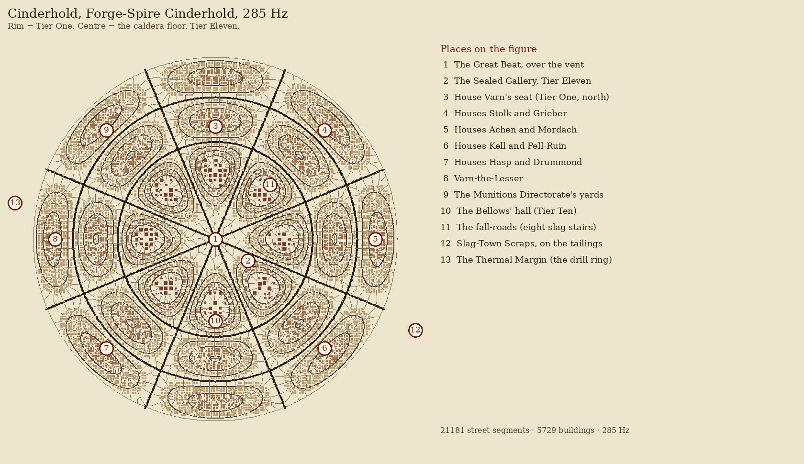
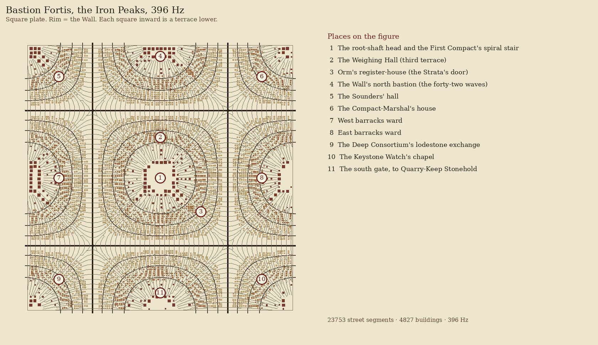
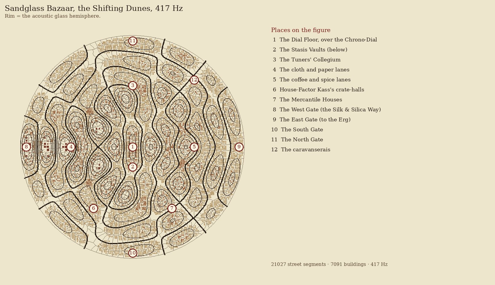
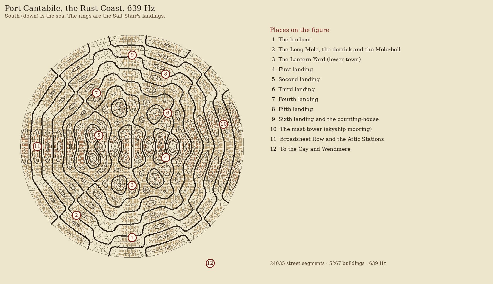
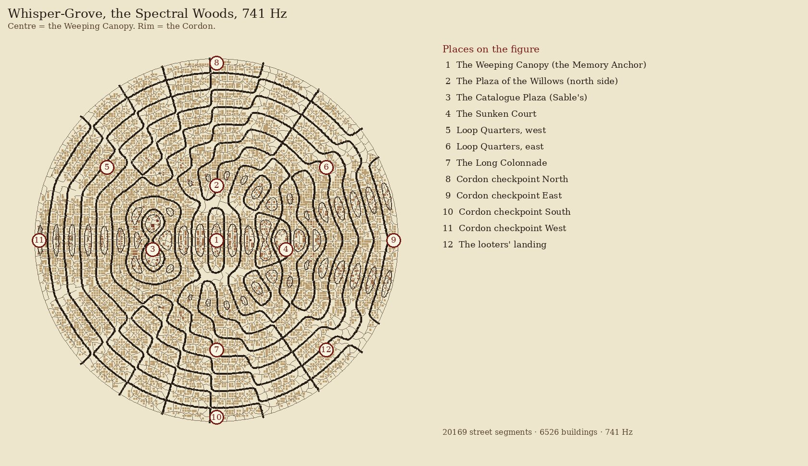
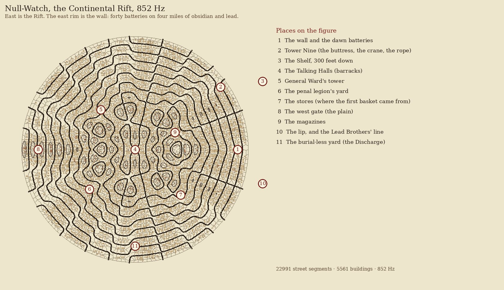

# Phase 89: the Continent (lore and great cities, for ruling)

*Written 14 Nov 2026 for the owner's ruling. Nothing here is built. This is the first half of the world expansion: the lore, and the plan of each realm's great city. The second half (Phase 90) draws the layout of every place named here, room by room, before any graphics.*

## How to read this

The owner asked for the whole world: all eight realms, the places from Books Two to Four, as much lore about the places and the people as can be packed in, in the spirit of Elden Ring and Dark Souls (huge places underground, cities, spires, magic). Each realm has one great city laid out by its own frequency with the owner's Cymatic City Engine.

Rules this document keeps:

- **The books win.** Every line marked *canon* comes from a book or a bible, and the source is named. Where the bibles disagree, the later ruling wins (Vol III over Vols I and II, Vol III (b) over Vol III, the manuscript over all of them).
- **Everything invented is marked [PROPOSED].** There is a lot of it, because five of the eight realms have never been written in a book at all. Cinderhold is not named once in the four books; it lives only in the bibles.
- **The retired words stay retired** (Vol III, "do not reuse"): no Oren Calloway, no Under-Choirs, no "Grade V Signature Glass" or rendering yards, no Vaelen's daughter, no Measure-dating, no surgically winged seraphim. Vol II's Null-Watch "Chord-row" and Yard-Overseer Hoyt go with the rendering yards.
- **The Hush is never a monster** (Vol IV §1.8). It is never fought, never described, never shown. It is what you cannot hear. No keeper in this plan is the Hush.
- **The Woods have no monsters in the foreground** (Vol II writing note). Their keepers are people.
- **Harm to children is never shown in detail** (Vol III (b)).

Each realm's page has the same parts:

1. **At a glance:** law, note, Anchor, great city.
2. **Canon:** what the books and bibles already say.
3. **The people:** who lives there, how they talk, what they believe, who rules, who is hunted.
4. **The great city:** its plan on the cymatic figure, quarter by quarter.
5. **The great places** (the Souls set): the city's own heart, the underground, the spire, the magical place. Each with its keeper, its lamps and its shortcut.
6. **Smaller places:** dungeons, ruins, nests, hideouts, strongholds, secrets.
7. **What walks there.**
8. **Invented on this page.**

The questions for the owner are at the end, each with a recommendation, so "approve all" can settle them.

---

# Part One: the frame

## What there is now

The game has **88 maps**. The books and bibles name **52 sites** across the eight realms; about **14** of them are in the game, all in the Reach, the Woods and the Rust Coast. **Five realms are not in the game at all:** the Dawning Heights, Cinderhold, the Iron Peaks, the Shifting Dunes and the Rift. Nor is the Organum.

This plan names **9 great cities**, **36 great places** (four per realm and four in the Organum's country), **about 70 smaller places**, and **about 100 quarters** pinned on the city plans: about **210 places** in all. The tally is at the end.

## When the world is shown

**The game is set in Harvestmonth 419** (Phase 81 shows "the Plaza *before*"). Books Two to Four happen after it, between Ashfall and Frostmonth of the same year. So every new realm is shown **as it stands in Harvestmonth, just before the books reach it:**

- Sol-Luminary has had seven years of the Bleach; the Rite on Lumina has not happened.
- Port Cantabile is not burned (15 Frostmonth); the Chime at Wendmere still rings in threes.
- The Shelf has had its rope for six years; Halvard Greer is alive and lowering the basket.
- Fortis's Ninth Stratum is descending, and Ulf Garrow and his six are alive.
- The loops in the Plaza of the Willows are four words long. The Choir-That-Eats is somewhere in the Woods, not yet beautiful.

What the books do later is never done by the player. A place a book changes (the Chime, the Hall of Carriage, the Undercroft, the Shelf's press) is built so the player can **see** it and **not** settle it, the way the Deep Grove's "nothing opens" works. [PROPOSED]

## How the player gets there

Phase 81, ruled: **the world is countries, each walked inside itself, with the *Drift-Kestrel* between them.** That holds. The Kestrel's map table gains seven new destinations, one per new country, and each country is walked inside itself like the Reach.

When they open is the owner's choice (question 1). The recommendation: **each country opens on the Kestrel's chart once Book One's story is done** (the escape from Oakhaven), as the "open sky" after the ending, with the Reach, Woods and Coast as they are. The books' order of travel suggests a reading order but nothing is locked: Heights (Book Two), Rift and Organum (Book Three), Fortis, Cinderhold, Sandglass, Woods and Reach again (Book Four). [PROPOSED]

## The Souls frame [PROPOSED; the frame itself was approved, these are its parts]

Every realm gets the same four great places, each built like a Souls area:

| Great place | What it is | Elden Ring / Dark Souls likeness |
|---|---|---|
| **The city's heart** | The great city itself, walked from its gate to its centre: streets, roofs, galleries, a way in through the back | Stormveil, Leyndell, Anor Londo |
| **The underground** | A huge place under the realm: a buried city, a mine, a root-system, a vault of levels | Siofra River, Nokron, the Catacombs, Blighttown |
| **The spire** | The approach to the realm's Anchor, the god holding the law: a climb to a door the player sees and cannot open | the Erdtree, Lothric Castle's spires, the Haligtree |
| **The magical place** | Where the realm's broken law is strongest and strangest | Caelid, Liurnia's lake, the Painted World |

### Keepers

Each great place has **one hard, named keeper**, as the Reach's do now (the Hiss, the Briar Queen, the Hollow Dog, the Sunk Bell, the Standing Note). A keeper is found at the end of its place, fights in a way that comes from its realm's broken law, is down for a week once beaten (Phase 86 rule), and leaves a trophy and one piece of gear in that realm's line.

**What "beaten" means** follows the Bestiary: Cacophony things are **resolved**, they "stop having been", and everyone present forgets a little of the fight (Vol II, universal rules). People are beaten and left alive unless they choose otherwise; the game does not ask the player to kill a person who is a victim. [PROPOSED]

### Lamps (the rest points)

The game already wakes the dead player "by the lamp" (game.js). The plan makes that the rest point: **each great place has two to four lamps**. A lamp is lit once by standing at it; after that, resting at it heals, saves, and resets the place's ordinary foes (not its keeper). On death you wake at the **last lamp you lit**. [PROPOSED]

Each realm's lamp has its own form, from its own customs:

| Realm | The lamp |
|---|---|
| Reach | a hush-lamp in a niche (as now) |
| Heights | a shade-lamp: a lamp with blackened glass, lit in a doorway's shadow (the Umbral Tiers paint windows black) |
| Cinderhold | a banked furnace-mouth, with a slag-wine cup on its lip |
| Fortis | a calibrated weight on a chain over a lamp (the Weighing Hall's custom, small) |
| Dunes | an hourglass lamp: sand runs while you rest and stops when you leave |
| Coast | a lantern hung on a bell-hook, as on the children's graves |
| Woods | a scriptorium stove with a slate beside it (Sable lit the first fire in the east stove in three years) |
| Rift | a talking-post: a lantern with a tin of notes, where the last trooper left something to read aloud |

### Shortcuts

Every great place that can loops back on itself. The way in is long; once through, the player opens a gate, drops a ladder, kicks a lift free or unbolts a door **from the far side**, and the far end joins the first lamp. The second visit takes a fraction of the time. Each place's shortcut is named on its page. [PROPOSED]

### The cost of dying: the Piece [PROPOSED]

Today a death costs 5 coins. The approved Souls cost, built on the books' own law:

> *"A piece knows its way home, if there's someone home to call it."* (Book Three; Vol III (b).)

When the player dies, **what they carried in unspent coin and unspent experience stays where they fell, as their Piece**: a faint hum of their own note, low in the dark, which the player can hear from a little way off. They wake by the last lamp. If they walk back and stand where they fell, the Piece comes home. **If they die again first, it is gone.** Nobody can say where; the game never says.

- The Piece is a sound before it is a sight: in first person it is heard (the player's own note, panned to where it lies) and seen only close, as a lilac shimmer. No glowing marker on the map. [PROPOSED]
- Gear is never lost. Neither are the items the player is wearing.
- A hardcore run (already in the game) does not change: death is final.
- **An Options switch** keeps the old cost (wake by the lamp, lose 5 coins) for players who want it, with the Piece as the default for the new realms.

## The great cities and the cymatic figures

For each realm, the owner's **Cymatic City Engine** was run at the realm's note (`generateCity` with the realm's frequency, the `town`/`city` preset, a fixed seed of 1, and a fundamental of 48 Hz so all eight notes, 174 to 852, fall in the modelled range). Nothing in it is random: the same note gives the same city every time.

The figure is the city's **plan**: the dark nodal lines become its great streets and walls, the bright cells between them its quarters, and the centre the place where the note is strongest. Fortis alone stands on a square plate, because it is a fortress of mass cut square into a mountain. Sol-Luminary's figure is read as an **elevation** (the face of the city hanging on the mountain), because the city hangs.

**Scale.** The engine models a real city of its size (the 174 Hz plate is 28 km² with 7,700 buildings). The game uses the *shape*, not the size: in Phase 90 each figure is scaled to something walkable (about 400 to 600 steps across, like the Greenroot road's stretches), and the cells become blocks of the game's own buildings. [PROPOSED]

Each city's page shows its figure with the canon places pinned where they best fit the shape.

---

# Part Two: the realms

## I. The Resonant Reach

**Growth and Root · 174 Hz (F) · the Spire of Living Arbor, the Root under Oakhaven · great city: Oakhaven**

### Canon

The Reach is the one realm the game has built: Oakhaven's inside, Greenroot, the Flume, Stillwater Landing, the Low Rings, the Watch Downs, Wethercombe, the drove road, the Dry Flume, the Antler Galleries, the Deep Grove, Singers' Howe. Its canon is in Vol II, Vol V §4 and Phase 81, and the game carries it. What matters for this plan:

- Oakhaven is a river city of grown halls (iron-bough trunks trained over two centuries) with four quarters: **Reedside** (the wind-reed orchards and the Conservatory), **the Ladder** (terraced market up the river bluff), **Quarry Gate** (Synod-occupied) and **the Low Rings** (drowned, left outside the Hedge, ruled in Phase 81). (Vol II.)
- **Relay VII-Light**, the Sub-Vault, is sealed, collapsed and leaking; the northern half of the city is shadowless. (Vol I §2.3, Vol II.)
- **The old stair** goes down from the east side of town, where the Hedge meets the Conservatory orchard wall, to **a gallery** above the Root-vault. (Vol V.)
- **The Cantors were founded to sing to the Root**, and on every Longest Night they went down the old stair and sang it the five-note lullaby. (Vol V, major canon.)
- **Nothing new joins Oakhaven**: the Hedge is a story boundary (owner's ruling, 22 Oct).

### What this plan adds to the Reach

Very little that is new ground, because the Reach is the built realm and the Hedge rule stands. Two things:

1. **Oakhaven's figure.** The streets the game has already built inside the Hedge are kept, and fitted to the 174 Hz figure as the master plan of the whole city, so that what is built later inside the Hedge (if the owner ever lifts the boundary, or for Book Four's winter Oakhaven) has a plan to go into.
2. **The Reach's Souls set**, named from what exists, so the realm reads the same way as the others: four great places, each with a keeper and lamps.

### Oakhaven on its figure

The 174 Hz figure is a calm one: a single oval core, three rings round it, two long lobes east and west, and one wide wandering ring that touches the rim north and south. It is the lowest note and the least divided city; it reads like a tree's rings, which suits the realm. [PROPOSED reading]

- **The core (1): the Root-shaft head.** The note is strongest over the Root, so the figure's centre is the shaft-head where the quarry bore went down in 417 and where Aldric Vance's ring stood in Ashfall. In Harvestmonth it is the Synod's bore-head, fenced.
- **The first ring (2): Quarry Gate.** The Synod's barracks wrap the bore in a tight oval, which the figure gives them: a ring road with one way in on each side.
- **The north (3): Relay VII-Light.** The wandering ring bulges north; inside the bulge is the shadowless quarter, the Sub-Vault's cordon at its heart.
- **The west lobe (4, 5): the Ladder.** The river runs down the west side of the plate, and the long west lobe is the bluff: its contour lines become the Ladder's terraces, stepping down to the water. The Boar & Dulcimer sits on the lowest ring.
- **Outside the rim, west (6): the Low Rings,** drowned, at the Ladder's foot, outside the Hedge (Phase 81).
- **The east lobe (7, 8, 9): Reedside.** The orchards fill the long east lobe; the Conservatory stands on its inner edge; the old stair is at the rim where the Hedge meets the orchard wall, exactly where Vol V puts it.
- **The south (10, 11, 12):** the river gate and the reed-beds (Dorran Sedge's) at the south-west; the Greenhall and the Governor's house where the wandering ring meets the south rim; the orchard-school between.
- **The rim: the Hedge.** The figure's outer circle is the Hedge itself, three men deep.

### The Reach's great places

| Place | Kind | Keeper | Lamps | Shortcut |
|---|---|---|---|---|
| **Oakhaven inside the Hedge** | the city's heart | none: Oakhaven is home ground, not a dungeon | the Boar's hearth | the Hedge gate |
| **The Antler Galleries** (built) | the underground | the thing denned in the deepest gallery | 2 (built) | (built) |
| **The Dry Flume** (built) | the underground | the Standing Note (built) | (built) | the stair to the Pound Stair's grating (built) |
| **The Deep Grove** (built) | the magical place | none: nothing opens | none | none |
| **The old stair and the gallery** [PROPOSED as a place] | the spire | none | one: the gallery | none |

**The old stair** is the Reach's spire turned upside down: the Reach's god is *under* the town, not on a mountain, and the way to it goes down. In Harvestmonth it is filled at the bottom by the Synod (Vol V). The player can find the slab with the iron ring, go down the stair, and reach the fill: packed earth and rubble, and through it, faintly, a hundred thousand roots holding one note. **Nothing opens**, as in the Deep Grove; it is Book Four's. [PROPOSED]

### Invented on this page

The reading of the figure; the placing of the quarters on it; the old stair as a visitable dead end.

---

## II. The Dawning Heights

**Light and Clarity · 528 Hz (C) · the Spire of Light, the Sun-Altar on Mount Lumina, the Eye · great city: Sol-Luminary**

### Canon

*Book Two is set here. Vol III corrects Vol II heavily; the manuscript wins.*

- **Sol-Luminary** hangs from the face of Mount Lumina on **nine great links**, adamantine chains a kilometre long, over a gulf of two thousand feet of dark air with the peaks "pale as teeth" at the bottom. The city sways; walkways run between the houses on chains. (Book Two; Vol II; Series Bible.)
- **The Fracture**, 412: Chief Resonant Engineer Kaelen Vance tried to hold the Dawning Spire during an over-pressured draw at **the Foundry**, and it ruptured. **11,040 died** at the Foundry and in the upper tiers that morning. The city was 81,000; the 417 census found ~19,000. The rest are listed as *lost to the Bleach* or *departed*, two columns the Office forbade anyone to reconcile. (Book Two; Vol III.)
- **The Bleach**: since the Fracture the upper tiers are overexposed ruins **where light eats**. "Everything inside that mile was overexposed... so pale and so bright that it hurt to look at and the eye slid off it." People are *lost to the Bleach*. (Book Two; Series Bible.)
- **The Umbral Tiers**: survivors live on the city's undersides, where shadow is shelter. Windows are painted black. **Mirrors are illegal.** Children are taught to walk in the shade of the person ahead. Nobody has spoken above **the Narrow** (speaking quietly) in seven years. Below the line, the Tiers are "as dark as the inside of a hat". Gulls wheel under the city living on what the Tiers throw down. (Book Two; Series Bible.)
- **The Keel Docks**, at the bottom of the city: ladders go up from them through the hanging houses, iron rungs in black stone. (Book Two.)
- **The Basilica of the Pure Note**: its black tower; a great black wall cutting the Basilica in two **along the line**; an iron door, man-high, studded, in the middle of that wall; a bell-gallery with a parapet; the **Basilica school**, where a child is taught on a bench under the great east window, and where the best treble is chosen each spring to sing the first line of the morning hymn alone. Its bell is "a deep slow bronze note" that silences the Tiers level by level. (Book Two.)
- **The anchor-houses** on the city's rim: "the seventh anchor-house" (Book Two). Vol II's **Chain-Yards** (maintenance crews on three-month contracts, one in nine dies) and **Winchmaster Bardo**, who keeps the tally of nineteen men in his winch housing, are not contradicted. (Vol II.)
- **The Pilgrim Chain**: a kilometre of black link across the gulf from the city to **the Altar**, round, cut into the shoulder of Mount Lumina, ringed with black canopies; and at its back, on a frame, **the Eye**. Pilgrims go up in shifts in white robes "under moving canopies like a procession of black mushrooms". (Book Two.)
- **The Unison**: forty choristers wired through the vocal fold with copper at the Rite of Pure Unison, one mind, loose in the Bleach, **hunting their lost lead** (Solenne Aubade) for seven years. The Church's working choirs are unwired and hold the Pure Note in shifts. (Vol III; Book Two.) The Series Bible calls them "the Wired".
- **Sun-Peak Vigil**, mountain monastery, twelve clergy left; **the Chalk Cliffs** below the cloud deck, where shadow remnants crawl up nightly and the Vigil's dusk bell is "the only thing that works". (Vol II; Master Reference: Sun-Peak Vigil at (640, 720).)
- **The Mirror Walks** (Vol II: "two thousand workers polishing coherent death") are not contradicted, but Book Two makes **mirrors illegal** in the Tiers. [PROPOSED reconciliation: the Walks are the solar arrays on the *upper* faces, inside the Bleach, abandoned since the Fracture; the mirrors are what the Bleach shines from.]
- **The old nobility, House Aubade among them, clings to the Church.** Seraphina Aubade is its daughter; Solenne her sister. (Series Bible.)
- **Struck by Vol III:** Oren Calloway (now **Severin Ashe**, High Patriarch: old, small, soft-faced, sits on the floor so as not to loom, has never heard a god), the Under-Choirs, Choir-Warden Tessaly Vane-Mor (she ran the Under-Choirs), the surgical seraphim.

### The people of the Heights

- **The Umbral folk** [PROPOSED name for the Tier-dwellers]. Nineteen thousand who have spent seven years learning to live in each other's shadows. They speak in the Narrow, walk single file in the shade of the one ahead, and move by ladder and chain-walk. They are **good at this**: Book Four's evacuation down nine chains is "the most beautiful logistics sequence in the series precisely because they are *good at this*". (Vol III.) Customs [PROPOSED]:
  - **Shade-right.** The person ahead owns their shadow and lends it. To step out of someone's shade without a word is the worst rudeness in the Tiers; to *give* your shade to a stranger is the highest courtesy.
  - **The black window.** Every window is painted black on the inside, and families scratch one small sign in the paint, a bird, a name, a sun, so the house can be told from outside by the scratch-light at dusk.
  - **Counting the chains.** Children learn the nine links by name before they learn letters, because the chain you are on decides which way you run when one jerks.
- **The Church.** The Choir-Church of the Pure Note: High Patriarch Severin Ashe; the **Flambeaux** (Inquisition) with **glass-fire**, the white-gold flame fed on amber glass that the Cacophony will not cross, so the Church alone can sing aloud in the open; the working choirs in shifts. (Vol III; Series Bible.) Doctrine: **the second note is sin.**
- **The old nobility.** Houses that hold their tiers above the line and cling to the Church: Aubade (canon); [PROPOSED] **Sancterre**, **Valmont-Lune**, **Orisande**, Latinate and pitch-coded per Appendix C. A noble speaks a half-step above their natural pitch (Vol II dialect).
- **The chain crews.** Winch-crews and chain-walkers of the anchor-houses, contract labour, one in nine dies (Vol II). [PROPOSED] Their guild mark is a link with a notch cut in it for each crewmate lost.
- **Speech.** Formal, Latinate, status-obsessed. Greeting: *"Light keep you true."* **"Low-pitched"** is the worst insult. To say someone **"casts"** means they cast a shadow: vulgar, provincial, real. (Vol II.) Since the Fracture, in the Tiers, *"casts"* has turned round and become praise: a person who casts is a person you can stand behind. [PROPOSED]

### Sol-Luminary on its figure (read as an elevation)

The 528 Hz figure is the most ornate of the eight: a vertical spine through the middle, a pinched waist where it crosses itself, and nested cells fanning out to both sides like the gills of a mushroom seen from below. Read as the **face of the hanging city**, up is up:

- **Top (1): the upper tiers and the Basilica.** The great black wall runs across the figure's upper third along the dark nodal line: that line is **the line**, where the Bleach stops (3). Above it, the Bleach: white ruins, the Basilica's bell-gallery, the abandoned noble houses.
- **Top right (2): the Pilgrim Chain** leaves the rim for the Altar across the gulf.
- **The waist (4): the Foundry.** Where the figure crosses itself is the Foundry, ruined at the Fracture: the gallery, the third platform, the gantry, the bore. [PROPOSED placement: the books place it in the city, not where.]
- **Left and right lobes (5, 6): the Mirror Walks,** the solar arrays on the city's outer faces, white, abandoned, still catching.
- **The lower half (7, 8): the Umbral Tiers.** Below the line the cells are the hanging houses; the curved nodal lines between them are the chain-walks.
- **Bottom (9): the Keel Docks,** where the ladders start.
- **The rim (10, 11): the nine anchor-houses** where the chains are made fast, and the Chain-Yards below them.

### The Heights' great places

**1. The Umbral Tiers, from the Keel Docks to the line** (the city's heart) [PROPOSED as a place]
- *The way:* up from the docks by ladder, along the chain-walks, through the hanging houses (in by one window, out by another, as the Tiers do), to the iron door in the Basilica's black wall.
- *The danger:* light. Any patch of the Bleach that reaches below the line is a hazard that drains the player the way glass-fire burns: stand in it and you begin to be *lost*. The Tiers' streets are lit by the shade-lamps, and the safe way is the way through shadow.
- *The keeper:* **the Lamplighter of the Seventh Chain** [PROPOSED]. A Flambeau who stayed below the line when his chapter went up, and who has been "correcting" the Tiers for seven years: he carries glass-fire into the dark, and where it burns, the Bleach can follow. He fights with light, and the arena is a hanging square where the player must keep him out of the shade the Tiers lend them.
- *Lamps:* the Keel Docks; a cobbler's in the fourth tier; the bell-gallery stair.
- *Shortcut:* a goods-cage on the seventh chain's anchor-house, winched down from above, back to the docks.

**2. The Anchorage** (the underground) [PROPOSED]
- *What:* where the nine chains go into the mountain. Each anchor-house on the rim opens on a gallery cut into Mount Lumina, and the chains run down it into the rock, a kilometre of link in a shaft, fixed at the bottom to **the bed-weights**: blocks of the mountain's own stone, as big as churches, cut free and hung. The nine shafts join in a cavern under the city, **the Winch-Deep**, where the first crews tied the city to the mountain.
- *The wonder:* the chains toll. Inside the rock the city's sway is a sound: nine notes, never together, rolling through the galleries like a slow bell-change. When a chain jerks, the whole Anchorage rings, and anything standing on a link is thrown.
- *What lives there:* fret-crawlers on the walls, shriek-motes clustered on the tolling links, and **Glass-Grown** (Vol II: terminal vitrification cases, human-shaped bells, conscious, drawn to their Anchor) standing in the shafts facing up toward the light they cannot reach.
- *The keeper:* **Bardo's Nineteen** [PROPOSED]. Winchmaster Bardo cuts a tally of his nineteen lost men into his winch housing (Vol II, canon). In the Winch-Deep a Static Remnant cohered from the nineteen (Vol II: "nine in recorded history" cohered; this would be the tenth, and the party's Remnant would know the number) works the old winches still, hauling the city up a chain that is already made fast. It fights with weight: tether jerks (Vol II hazard: four times the weight for six seconds) on a beat.
- *Lamps:* the seventh anchor-house; the third shaft's landing; the Winch-Deep.
- *Shortcut:* a bed-weight's counterweight cage that rides the shaft from the Winch-Deep straight up to the seventh anchor-house.

**3. The Pilgrim Chain and the Altar** (the spire)
- *What (canon):* the kilometre of black link across the gulf; the Altar cut into Lumina's shoulder, ringed with black canopies; the Eye on its frame; the Vessel's stone. In Harvestmonth the Church holds the Pure Note there in shifts, and the pilgrims go up under their canopies.
- *The climb* [PROPOSED]: on the chain itself, in the open, in the Bleach. The pilgrims' moving canopies are the only shade; the player crosses canopy to canopy, as the pilgrims do, or crosses in the dead hour when the Bleach is weakest. Glass-Grown stand along the Altar's rim "facing the light" (Vol II), and do not move unless sung near.
- *What does not open:* the Altar. The Rite is Book Two's. The player can reach the Altar's rim and see the Eye on its frame; the Church's choir holds the note and a Flambeaux line holds the steps.
- *The keeper:* **Brother-Captain Aurel Sant of the Flambeaux** [PROPOSED], who holds the chain's far end. He fights with glass-fire, which the player's own Cacophony foes will not cross: so the fight is the one place in the Heights where nothing else can join it.
- *Lamps:* the chain's foot; the halfway canopy-station [PROPOSED]; the Altar's rim.
- *Shortcut:* a pilgrims' rope-slide back from the Altar's rim to the halfway station.

**4. The White Mile** (the magical place) [PROPOSED name for the overexposed mile of Book Two]
- *What:* the Bleach at its strongest: the upper tiers and the Mirror Walks, where everything is so pale the eye slides off it. Ruins of the noble houses, the abandoned Mirror Walks with their polishing gantries, a whole quarter in white.
- *The wonder:* there are no edges. The screen itself is overexposed, and what is near and what is far cannot be told apart. The player finds their way by sound, or by holding something dark out ahead of them (a black cloth on a pole, as the Tiers' scavengers do), because where it vanishes the light is too strong to enter.
- *What lives there:* **the Unison**, forty voices, one mind, hunting their lead. They are not fought: they are hidden from. When they come, the player must be silent and in shadow, and if they find the player, they sing, and the player must break line of sight. [PROPOSED] **Feedback Angels** (Vol II) are left out unless the owner wants them: the Unison does the same work and is canon.
- *The keeper:* **the Polisher** [PROPOSED]. Vol II's scene hook: a Mirror Walk polisher went blind and claimed the light spoke to him, and repeats one phrase, in Cant. Here he is still at work, alone, on the Walks, seven years on, keeping one great mirror bright. He is not a monster. The fight is his mirror: it throws a beam across the Walk (Vol II hazard: "a line of white light crosses the street at head height") and the player must reach him and cover it. He then says his phrase, and goes back to polishing.
- *Lamps:* none inside. The only rest is at the edge, in the shade.
- *Shortcut:* a polishing gantry that runs on rails round the Walk back to its edge.

### Smaller places in the Heights

- **Sun-Peak Vigil** (canon). Twelve clergy of the old faith left; Abbess Coriel (Vol II, not struck: watched the Rite and did nothing, helps completely and will not be thanked). [PROPOSED] Since Vol III re-labels the "old faith" as the Reach's Cantor craft, the Vigil becomes a house of the *older* Heights tradition: they kept the Light's lullaby, as the Cantors kept the Root's, and lost it three hundred years ago when the Church sealed the Altar's under-stair.
- **The Chalk Cliffs** (canon). Below the cloud deck. Shadow remnants crawl up nightly; the Vigil's dusk bell is the only thing that works. A night climb, with the bell as the timer.
- **The Basilica school** (canon). Benches, the great east window. Empty in the day; a single treble rehearsing at dusk. [PROPOSED] A place to *find*, not fight: the school's roll, with seven years of names crossed through.
- **The Bell Yard** (canon place-name in Book Two; the Basilica's bell). [PROPOSED] The yard under the bell-gallery, where the bell-ropes come down through a hole in the vault.
- **The cloud deck** [PROPOSED]. Below the city and above the gulf's floor, a sea of cloud. Gulls. The Keel Docks' winch-boats go down through it to the valley farms that feed the city.
- **The valley farms** [PROPOSED]. At the gulf's floor, among the peaks "pale as teeth": terraced barley under black netting, worked by Umbral folk who come down the chains for the season.
- **The nine anchor-houses** (one is canon, "the seventh"). Each its own small stronghold on the rim, each with its own crew and its own tally.
- **The Glass-Grown's slope** [PROPOSED]. On Lumina's shoulder below the Altar, a slope of them, standing, sounding, facing the Eye. A place you walk through very quietly.
- **The pilgrims' hostel at the chain's foot** [PROPOSED]. Where pilgrims sleep before the climb; white robes hung in rows; black canopies stacked.
- **The Tiers' scavenger camp** [PROPOSED, a hideout]. At the line's edge, under a shelf of black-painted wall: people who go up into the Bleach for what the noble houses left, with a black cloth on a pole.

### What walks in the Heights

The Unison (canon, unfought); Flambeaux (canon, people); shadow remnants (canon, the Chalk Cliffs); Glass-Grown (Vol II); fret-crawlers and shriek-motes (Vol II, common); [PROPOSED] **bleach-hounds**, Dissonance Hounds whose wrong notes have been bleached white and who hunt the edge of the light.

### Invented on this page

The Umbral folk's customs (shade-right, the black window, counting the chains); "casts" turned to praise; Houses Sancterre, Valmont-Lune, Orisande; the chain-crews' notched link; the Mirror Walks' reconciliation; the Foundry's place on the figure; all four great places' shapes, the Anchorage and the Winch-Deep and the bed-weights, the White Mile as a name; the Lamplighter of the Seventh Chain, Bardo's Nineteen, Brother-Captain Aurel Sant, the Polisher; the Vigil's lost lullaby; the Bell Yard as a place; the cloud deck, the valley farms, the Glass-Grown's slope, the hostel, the scavenger camp; bleach-hounds.

---

## III. Forge-Spire Cinderhold (the Blighted Caldera)

**Heat and Purge · 285 Hz · the Ignis Hearth, the Spire of Heat · great city: Cinderhold**

### Canon

*Not named once in the four books. Everything here is from Vol II, the Series Bible and the Master Reference, and Book Four's outline sends a team here ("Fortis, Cinderhold, Sandglass, Whisper-Grove"), so a later book will write it. This page should be held loosely.*

- **Cinderhold**, pop. ~120,000: **eleven basalt tiers descending into a live caldera.** Tier One is House nobility and clean air; Tier Eleven is indentured, 56 °C, and has no House. (Vol II.)
- **The Eleven Houses:** Varn, Stolk, Grieber, Achen, Mordach, Kell, Pell-Ruin, Hasp, Drummond, Varn-the-Lesser, and *(Tier Eleven has no House)*. (Vol II.)
- **The Great Beat**, the central reverberation hammer, cathedral-sized. It has stopped twice in two hundred years and both times are dated eras. Everyone times their speech to its four-count; a Cinderholder pauses in rhythm for the rest of their life, anywhere. (Vol II.)
- **The Sealed Gallery, Tier Eleven:** the Siphon Harvester's engine. Works. Needs no glass. Sealed by House order in 416. Thessa, of no House, cleans the corridor outside it. (Vol II.)
- **Slag-Town Scraps** (1080, 240), on the tailings: where the Unstrung labour goes; no census, no names. **The Thermal Margin**: the ring of geothermal drills outside the caldera, where the Synod raised bore-pressure and Tier Three's nine hundred died in four seconds. (Vol II; Master Reference.)
- **The Subterranean Foundry** (D3, (1220, 360)): steam vents and golems; levels 5–7. **Pyraxis**, the Ash-Wing Sovereign, has nested in the caldera's core for nine hundred years, predates the Synod, and "is furious about the drills specifically". (Master Reference; Vol II.)
- **The Cold Burn:** heat has stopped obeying. Fires freeze, frost scalds, and **the ember-blind** walk the streets with their inner heat gone out. **The Deep Guilds** mine the richest glass seams on the continent and know something the surface does not: **the deep glass whispers.** (Series Bible.)
- **Hazards:** the F-sharp whistle (thermal law reasserting: four seconds to basalt); the cold furnace (stores heat and lets it go later, all at once, elsewhere); soot-fall blackout; beat-drift (the Great Beat skips and every Cinderholder freezes mid-word); slag surge; boiler sympathy. (Vol II.)
- **People (Vol II):** House-Master **Edda Varn** (first among the Eleven, commercial, the only person who can stop the Synod's munitions); **Scrapper Muty** (Tier Three, survived 417 behind basalt, talks about it constantly); **Overseer Grieber the Younger** (runs Tier Eleven, horrified, doing nothing yet); **Furnace-Priest Kell** (heretic: heat is the only honest Anchor because it admits to consuming); **Thessa, of no House**.
- **Powers:** the Eleven Furnace Houses, the Synod Munitions Directorate, **the Bellows** (Tier Eleven's unrecognised union: four hundred members, no leverage, extraordinary courage). (Vol II.)
- **Speech:** percussive, profane, clipped between hammer-falls. Greeting *"Still standing."* Oath *"On the ingot."* **"Cold"** means cowardly. **"He kept his hand on it"** is the highest praise, from the bare-handed ingot oath. (Vol II.)
- **Beasts:** **beat-wolves** attack on the four-count; when the Beat skips, they do not, and that desynchronisation has killed more Cinderholders than the wolves. **Slag-ghasts**: workers killed in thermal inversions, re-formed in cooling slag, who walk the shift they died on and try to hand you a tool. **The Tailings-Crawl**: a creeping mass of weep, scrap and the odd boot, eleven hectares, growing since 409, now with a pitch of its own. Gravewells drift in the caldera. (Vol II.)

### The people of Cinderhold [PROPOSED where not above]

- **The tiers are a ladder of air.** Rank is height: the higher your tier, the cleaner what you breathe. People say *"I'm a Sevener"*, *"born on Four"*. To "go down a tier" is to be ruined; to "come up for air" is to retire.
- **The Houses** each keep a hammer, a seal and a colour of slag-glaze on their doors: Varn black-on-black, Stolk iron-red, Grieber ash-white, Achen copper-green, Mordach soot-blue, Kell bone, Pell-Ruin cracked gold, Hasp tar, Drummond ochre, Varn-the-Lesser black with one red stripe (Varn's cadet line, and never allowed to forget it).
- **The ingot oath** (canon): a bare hand on a cooling ingot. [PROPOSED] Old Cinderholders carry the scar across the palm, and a handshake there is two palms laid scar to scar.
- **The Beat-calendar.** The two dated eras are **the First Stop** and **the Second Stop** [PROPOSED names]; years are counted "two hundred and six since the Second Stop".
- **The Deep Guilds** are not Houses. They are the glass-miners under the caldera floor, a closed brotherhood who marry within the Guild and come up once a month. They will not say what the deep glass whispers. [PROPOSED] Their sign is a finger laid along the lips, then on the ear: *it speaks; I listen; I do not repeat.*
- **The ember-blind** (canon) are pitied and avoided; their hands are cold as stone. [PROPOSED] Tier Eleven takes them in, because Tier Eleven's heat is the only heat strong enough to warm them, and they work the hottest jobs because they cannot feel them.
- **Slag-wine** (canon smell). [PROPOSED] It is fermented from the grey lichen that grows on cooling slag, black, sweet, and drunk warm from a cup set on the furnace lip.

### Cinderhold on its figure

The 285 Hz figure is the most regular of the eight: **eight straight spokes** from the centre to the rim, a ring at half the radius, a petal in each of the eight inner sectors, and a double rank of lobes round the edge. It looks like a cut gem, or a wheel. Read as the caldera seen from above, it is the city of the Beat: everything radial, everything counted.

- **The centre (1): the Great Beat,** over the vent, on the caldera floor, with the Forge-Spire rising from its housing. **Tier Eleven** is the ring round it; the **Sealed Gallery** (2) is in Tier Eleven, a door in the hammer-housing's foot.
- **The eight spokes: the fall-roads** (11) [PROPOSED]. Eight stair-streets cut straight down the bowl from rim to floor. Slag runs down beside them in stone channels, so the fall-roads are lit orange at night from below. They are the only straight streets in the city, and the only way from tier to tier.
- **The inner petals: Tiers Ten to Six.** Each sector between two fall-roads is a ward with its own furnace, its own boiler-hall and its own dialect of the Beat. The Bellows' hall (10) is under Tier Ten.
- **The half-radius ring: the Fourth-Tier Road.** The great ring road at the city's middle height, where the Houses' foundries meet the workers' tiers; the market is here.
- **The outer lobes: Tiers Three to One, and the Houses.** The ten Houses' seats stand on the rim (3–8), each in its own lobe, House Varn at the north. The Synod Munitions Directorate (9) has taken the lobe that was House Stolk's lesser yard.
- **Outside the rim:** the Thermal Margin's drill ring (13), and Slag-Town Scraps on the tailings to the north-east (12).

### Cinderhold's great places

**1. The Fall-Roads and the Great Beat** (the city's heart) [PROPOSED]
- *The way:* in at Tier One by the Houses' gate, down a fall-road, off it into the wards when the fall-road is blocked by a slag surge, back onto another, down to the Great Beat's housing on the floor.
- *The law:* **everything is on the four-count.** Doors, lifts, steam-valves and beat-wolves all move on the Beat; the player who learns the count can walk through a gate on *three* and be past before *four*. At set places the Beat **skips** (Vol II hazard), and for four seconds everything that was in time is out of it.
- *The keeper:* **Four-Count** [PROPOSED], the oldest beat-wolf in the caldera, with a pack that attacks only on the beat. On every skip of the Beat, the pack loses time and Four-Count does not, because he has learned to keep the count in his own body. He is resolved by a held perfect fifth against him (Vol II: "a sustained perfect fifth against the pack leader collapses the whole pack").
- *Lamps:* the Houses' gate; the Fourth-Tier market; a ganger's furnace on Tier Nine.
- *Shortcut:* a slag-skip (an ore-bucket on a cable) from the Great Beat's housing back up to the Fourth-Tier Road.

**2. The Under-Forge** (the underground) (canon: "the Subterranean Foundry", D3) [PROPOSED name in the game, so it is not confused with Sol-Luminary's Foundry]
- *What:* under the caldera floor, older than the city: a forge cut into the mountain by people before the Houses, with steam vents for bellows and **golems** (canon) of iron and basalt that still work it. Below it, the **Deep Guilds' seams**: glass galleries where the walls are veined green-gold and **whisper**. Below the seams, the **Caldera Core**, the vent's throat, and Pyraxis's nest.
- *The size:* the largest underground in the plan. Three levels (forge, seams, core) and a fourth that is one huge cavern of lava-light: Elden Ring's Volcano Manor turned inside out.
- *The wonder:* **the whispering seams.** The deep glass speaks, too low to hear, in voices. If the player stands still against a seam, a line comes up into the subtitles, a sentence in someone's voice, and it is one of the voices pressed into cores in the Organum's basement. The Deep Guilds know. [PROPOSED; ties the Series Bible's "the deep glass whispers" to the Catalogue: cores and raw glass are one stuff.]
- *What lives there:* the forge's golems; slag-ghasts of the Guild dead; fret-crawlers; gravewells.
- *The keeper:* **Pyraxis, the Ash-Wing Sovereign** (canon apex). Takes flight at half; thermite breath. Furious about the drills: in the fight, she goes for whatever is drilling, and if the player has broken a drill-head on the way down she is calmer at the start. [PROPOSED mechanic]
- *Lamps:* the forge door; the Guild's chapel in the seams; the core's lip.
- *Shortcut:* the Guild's man-engine (a moving ladder of beams, as in real Cornish mines) from the seams straight back up to the forge door.

**3. The Ignis Hearth** (the spire)
- *What:* the Forge-Spire, the Anchor of Heat's seat, rising from the Great Beat's housing through the soot to above the caldera's lip: a chimney a mile high, built round a flame that has been burning since the First Compact. [PROPOSED shape; the canon gives only the name.]
- *The climb:* up the inside of the chimney on the iron stair that spirals round the flue. **The Cold Burn is strongest here**: halfway up, the heat turns over. Fire is cold, ice burns, and the iron stair is rimed with frost that blisters the hand.
- *What does not open:* the Hearth. At the top, the player reaches the hearth-gallery and sees the flame. It has gone **pale**. Book Four's team will hear it ask.
- *The keeper:* **the Cold Smith** [PROPOSED], an ember-blind master of House Kell who climbed the Hearth to warm himself at the god and has stood on the gallery since, hammering on a cold anvil, keeping the stair. He fights with the Cold Burn's law: his hammer's blows chill, and only standing near the pale flame warms the player back.
- *Lamps:* the housing's foot; the turn-over landing; the gallery.
- *Shortcut:* a chain-hoist for coal-baskets from the gallery to the foot.

**4. The Thermal Margin** (the magical place)
- *What (canon):* the drill ring outside the caldera; where Tier Three's nine hundred died in four seconds.
- *The wonder:* **the four seconds are still there** [PROPOSED]. At Bore Nine, the drill where it happened, the F-sharp whistle sounds on the hour, and for four seconds the nine hundred stand at their posts in red heat as slag-ghasts, and then are basalt again. The player crosses the Margin in the gaps between, and, if they wish, can stand among them for the four seconds and see their faces.
- *The cold furnaces:* along the Margin, furnaces that went cold and are holding heat to release "later, all at once, somewhere else" (Vol II). The player can learn which way each will release and use it (to melt a door, to burn a nest) or be caught by it.
- *The keeper:* **the Ganger of Bore Nine** [PROPOSED], the shift's foreman, a slag-ghast who walks the shift pattern and offers the player a tool. Take it, and the fight begins: he works, and the player must work with him, on the four-count, until the shift ends. Refuse it, and he walks his shift and never notices. (Slag-ghasts are "not hostile until approached, at which point they attempt to hand you a tool"; this makes the tool the choice.)
- *Lamps:* the Margin's gate-house; the pump-house at Bore Five.
- *Shortcut:* the drill-ring's rail-track, which loops back to the gate-house.

### Smaller places in Cinderhold

- **Slag-Town Scraps** (canon). On the tailings; the Unstrung's labour camp; no names on file. [PROPOSED] Shanties of furnace-brick and sheet; a soup-kitchen run by the Bellows.
- **The Tailings-Crawl** (canon, a nest). Eleven hectares and growing. [PROPOSED] Things that eat pitch hunt it, and the player can follow them in.
- **The Sealed Gallery** (canon; does not open). A door in Tier Eleven, sealed in 416. Thessa's mop and bucket in the corridor. [PROPOSED] The player can put an ear to the door and hear the engine run.
- **The Bellows' hall** (canon union; a hideout) [PROPOSED place]. Under Tier Ten in an old boiler; four hundred names on the wall, and a vote-board.
- **Kell's chapel** [PROPOSED; a heretic's house]. Furnace-Priest Kell preaches that heat is the only honest Anchor. A chapel cut in a furnace-mouth, where the faithful burn their debts.
- **House Varn's counting-house** [PROPOSED]. Tier One; where Edda Varn sells the Synod its munitions and the player can learn the price of stopping it.
- **The Munitions Directorate's yards** [PROPOSED; a Synod stronghold]. Shell-casting halls under guard; the glass-fire shells of Book Four were cast somewhere like this.
- **The beat-wolves' den** [PROPOSED; a nest]. In a cold furnace on the Margin, where the pack sleeps to the Beat's sound coming through the ground.
- **The First Stop's hammer** [PROPOSED; a ruin]. The Great Beat's first hammer-head, replaced after the First Stop, lies cracked in a quarry under Tier Two, as big as a house.
- **Pyraxis's old ledges** [PROPOSED; a secret]. High on the caldera wall, the nests she used before the drills: bones of things nobody has seen alive, and the tooth of a drill-head she pulled out of the ground.
- **The slag-wine cellars of Tier Five** [PROPOSED]. Under the market; the best place to hear what the Houses are doing.

### What walks in Cinderhold

Beat-wolves, slag-ghasts, the Tailings-Crawl, gravewells, golems (canon); the ember-blind (canon, people); Synod munitions guards [PROPOSED]; Pyraxis. [PROPOSED] **Cinder-motes**, shriek-motes that cluster on a held tone and, in Cinderhold, are hot.

### Invented on this page

The tiers as a ladder of air; the Houses' colours; the palm scar; the First and Second Stop; the Guild's sign; the ember-blind in Tier Eleven; slag-wine's making; the fall-roads and the Fourth-Tier Road; the Directorate in Stolk's yard; all four great places' shapes, the Under-Forge as a name, the whispering seams' voices, the man-engine; Four-Count, the Cold Smith, the Ganger of Bore Nine, Pyraxis's calm; the four seconds at Bore Nine; the smaller places marked so; cinder-motes.

---

## IV. The Iron Peaks: Bastion Fortis

**Mass and Inertia · 396 Hz (G) · the Adamantine Keystone, the Spire of Mass · great city: Bastion Fortis**

### Canon

*Book Four, Part One writes Fortis in winter. Vol V is the manuscript's gazetteer and wins over Vol II.*

- **Fortis is carved into the mountain**, in the Titan's Spine. The outer Bastion wall has held forty-two waves. Below: the **Lodestone Vaults**, nine known levels. (Vol II.) **Twelve thousand people** in Frostmonth; Hadda Steyn has moved 9,000 above the second terrace as the floor goes soft from the bottom up. (Vol V; Vol II's 55,000 is superseded.)
- **The Sounders:** the deep patrol, tuned black-iron rods as tall as a man, walking in a wedge, tapping. Good stone rings. **The dead note** (no ring) means the floor ahead has gone quiet. **Sounder-Captain Ulf Garrow** (Vol V; Vol II's "Ulf Brenner"). Seventeen Sounders lost in nine years. (Vol V.)
- **The Weighing Hall**, a long vault on the third terrace: a dead soldier's kit is weighed and the weight cut in the wall beside the name. Tens of thousands of names. (Vol V.)
- **The Strata:** twelve living-quartz golems grown from the mountain at the First Compact, one to each sealed chamber below the ninth level, each holding part of the Compact's tally. **Orm**, the Vault-Warden, keeps the iron-bound **Register of the Strata**. **The Ninth Stratum** is *Ambulatory. Descending.* and has left 10,006 rows of tally-marks and *IT IS THE TEN THOUSAND AND SEVENTH YEAR. THE TERM IS SERVED.* The Compact of Stone's term was served in 412. The register's last page is headed **the Fourteenth Stratum**; there is no thirteenth. (Vol V.)
- **The Keystone** hangs an inch off the floor of a pearl-dark chamber, reached by **the First Compact's spiral stair**, older, narrower and steeper than the root-shaft. (Vol V.)
- **Quarry-Keep Stonehold** (1260, 600): lodestone extraction, magnetic mist, the fault edge. **Tremor Basin**: Terrasque territory; three settlements tried to build; "the ruins are all at the same depth". (Vol II; Master Reference.) The **Lodestone Vaults** are D2 at (1210, 660): magnetic gravity.
- **The Titan's Spine** holds veins of **anti-gravitational lodestone** and magnetic mist; gravity-tides make weight wander, "a sentry floats off the wall-walk". **Peak-folk bury their dead standing, so the mountain can carry them.** (Master Reference; Series Bible.)
- **The culture of weight** (Vol V): *"You're heavy?" / "Heavy enough."* **Light** is the worst thing to call a person; **heavy** is steadfast. You do not offer your hand to a stranger (a claim on their weight). The Compact-Marshal wears the city's **tuning-weight**, a brass mass on a chain, and every scale is checked against it. *"I'd stand on him"* means complete trust (Vol II).
- **People:** Compact-Marshal **Hadda Steyn**; **Dalla** (Ulf's heir, the last Sounder of the ninth level); **Orm**; Deep Consortium **Factor Rike** (lodestone cartel; "Could end the war by refusing to sell. Will not. Contracts."). Davey Pruett is **of Coldharrow**, Halvard Greer **of Greystairs**, both in the Peaks. (Vol V; Vol VI; Vol II.)
- **Powers:** the Martial Compact, the Deep Consortium, the Sounders, the **Keystone Watch** (Orthodoxy clergy who keep the Anchor and have never been expelled because the Synod needs mass to work). (Vol II.)
- **Hazards:** soft floor; magnetic mist (metal pulls sideways); graviton density (knockback nullified both ways); shield-weight (armour gains eighty pounds in the pits); Terrasque tremor; dead note; terrace slump; stone memory (a dropped thing goes back to where it lay yesterday); weight-sick; tally-sound; the lean. (Vol II; Vol V.)

### The people of the Peaks [PROPOSED where not above]

- **Standing burial** (canon). [PROPOSED] The standing dead are set in niches cut along the mountain roads, facing down the valley, wrapped in wool with their rod or tool upright beside them. Travellers touch nothing and walk past slowly. A road with many standing dead is a safe road: the mountain is carrying it.
- **The mark of weight.** Peak-folk wear one heavy thing always: a lead button, an iron ring, a stone on a cord. To take it off is to say you are about to do something you may not come back from.
- **Silence of the Sounders.** Sounders do not speak in the deep; they talk by taps on the rod, a code of rings and dead notes. Davey Pruett learned iron-cant at Null-Watch "because he had nothing to do on the wall but talk and listen" (canon); [PROPOSED] he grew up hearing the Sounders' tap-code at Coldharrow, and that is why iron-cant came easily.
- **The villages of the Spine:** **Coldharrow** and **Greystairs** (canon names); [PROPOSED] **Hob's Weigh**, **Dunmarrow**, **Ketterfold**: stone houses roofed with slabs too heavy to lift, built into the slope so the back wall is the mountain.

### Fortis on its figure

The 396 Hz figure on the square plate is **three by three**: two straight walls cut the square each way, and in each of the nine squares the field rings in nested squares. The centre square's rings are tight round a small open court. It is the only figure in the plan that is a grid, and it looks like a fortress plan by Vauban.

- **The centre (1): the root-shaft head** and, in the same court, the narrow door of the **First Compact's spiral stair**. The nested squares round it are **the terraces**, stepping down toward it: Fortis is a square pit cut down into the mountain's top, terrace under terrace, and the shaft goes on down from the bottom. [PROPOSED reading]
- **The third ring (2): the Weighing Hall,** on the third terrace (canon), a long vault along the north side of the centre square.
- **Orm's register-house (3),** by the shaft-head, where the Register of the Strata is kept.
- **The four corner squares (5, 6, 9, 10):** the Wall's corner bastions and the four great houses of the city: the Sounders' hall, the Compact-Marshal's house, the Deep Consortium's lodestone exchange, the Keystone Watch's chapel.
- **The edge squares (4, 7, 8, 11):** the north bastion facing the passes (4), the barracks wards east and west (7, 8), the south gate (11).
- **The rim: the Wall,** the outer Bastion that has held forty-two waves. The south gate leads down the mountain road to Quarry-Keep Stonehold.

### Fortis's great places

**1. The Terraces and the Wall** (the city's heart) [PROPOSED]
- *The way:* in at the south gate, along the Wall, then down terrace by terrace to the shaft-head. Each terrace is a square ring of streets; the stairs between them are at the corners, so the way down is a square spiral.
- *The law:* **weight.** Below the third terrace, everything the player carries grows heavier (the realm's own "your gear gains weight as you descend"), and pack weight, when the owner rules on it, is felt most here.
- *The keeper:* **the Sapper** [PROPOSED]. Something from the forty-second wave did not go back. It dug in under the Wall's north bastion and has been eating at the mortar's pitch for years (a fret-crawler grown huge: Vol II, "they sever intervals, not flesh", and it is one of the few that bleeds). The fight is under the Wall, in its tunnel, and every time it severs an interval the tunnel's roof comes down a little.
- *Lamps:* the south gate; the Weighing Hall; the shaft-head court.
- *Shortcut:* a weighted counter-lift (a cage balanced by a stone, the Peaks' way) from the shaft-head court back up to the Wall.

**2. The Lodestone Vaults** (the underground) (canon: D2)
- *What:* nine known levels under the city, then the Strata's sealed chambers. Magnetic gravity: the canon hazard "dropped weapons go over the edge, not down".
- *The wonder* [PROPOSED]: **the floor is not always down.** On the lodestone levels gravity leans: a gallery's floor becomes its wall, and the Sounders' rods hang sideways on their straps. The player walks rooms whose "down" turns as they cross them, by the lodestone veins in the walls.
- *What lives there:* soft floor (the Sounders tap for it; so must the player, with a rod, if they have one); fret-crawlers; the dead note.
- *The keeper:* **the Eleventh Stratum** [PROPOSED]. Vol II has three Strata "cracked past function". The Eleventh is one: a golem of living quartz, cracked through, that still walks the circle of its chamber, adding tally-marks to a wall it can no longer reach. It does not attack; it **walks**, and whatever is in its path is part of the floor. The fight is staying out of the circle while bringing it to a stop (a struck note at the crack's pitch, as the reconciling bar does in the Organum, Vol VI §3.4). Stopped, it sits down. Orm writes *Stilled* in the register.
- *What does not open:* the Ninth Stratum's chamber (the player can stand in its door and see the 10,006 rows), the Twelfth's door, the Keystone's stair. All Book Four's.
- *Lamps:* the first level's guard-room; Orm's lamp on the fifth level; the ninth level's last post.
- *Shortcut:* a Sounders' rope-way down the root-shaft from the ninth level to the shaft-head court.

**3. The First Compact's Stair** (the spire, going down)
- *What:* in Fortis, as in the Reach, the god is under the city. The stair is older, narrower and steeper than the root-shaft (canon). [PROPOSED] It is cut so that the walls press in as you go down, and every step is a little higher than the one before, and the player's pack is heavier at every turn. The Keystone Watch keep a door on it at the ninth level.
- *What does not open:* the pearl-dark chamber. The player reaches the last landing above it and can look down into the dark and see the Keystone, an inch off the floor.
- *The keeper:* **Watch-Brother Hamm** [PROPOSED], of the Keystone Watch, sworn to let no one past the ninth door. He is a heavy man in the Peaks' sense, a man you would stand on, and he fights with the Keystone's law: in his circle, nothing can be pushed or thrown (graviton density). He is beaten, not killed, and says *"Heavy enough,"* and stands aside to the last landing.
- *Lamps:* the ninth door; the last landing.
- *Shortcut:* none. The stair is the only way, and it is meant to be.

**4. Tremor Basin** (the magical place)
- *What (canon):* the Terrasque's country. Three settlements tried to build there; **the ruins are all at the same depth.**
- *The wonder* [PROPOSED]: the three ruins stand in three pits on a wide grey plain, each sunk the same depth exactly, so that from the rim the three villages look like three toys pressed into clay by the same thumb. Their bell-towers' tops are at ground level.
- *The keeper:* **the Terrasque** (canon apex). It burrows every fifteen seconds and surfaces under the highest damage-dealer. [PROPOSED] It can be fought in the open plain, or led into one of the three pits, where it cannot burrow and must come up the same way it went down.
- *Lamps:* the rim-shelter (a drover's stone hut).
- *Shortcut:* none; the Basin is open ground.

### Smaller places in the Peaks

- **Quarry-Keep Stonehold** (canon). Lodestone extraction; magnetic mist; the fault edge. Guard Dalla (canon) tells you knockback doesn't work in the pits. [PROPOSED] Its hoists lift lodestone that weighs less than nothing: a pallet of it is tied *down*.
- **The floating fields of the Spine** [PROPOSED]. Above Quarry-Keep, where the anti-gravitational lodestone breaks the surface, stones the size of houses hang in the mist at the height of the veins, and the miners' paths go out to them on plank bridges.
- **Coldharrow and Greystairs** (canon names). [PROPOSED] Coldharrow is a Sounders' village on the north road; Greystairs is a stair-village cut into a cliff, where Halvard Greer was born.
- **The standing dead of the Long Road** [PROPOSED]. A road lined with the niches of the standing dead.
- **The Weighing Hall** (canon). Its walls of names; the pan; the calibrated masses. A place to find the weight of someone the player knew.
- **The Deep Consortium's exchange** [PROPOSED]. Where lodestone is sold by weight, which in the Peaks is a joke nobody makes.
- **The Sounders' hall** [PROPOSED]. Rods racked by length; the tap-board where the lost are tapped out at dusk.
- **The fourteenth chamber** [PROPOSED secret, Book Five's]. Somewhere below the Strata, where the player can find a thirteenth door that leads nowhere: a wall with the first Warden's mark and nothing behind it. The register's blank page.

### What walks in the Peaks

Fret-crawlers, the soft floor, the Terrasque, golems (canon); the Strata (canon, not foes but one); [PROPOSED] **mist-drifters**: hounds whose wrong notes have caught in the magnetic mist and who move sideways, pulled toward iron.

### Invented on this page

The terraces as a square pit; the standing dead's niches; the mark of weight; the Sounders' tap-code; Hob's Weigh, Dunmarrow, Ketterfold; Coldharrow and Greystairs's shapes; the reading of the figure; all four great places' shapes; leaning gravity; the Sapper, the Eleventh Stratum, Watch-Brother Hamm; the three pits; the floating fields; the smaller places marked so; mist-drifters.

---

## V. The Shifting Dunes

**Time and Stasis · 417 Hz (G#) · the Chrono-Dial of the Sands, the Spire of Time · great city: Sandglass Bazaar**

### Canon

*Written only in the bibles. Book Four's outline sends a team to Sandglass; the Tide-Weaver's thread runs through here.*

- **Sandglass Bazaar**, pop. ~70,000 plus up to 40,000 passing through, under an **acoustic glass hemisphere** two kilometres across, which breaks the sand's voice into a soft white hiss and throws rainbow seams across every surface. The greatest market on the continent. (Vol II.)
- **The Dial Floor**: the contract exchange. **Every term in the province expires on Dial Day** and is renegotiated in one twelve-hour riot. **The Stasis Vaults**: crates that hold a moment (medicine, evidence, wine, bodies, hostages); the lower vaults are full of **sealed rooms where clocks run backwards**. **The Tuners' Collegium**: neutral, certifies rods and Signatures for every faction, the best-informed institution in the world. (Vol II.)
- **The Chrono-Dial is being read, not drained.** (Vol I.) Book Four's outline resolves it: what is reading the Dial is **the Octave itself**, checking whether anyone has come yet. (Vol III.)
- **Mirage Rest** (560, 220): a caravan stop; Hanne of Mirage Rest, the receipt-wound case, whose nine-day journal is in the Collegium archive; the last entry is four words. **The Hourglass Erg**: Chronos Drake territory; **the Tomb of the Astrolabe** (D4, (780, 180), temporal traps), where the Ninth Anchor doctrine is later recovered (Book Five). (Vol II; Vol III; Master Reference.)
- **The Glass Sea**, on the western edge: an inland sea fused to glass. On its shore **Veridia**, an orchard-city caught in a **twenty-four-second loop** since the Cascade, where Growth and Time knotted together. **The Stutter** ages people unevenly; **hour-merchants** buy and sell hours of life. **The Loom-Wardens** keep the time; they exiled the Tide-Weaver (Ilias Marren, who remembers every discarded thread of time). (Series Bible.)
- **People (Vol II):** Dial-Keeper **Yusra al-Mahrek** (custodian of the Dial, near enough head of state; knows it is being read and has told one person); Collegium Proctor **Sahim** (will certify a Synod warrant and a forged passport in the same hour); House-Factor **Delmi Kass** (stasis crates; has stored people; her client list is the most dangerous document in the Dunes); Caravan-Master **Oric** (the Silk & Silica Way; two hundred crossings; on his fourth scheduled mourning for the same wife). [Note: Vol II's "Collegium Proctor" is a Collegium title, not the Office's proctors of Vol VI. The game should call Sahim **Certifier Sahim** to keep them apart. PROPOSED]
- **Powers:** the Mercantile Houses, the Chrono-Dial Custodianship, the Tuners' Collegium, the Caravan Compacts. Nobody rules Sandglass; everyone has a contract with it. (Vol II; Vol I.)
- **Speech:** precise, contractual, courteous. *"For how long?"* (a real question); *"Until the term."* Grief is **on schedule** or **overdue**, and to be overdue is indecent. **"Open-ended"** is an insult. (Vol II.)
- **Beasts and hazards:** **silica adders** (living glass serpents; the bite makes the wound *sound*, a beacon for every Cacophony thing within ten kilometres); the **Chronos Drake** (freezes cooldowns, rewinds its own wounds 40%, killed eleven times by eleven parties and alive; the Collegium has stopped issuing bounties); chronometric fluctuation; the singing sandstorm (a scream in a key; the key tells what else is coming); causal inversion (the effect first); sealed rooms; stasis leak (everyone in the room briefly nine years ago). (Vol II.)

### The people of the Dunes [PROPOSED where not above]

- **The term.** Everything has one: a marriage, a lease, a friendship, a feud. Terms are written, witnessed at the Collegium and kept in a brass tube on a cord round the neck. A child's first term is its name, given for one year and renewed on its birthday.
- **Scheduled mourning** (canon). [PROPOSED] Mourning is booked at the Collegium like a passage: so many days of black, so many of grey. To mourn past the booking is *overdue*, and the overdue wear a white thread at the wrist so others know not to speak of it.
- **The Stutter's ages.** People are aged by the Stutter unevenly: a woman of thirty with one grey hand, a boy with an old man's knees. [PROPOSED] Sandglass manners require you to address a person by the age of their *eyes*.
- **Hour-merchants** (canon). [PROPOSED] Their stalls are a row in the Bazaar under red awnings; an hour is sold in a sealed glass bead that the buyer swallows. The poor sell; the old buy. The Collegium certifies each bead and takes a minute in tax.
- **The Loom-Wardens** (canon). [PROPOSED] They keep the Dunes' time from a hall of looms where the threads are time itself, cut and knotted. They wear their cut threads as tassels, one for each hour they have unmade. The Tide-Weaver was exiled for keeping the threads they cut.
- **Names** are Levantine and Persianate and patronymic (Appendix C): [PROPOSED] Nazeh al-Qadir, Rafiq ibn Sahim, Mariam bint Oric, Ilham Dastani, the Kass and Mahrek houses.

### Sandglass Bazaar on its figure

The 417 Hz figure is a lattice of small closed cells: dozens of little rings packed together, with a diamond at the centre and a wandering web of nodal lines between. It looks like a honeycomb seen through water, which is what a covered market is.

- **The centre (1): the Dial Floor,** over the Chrono-Dial, in the figure's diamond. **The Stasis Vaults (2)** are under it.
- **North (3): the Tuners' Collegium,** in the largest closed cell on the north axis.
- **The cells: the lanes.** Each small closed cell is a court of stalls opening inward, and the nodal lines are the covered lanes between: cloth and paper to the west (4), coffee and spice to the east (5), Kass's crate-halls (6) and the Mercantile Houses (7) to the south.
- **The four gates (8–11)** stand where the figure's axes meet the hemisphere's rim: the West Gate for the Silk & Silica Way, the East Gate onto the Erg.
- **The caravanserais (12)** fill the big cells inside the north-east rim.

### The Dunes' great places

**1. The Bazaar and the Stasis Vaults** (the city's heart)
- *The way:* in at the West Gate with a caravan, through the lanes (the lattice is a maze, and the market's lanes shift on Dial Day, when stalls are struck and re-pitched), down into the Stasis Vaults under the Dial Floor, level by level to the sealed rooms.
- *The law:* **time is for sale and for keeping.** The player can buy an hour (a bead) to undo a death once [PROPOSED], or store a thing in a crate to keep it as it is (a fresh potion that never spoils).
- *The keeper:* **the Ninth Room** [PROPOSED]. A sealed room (Vol II: predatory geography, "the Sealed Rooms") in the lowest vault, where time runs backwards. It is the keeper: once the player is in, the room un-does what they do. Damage they deal comes undone after a few seconds; wounds they took close; the door they came in by un-opens. The way out is to do things **in reverse order**: open the far door first, then cross. A puzzle-fight with the room's rewinds as its blows.
- *Lamps:* the West Gate caravanserai; a coffee-house on the Dial Floor; the Vaults' first landing.
- *Shortcut:* a crate-lift from the lowest vault to Kass's crate-hall.

**2. The Tomb of the Astrolabe** (the underground) (canon: D4)
- *What:* under the Hourglass Erg. [PROPOSED] A buried observatory of the First Cycle, where the Astrolabe that charted the Octave was kept: a descending spiral of star-chambers, each set to a different hour, so that walking from one to the next is walking from midnight to noon.
- *The wonder:* **temporal traps** (canon). [PROPOSED] A corridor where the player sees themselves coming the other way, a few seconds ahead; a room where arrows hang in the air until the player steps where they will land; a bridge that is only there at one hour.
- *The keeper:* **the Chronos Drake** (canon apex), denned in the tomb's sunken court. Freezes cooldowns; rewinds its own wounds. [PROPOSED] It can be stopped only by wounding it faster than it rewinds, or by striking it while it rewinds (when it is the wound that is coming, not the blow).
- *What does not open:* the deepest chamber, where the doctrine is (*"we left the chord open; a closed thing cannot be joined; the ninth is not stone, the ninth will be born"*). Book Five's.
- *Lamps:* the tomb's mouth in the Erg; the noon chamber; the sunken court.
- *Shortcut:* a sand-fall: a shaft where the Erg's sand pours down, which the player can ride back down later, or open from below to reach the mouth.

**3. The Gnomon** (the spire) [PROPOSED shape for "the Chrono-Dial of the Sands"]
- *What:* the Chrono-Dial is a sundial the size of the Dial Floor, and its gnomon (the pointer whose shadow tells the hour) rises through the hemisphere's crown: a blade of black stone, leaning, a thousand feet tall. Its shadow crosses the Bazaar through the day as the city's clock.
- *The climb:* up the gnomon's leaning back by the Wardens' steps. Time thins as the player goes up: at the top, a breath takes a minute.
- *What does not open:* the Dial itself. At the top the player looks down through the glass at the whole Dial and sees **its hand move backward** for a moment, and forward again. Something is reading it.
- *The keeper:* **Warden Nazeh al-Qadir of the Loom** [PROPOSED], who keeps the gnomon's hour and cut the Tide-Weaver's threads. He fights with cut time: he removes seconds, so the player's swings that would have landed in the cut second never happen.
- *Lamps:* the gnomon's foot (the Wardens' hall); the half-height ledge.
- *Shortcut:* the shadow-rail: a rope run down the gnomon's shadow-line to the Dial Floor.

**4. Veridia and the Glass Sea** (the magical place) (canon place)
- *What:* an orchard-city on the shore of a sea fused to glass, caught in **twenty-four seconds** since the Cascade.
- *The wonder* [PROPOSED]: in Veridia it is always the same afternoon, and the same twenty-four seconds: a girl drops an apple, a cart turns a corner, a door opens, the orchard's leaves turn over in the wind, and then it all goes back and does it again. The player can walk through the loop and change nothing for longer than twenty-four seconds. **The trees bear fruit and drop it and bear it again.** The Glass Sea beyond is walkable, a plain of green glass with ships fused in it.
- *The keeper:* **the Reeve of Veridia** [PROPOSED], a man of the orchard-city who has lived the same twenty-four seconds for seven years and knows it. He is the only one in Veridia who does, and every twenty-four seconds he is attacked by the knowing again. His fight repeats every twenty-four seconds exactly (learnable, like a Souls boss's patterns made literal), and he is beaten by being made to finish the sentence he has been starting for seven years.
- *Lamps:* the shore-house on the Glass Sea; the orchard gate.
- *Shortcut:* a fused ship's keel that bridges the glass back to the shore-house.

### Smaller places in the Dunes

- **Mirage Rest** (canon). The caravan stop of the receipt-wound case. [PROPOSED] The room Hanne slept in, kept as it was, booked by the Collegium for nine days a year.
- **The Collegium archive** (canon). Hanne's journal. [PROPOSED] A place to read it, in nine entries.
- **The Silk & Silica Way** (canon). Caravan-Master Oric's road. [PROPOSED] Wells a day apart, each with a glass marker that sings in wind.
- **The singing dunes** [PROPOSED]. A field of dunes whose chord is a perfect fifth on still days; a tritone is a storm.
- **The silica adders' nest** [PROPOSED]. A dune where glass grows out of the sand like reeds.
- **The hour-merchants' row** [PROPOSED]. Red awnings; beads in trays.
- **The Loom-Wardens' hall** [PROPOSED]. Looms of time, cut threads.
- **The receipt-house** [PROPOSED]. Where the Collegium files the effects that arrived before their causes, unclaimed.
- **The stored house** [PROPOSED secret]. Delmi Kass's crate with a person in it, and its term expiring.

### What walks in the Dunes

Silica adders, the Chronos Drake (canon); the Stutter-aged (people); caravan raiders [PROPOSED]; [PROPOSED] **echo-hounds**, Dissonance Hounds caught in a short loop, who attack from where they will be in a second.

### Invented on this page

The term's brass tube; a child's name as a term; the white thread of the overdue; addressing by the eyes; the hour-bead; the Loom-Wardens' looms and tassels; the names; the reading of the figure; all four great places' shapes; the Ninth Room; the Tomb's star-chambers; the Gnomon; Veridia's twenty-four seconds as shown; Warden Nazeh al-Qadir, the Reeve of Veridia; the Drake's weakness; the smaller places marked so; echo-hounds; "Certifier Sahim".

---

## VI. The Tempest Archipelago and the Rust Coast

**Velocity and Drift · 639 Hz (E♭) · the Spire of Velocity, under the sea · great city: Port Cantabile**

### Canon

*Books Two and Four. Vol IV corrects Vol II: Port Cantabile is a cliff harbour, not six islands on rope bridges.*

- **Port Cantabile** is a **cliff town above a harbour**, climbed by **the Salt Stair** in six wet flights, with numbered **landings**, first to sixth, and shops on them, lit at night as a zigzag of small gold points. At the top, **the counting-house** (the Organum's). **The Long Mole**, the harbour arm, with **the derrick** and **the Mole-bell** at its head, rung once for each soul that goes into the water. **The Lantern Yard**, the lower town, Hesper's four houses, where the first vox-bottle was opened. **The Cay**, past the harbour mouth, the burial ground; children are buried in earth with a bell on an iron hook. **The mast-tower**, sixty feet of iron rungs, the skyship mooring. **The Jetty.** (Vol IV; Vol V; Book Two.)
- **The Free Captains** and **the Articles**: law is a numbered list read aloud in the voice of a tide-table. The **Twelfth** (theft from the Harbour's own pocket) carries **the drop** from the derrick. The **Sixteenth**: what lies below the tide-mark belongs to whoever brings it up; the Harbour takes a fifth. **Oona Salt, the Harbour-Queen**, fifty-six, in an admiral's coat, "built like a capstan", cannot sing. Her brother **Merret** was a pilot, lost off Wendmere; his bottle was held back by a dealer because his sister would pay more, and she hanged the dealer under the Twelfth (**Ormond Dace**, in **Ashfall**). Her cutter is the *Merret*. (Vol IV; Vol V.)
- **The vox-bottle trade:** since **the Screaming Year**, a bottle held mouth-down over the trench's lip sometimes catches what leaks up from the kept: **the real** (a living person, still down there, awake, calm), **the mimic**, or **the quiet**. Four to nine sovereigns to widows; six a bottle, forty a month, to the Office of the Catalogue as **tuning stock**. Handling is sacred procedure: never on a ship; never take the stopper out; a reed through a skin of wax; ear first; if your breath stops coming back off the wax, it is a quiet, and the bottle goes over the side. (Vol IV.)
- **Wendmere**, the drowned town, out past the Cay: its sunken bell, **the Chime**, rang in threes for six years, and the whole harbour learned to sleep by it. What rang it was a monster that ate the town's four hundred and sang to them every day so they would not hear the other thing. **The party breaks it in Book Two.** (Vol IV.)
- **The Sunken Carillon is Wendmere's tower.** Book Two: *"Dungeon Three on the Office's old hazard schedule, which lists it as closed, siren-held, do not insure. The bells are the original harbour peal of a town that went under in the Screaming Year. They are forty feet down and they still ring."* It is "a flooded bell-tower with a siren in it"; the Synod packet *Seraph's Gale* went into the reef in the gale of '16 with four lift-tanks aboard; the party goes down for them on **4 to 7 Ashfall** and meets **Sirena at forty feet**. So the Chime's monster is Sirena, and the dungeon, the bell and the drowned town are one place. (Book Two, Part One.)
- **Cape Dissonance**, forty miles south: **the trench**, the canonical mouth of the Hush. **Site Nine**: a Synod siphon platform on its lip, four iron legs, a derrick, a black pipe drawing water down in a slow swirl; **the Synod bored the trench in '13** to draw on the Velocity root; thirty-eight Hollows work its pumps, fed by a quarterly Synod tender. (Vol IV; Vol V.)
- **Reef-Readers** steer by ear: the reefs sing and change key with the tide, so the sea's pitch tells the hour, the depth and the set of the current. **Auld Bessa**, 84, is the last. Since the Fracture the sea has sung in **the winter key**. (Vol V.)
- **The Siren Reefs**, Sirena's water (D1 is placed at (170, 620) in the Master Reference). **Sirena**, the Drowned Empress, was a Reef-Reader, "the last one who could hear the whole ocean, which is more than a person is built for". **The Roaring Strait.** **Driftwood Cay** (140, 360), where dissolved hulls come ashore as blue jelly. **The Siren Shallows.** (Series Bible; Vol II; Vol V; Master Reference.)
- **The Drift's law** (kept from Vol II by Vol IV): velocity stutter (a thrown knife takes an hour; a stride goes supersonic and takes the leg); surface tension loss (hulls become jelly; swimmers do not float); key change (the charted channel is no longer the channel); **open-deck run** (children are taught not to run). **The Null-Tide**: a moving zone of forgotten surface tension, 200–900 m across, drifting with the current; resolve: none; read the water. (Vol II.)
- **Speech:** *"What's she singing?"* (what key is the tide). **"I'm chorus to you"**: I owe you and will pay. (Vol II.) Boy-King **Orrin** of the Archipelago died at nine and has been nine for two centuries, in the Organum's Glass Court. (Series Bible.)
- **Struck by Vol IV:** the six islands and rope bridges; Compact-Chair Isolde Fenn and the forty-one captains (now the Free Captains and Oona Salt). **Cosimo Pell, broadsheet-man,** is kept as [PROPOSED]. **The Attic Stations** (Wren, the numbers-station girl) and **Broadsheet Row** are not contradicted. [Vol II's "Station-Keeper Wren" is not Wren Halloway; the game should call her **Wren of the Attic** to keep them apart. PROPOSED]

### What the game has

Port Cantabile is partly built: the town, the harbour, the chandler's, the counting-house, the widow's house, the Cay, and (from Phase 81) the Cliff Walk to Harp Head. **They stay where they are.** The 639 Hz figure is the master plan of the whole town round them.

### The people of the Coast [PROPOSED where not above]

- **Nobody sleeps ashore** (canon, Phase 81). [PROPOSED] Every family keeps a boat or a berth, and the houses on the landings are shops and stores by day. At dusk the Stair empties downward and the harbour fills with lanterns.
- **Shanties are charts** (canon: shanties encode navigation). [PROPOSED] A pilot's apprenticeship is learning the shanties; a captain who changes a shanty's words is changing the chart, and the Free Captains vote on it.
- **The Mole-bell's count.** [PROPOSED] Every child of the Coast can tell you the bell's count for the year; it is said as a greeting at the year's turn.
- **Salvage law** (the Sixteenth). [PROPOSED] Salvors mark what they have brought up with a cut on the gunwale: one for goods, two for a hull, three for a body returned to its family. A boat with many threes is honoured.
- **The bottle-widows** [PROPOSED name for the trade's buyers]. Women (and some men) on the upper landings who keep bottles they have not opened, in rows on a shelf by the window. Vol IV's widow on the fourth landing who will not sell is one; the game already has her.

### Port Cantabile on its figure

The 639 Hz figure is symmetrical across a horizontal axis: a line of small cells along the middle, nested contour rings above and below, and long bands sweeping round the rim. Read with the sea at the bottom, **the rings are the cliff's contours, and the Salt Stair climbs them**, one landing to each ring, swinging left and right as the real Stair zigzags.

- **Bottom (1, 2): the harbour and the Long Mole,** the derrick and the Mole-bell at the Mole's head.
- **The middle band (3): the Lantern Yard,** the lower town, along the cliff's foot where the figure's axis of small cells lies: alleys, Hesper's four houses, the bottle-cellars.
- **The rings (4–9): the six landings,** each on its own contour, alternating side to side; the counting-house at the sixth.
- **East (10): the mast-tower** on the cliff's shoulder.
- **West (11): Broadsheet Row and the Attic Stations** in the band along the western rim, as far from the counting-house as the town allows.
- **Beyond the harbour mouth (12):** the Cay, and Wendmere.

### The Coast's great places

**1. Port Cantabile, Mole to sixth landing** (the city's heart)
- *The way:* the built Stair, now with the whole town round it: the Lantern Yard's alleys, the landings' back-stairs, the roofs.
- *The law:* **do not run.** The Drift's stutter takes runners (canon). On the open Mole and the landings, running risks the stutter; in the alleys it is safe.
- *The keeper:* **Ormond Dace and his cellar** [PROPOSED as a keeper; Dace is canon]. In Harvestmonth he is alive. He keeps the shop on the sixth landing, and before that kept a boat and took it out to the lip off Cape Dissonance once a month for six years with a crate of empty bottles and a stopwatch (Book Two). He is holding Merret Salt's bottle back to sell to Oona. His back room is racks of unlabelled bottles. He fights with them: he breaks bottles, and what comes out may be a real voice (harmless, and terrible), a mimic (it calls the player by name and draws foes) or **a quiet** (for a moment, the player cannot hear anything at all, and the fight goes on in silence). He is beaten, not killed. **The Twelfth is for Oona, in Ashfall.** The trophy is Merret's bottle, which the player can only give to Oona, unopened. [PROPOSED]
- *Lamps:* the Mole-head; the third landing; the counting-house door.
- *Shortcut:* a goods-whip (a rope-and-pulley hoist) from the sixth landing straight down the cliff to the Lantern Yard.

**2. The Undercliff** (the underground) [PROPOSED]
- *What:* the sea-caves under Port Cantabile's cliff, which the bottle-boats and the salvors have cut deeper for two hundred years into a warren of boat-halls, bottle-stores, net-lofts and tide-stairs, running back under the whole town. The tide fills it twice a day to the roof of its lower halls.
- *The wonder:* **the cliff sings with the sea.** The caves are the reefs' sound-box: when the tide changes key, the whole Undercliff changes key with it, and a player who knows the shanties can tell from the cave's note how long until the water comes.
- *What lives there:* brine-hounds; fret-crawlers on the wet rock; shriek-motes on the bell-buoys stored in the lofts.
- *The keeper:* **Wrecker-Captain Sall Murrow** [PROPOSED], who works the Roaring Strait with false lights and salvages what comes ashore under the Sixteenth, and keeps her boats in the Undercliff's deepest hall. She fights in the tide, and the water rises through the fight. Beaten, not killed: the Free Captains will want her for the Articles.
- *Lamps:* the Lantern Yard's cave-mouth; the net-loft; the deep hall's stair.
- *Shortcut:* a tide-stair that, unbarred, climbs from the deep hall to a trap in the Lantern Yard.

**3. Cape Dissonance and Site Nine** (the spire, going down)
- *What:* the Velocity god is under the sea; its root is under the trench. [PROPOSED] The spire is the platform: Site Nine's four legs, its derrick, its black pipe, standing over the trench lip forty miles south. The climb is up the derrick, in the wind, on the stutter.
- *What does not open:* the trench. The pipe draws. The thirty-eight Hollows work the pumps and sing nothing yet (that is Frostmonth). **Nobody cuts the pipe** (Book Four: *"Somebody's going to have to cut that"*).
- *The keeper:* **Tender-Master Corlan Vey** [PROPOSED] of the Synod's quarterly tender, which ties up on the quarter-day to feed the Hollows and take off the platform's log. He fights on the wet platform, in the stutter, and a running stride on its plates may go wrong. Beaten, he leaves the bread.
- *Lamps:* the tender's mooring; the derrick's head.
- *Shortcut:* a cargo net from the derrick's head to the mooring.

**4. Wendmere and the Sunken Carillon** (the magical place)
- *What (canon):* the drowned town; its tower, the Sunken Carillon, forty feet down, siren-held; its bell, the Chime, ringing in threes; four hundred under it, held under Sirena's song.
- *The wonder* [PROPOSED]: from a boat, on a calm day, the town can be seen under the water: streets, a square, the tower; and the bell's three strokes come up through the hull. On a still night the whole harbour sleeps to it.
- *What does not open:* the tower. **The Chime, Sirena and the lift-tanks of the *Seraph's Gale* are Book Two's** (4 to 7 Ashfall). The player can row out, see the tower's top under the water, dive to the louvres at slack tide and hear the bells forty feet down; the Office's old notice, *closed, siren-held, do not insure*, is nailed to a buoy. Sirena is not fought in the game: her song is what is keeping four hundred people from hearing the other thing. [PROPOSED]
- *The keeper:* **the Null-Tide** (canon), the moving zone where the sea forgets its surface, between the Cay and Wendmere. It is crossed, not fought: by reading the water, as Auld Bessa does. [PROPOSED] The player learns the reef's key from Bessa (a small task) and crosses by ear: the sea's pitch drops where the tide has forgotten itself. Crossing it once counts as beating it.
- *Lamps:* a lantern on the Cay's bell-hooks.
- *Shortcut:* none; it is the sea.

### Smaller places on the Coast

- **Driftwood Cay** (built). Quiet on purpose.
- **The Cliff Walk and Harp Head** (planned in Phase 81). The hanging rain.
- **Auld Bessa's house** [PROPOSED]. A reef-reader's hut on stilts at the harbour mouth, with her two apprentices.
- **The Attic Stations** (canon). Wren of the Attic's numbers-station, under a roof in the Lantern Yard; the tuner minigame's home. [PROPOSED] A hidden place reached over the roofs.
- **Broadsheet Row** (canon). Four papers, all libellous, one sometimes right. [PROPOSED] Cosimo Pell's press.
- **The Siren Shallows** (canon name). [PROPOSED] Sand-bars where the sea's key can be heard best, and where the reef-readers teach.
- **The Roaring Strait** (canon name). [PROPOSED] A strait where the wind never stops; the carillon masts on its cliffs sound one chord over it all day.
- **The jelly-shore** [PROPOSED]. Where dissolved hulls come ashore as blue jelly, past the Cay.
- **The salvage-wrecks of the Strait** [PROPOSED]. Hulks on the rocks, salvaged under the Sixteenth.
- **Siphon Site 9's survey store** [PROPOSED secret]. Under the counting-house, the Prior's papers and the survey Oona finds in Frostmonth; in Harvestmonth still in the Prior's keeping.

### What walks on the Coast

Sirena (heard, not fought), the Null-Tide (canon); reef-things [PROPOSED: **brine-hounds**, Dissonance Hounds who swim, and drown what they harmonise]; the Synod's naval men (canon presence, Vol II); wreckers [PROPOSED]. **Mimics** belong to the Hush and are only ever heard from bottles. (Vol IV.)

### Invented on this page

Families sleeping afloat; the shanty-vote; the Mole-bell count as greeting; the gunwale cuts; the bottle-widows; the reading of the figure; Ormond Dace's cellar as a keeper and Merret's bottle as its trophy; the Undercliff and Wrecker-Captain Sall Murrow; Wendmere seen not settled and Sirena left unfought; Site Nine as the spire; Tender-Master Corlan Vey; crossing the Null-Tide by ear; the smaller places marked so; brine-hounds; "Wren of the Attic".

---

## VII. The Spectral Woods

**Memory and Entropy · 741 Hz (F#) · the Weeping Canopy, the Spire of Memory · great city: Whisper-Grove**

### Canon

*Books One (Part Four) and Four. Vol V is the manuscript's.*

- **A date correction.** Vol II puts the Silencing in 401 and says "eighteen years". **The manuscript and Vol V put it in 416** (Series Bible: "The Memory Anchor was silenced in 416"). So in Harvestmonth 419 it is **three years**, not eighteen: the meals on the tables are three years old, the moss three years deep, the Mourn-Echoes three years at their fight. This page uses 416 throughout.
- **Whisper-Grove**: sunken marble plazas, lilac mist, **the Weeping Canopy** (the Memory Anchor, grown into the forest rather than built on it, a kilometre-high spire of fused wood and crystal). Seventy-four thousand **Unstrung** (the Hollows of the Grove), each with a loop of three to nine words. **The Catalogue Plaza** (where Sable sat with the Bound Ledger); **the Loop Quarters** (people in their homes, doors open, meals on tables); **the Cordon** (Synod containment, "restorative administration", four checkpoints, no one admitted, no one leaving because no one thinks to). Looting crews come monthly and have learned not to speak. (Vol II; Vol I; Vol V.)
- **The Plaza of the Willows**: 204 loops in Harvestmonth 419; the woman in the doorway on the north side ("— and I'll fetch the other one."; four words in Harvestmonth); the boy by the fountain ("four, and then we go"). (Vol V; Phase 81.)
- **The Chorister of Memory** under the Canopy recites the 74,000 names in order, beginning with **Halder Wick**. When the god can no longer reach a name, that Hollow's loop loses a word. (Vol V.)
- **The House of the Silent Veil** (the Synod's survey name: the **Mausoleum of Chords**, D5): a long low grey house on a rise above a frozen pool, the Veil's for eleven hundred years; the scriptorium (Sable's desk, third from the east on the north side); motto *What is written is not lost.* Under it, **the labyrinth**, cut to a silencing chord in stone, and **the stacks**, where the Canopy's roots hold ten thousand years of the archived dead, murmuring their names. **The fourth Hush mouth is under the Woods**: at the far end of the stacks a line moves across the floor, root by root. (Vol V.) In Harvestmonth the labyrinth still holds; it is broken by Frostmonth.
- **The Cloister of the Lost Choir** (860, 490): evacuated in time because one sub-prior believed the warning; thirty-one people, elsewhere now, none recovered. **Sub-Prior Edrin**. [Vol II gives him the surname Calloway, as kin of the struck High Patriarch. With Calloway struck, the game should drop the surname. PROPOSED] **Cordon-Captain Reyes** rotates his troops every three weeks because longer and they stop eating, and files honest reports nobody reads. (Vol II.)
- **The Whisper Catacombs** and the **Phantom Weaver** (7,200 HP): tethers that pass half the damage to the party; it is weaving **a catalogue**, the names correct, some of them of people not yet dead. (Vol II; Master Reference.)
- **The reflecting pools show strangers' memories.** **The Catalogue's harvest-houses still work at the edge of the mist.** (Series Bible.)
- **Writing note:** this is the series' atrocity. Everything quiet, slow, specific. **No monsters in the foreground.** The horror is administrative and human. (Vol II.)
- **Things:** **Mourn-Echoes** (Retribution Echoes gone chronic, fighting in the mist against nothing, attacking anyone who enters their engagement; resolve: tell them the battle is over, and they have to believe you); **Loop-shades** (loops decayed to gesture); **bone-chime spirits** (a dead person's Signature bound into carved bone; answers honestly; after forty hours begins to ask questions back); **bone-chime looters**; **the Choir-That-Eats** (recruits; arrives as beautiful distant singing; countered by reading names aloud, Vol V). **The Fading**: battlefields where the unarchived dead decay audibly; no combat, only the scene. (Vol II; Vol V.)
- **Name-loss** (Vol II hazard): prolonged exposure, and a character cannot recall a minor NPC's name, then a major one. *Players should not be told this is happening.*

### What the game has

Whisper-Grove, the Sunken Court, the Deep Woods camp and the Mausoleum (the House) are built, with the Willow Walks, the Plaza and the road to the Stump planned in Phase 81. **They stay.** The figure is the master plan of the whole Grove round them.

### The people of the Woods

The Woods have **no living dialect** and no living names: the Unstrung are designated by their loop (canon). The living here are visitors, and they are the inhabitants this page can add [PROPOSED where not above]:

- **The Cordon's troopers**, on three-week rotations, who learn not to look at faces and eat with their backs to the Grove.
- **The looting crews**, who come monthly by water and speak only by signs (Phase 81's salvage crew). [PROPOSED] They have a sign-language of their own, the *hand-cant*, a few hundred signs, mostly for weight, value, danger and *go back*.
- **The bone-chime traders**, who carry the dead in their packs and sell them on the Rust Coast and in the Organum.
- **The Veil's last scribes**, the few who were not absorbed or pressed: [PROPOSED] two or three, hidden in the House's out-buildings, copying the Ledger by night.
- **The Unstrung**: their loops "preserve pre-416 Grove speech: formal, warm, full of diminutives, a language of people who liked each other" (Vol II, date corrected). [PROPOSED] The game can let the player read a transcript of a quarter's loops, house by house: a town's last ordinary afternoon.

### Whisper-Grove on its figure

The 741 Hz figure is all rings: wavering concentric bands, with small closed cells along the horizontal axis and four faint spokes. It looks like the rings a stone makes in a pool, which is the Woods' own image.

- **The centre (1): the Weeping Canopy,** where the note is strongest.
- **The inner cells (2, 3, 4): the plazas,** each a sunken bowl in one of the figure's closed cells: the Plaza of the Willows on the north side (canon), the Catalogue Plaza to the west, the Sunken Court (built) to the east.
- **The bands (5, 6): the Loop Quarters,** ring after ring of houses with open doors, each ring a street that curves round the Canopy.
- **The south (7): the Long Colonnade** (Phase 81's name) runs out through the bands.
- **The rim: the Cordon,** and its **four checkpoints** (8–11) where the figure's spokes meet it.
- **South-east (12): the looters' landing,** where the crews tie up.

### The Woods' great places

**1. The Loop Quarters, Cordon to Canopy** (the city's heart)
- *The way:* through a checkpoint (by papers, by bribe or by the looters' water-way), ring by ring inward through the Loop Quarters to the Canopy's foot.
- *The law:* **memory.** The player's own map **forgets** here [PROPOSED]: rooms visited fade from the map after a while unless the player has written them down (the journal), and the quest-log's minor names blur. It is never announced (canon: players should not be told).
- *The keeper:* **the Fork** [PROPOSED name for a Proctor of the Office stationed at the Cordon]. Grey oilcloth, silver mesh over the face, a felted rod and a brass hand-fork tuned to 741 (canon, Vol VI). **Eight seconds of contact at the back of the neck takes a name.** In the fight, if the Fork holds the player for eight seconds, the player loses one learned song until a scribe gives it back (at the House). He is not a soldier and goes down to a knight; he only has to touch you once. [PROPOSED mechanic, with an Options switch]
- *Lamps:* the looters' landing; a scriptorium stove in a Veil out-station in the Quarters; the Canopy's foot.
- *Shortcut:* a looters' punt-way through a flooded street from the Canopy's foot back to the landing.

**2. The Labyrinth and the Whisper Catacombs** (the underground)
- *What:* under the House of the Silent Veil (built as the Mausoleum), through a door behind the kitchens, **the labyrinth**: passages cut to the pattern of a silencing chord, so nothing below is heard above (canon). [PROPOSED] Off the labyrinth, **the Whisper Catacombs**: older burial galleries of the Woods' people, before the Canopy took the dead, niches five deep (the game's catacomb wall already says so).
- *The wonder:* **the silencing works on the player.** In the labyrinth's true passages there is no sound at all, the player's own steps and blows included, and the way is found by where sound *stops*.
- *What lives there:* Mourn-Echoes at their fight; Loop-shades who walked down and could not walk up.
- *The keeper:* **the Phantom Weaver** (canon apex), in the deepest catacomb, weaving its catalogue. Tethers pass half the damage. [PROPOSED] In the weave the player can find **their own name**, correctly spelled. The fight is cutting the tethers, one by one, while the Weaver keeps weaving.
- *What does not open:* **the stacks.** The labyrinth's last passage ends at a grille, and through it the player can see the Canopy's roots coming down like towers and hear the archived dead murmuring their names. Book Four's.
- *Lamps:* the House's east stove (the scriptorium); the labyrinth's middle; the catacomb door.
- *Shortcut:* the kitchens' well, which drops from the House into the catacombs.

**3. The Weeping Canopy** (the spire)
- *What (canon):* the Memory Anchor, a kilometre-high spire of fused wood and crystal, grown into the forest.
- *The climb* [PROPOSED]: up the outside, on the trunk's buttresses and the fused crystal, through the mist, out above it. At every height the player hears the names being recited, louder as they climb.
- *What does not open:* the god. At the top, the player hears the Chorister say a name, then the next, then stop, and start the pass again from Halder Wick. Sable is asked; the player is not.
- *The keeper:* **the Last Company** [PROPOSED]: Mourn-Echoes of a Cordon detachment and a relief column who died in the first days of the Silencing and have been fighting on the Canopy's lower boughs since. They are resolved (canon) only by **telling them the battle is over**, and they have to believe it: the player must find the proof (the detachment's recall order, in Reyes's unread reports) and read it to them in the fight.
- *Lamps:* the Canopy's foot; the mist-line ledge.
- *Shortcut:* a looter's rope from the mist-line ledge to the foot.

**4. The Pools of Strangers** (the magical place) [PROPOSED name for the Series Bible's reflecting pools]
- *What:* a sunken water-garden in the Woods, a day out from the Grove, of hundreds of still pools under the willows, each showing **someone else's memory** (canon: the pools show strangers' memories).
- *The wonder:* the player looks in a pool and sees a moment from a life, never their own: a kitchen, a wedding, a road. The memories are of the Unstrung, and if the player finds the house in the Grove that the memory shows, the Hollow in it **says one word more** for a day. [PROPOSED]
- *The keeper:* **Mother Knell** [PROPOSED], chief of a bone-chime crew, who has camped at the pools for two years selling what she draws out of them. She fights with her chimes: each is a dead person bound in bone, answering honestly, and after a while they begin to ask the player questions back. She is beaten, not killed, and her chimes can be left, sold, or (on the Shelf, much later) taken somewhere better.
- *Lamps:* the looters' boat at the garden's edge.
- *Shortcut:* a willow-root bridge across the central pool.

### Smaller places in the Woods

- **The Cordon's four checkpoints** (canon). [PROPOSED] North is Reyes's; each has its tally-board of rotations.
- **The Cloister of the Lost Choir** (canon). Empty; the thirty-one are elsewhere. [PROPOSED] Their choir-stalls with the names cut in the backs; the sub-prior's cell, with eighteen pages of a letter he cannot finish.
- **The Fading at Ash Ford** [PROPOSED place for canon's Fading]. A battlefield where the unarchived dead decay audibly; veterans come to listen and cannot pick out their friends. No combat. Only the scene.
- **The looters' landing and the bone-chime market** [PROPOSED]. A raft-camp at the Woods' edge.
- **The harvest-houses at the mist's edge** (canon). In Part Nine (the Middle Country).
- **The House's out-buildings** [PROPOSED]. The last scribes' hiding place.
- **The Stump** and **the Willow Walks** (Phase 81).

### What walks in the Woods

Mourn-Echoes, Loop-shades, the Choir-That-Eats (heard, not fought: read names aloud), bone-chime looters (canon); the Office's proctors (canon); Cordon troopers (canon). No new monsters, by the writing note.

### Invented on this page

The hand-cant; the hidden scribes; the loop transcripts; the reading of the figure; the forgetting map; the Fork and his song-taking; the silence in the labyrinth; the player's own name in the Weaver's weave; the Last Company and Reyes's recall order; the Pools of Strangers as a name and their one-word gift; Mother Knell; the Fading at Ash Ford; the smaller places marked so; dropping the Calloway surname.

---

## VIII. The Continental Rift

**Decay and Silence · 852 Hz (A♭) · the Spire of Decay, the Maw · great city: Null-Watch**

### Canon

*Book Three. Vol VI is the manuscript's and wins over Vol II.*

- **Null-Watch**: obsidian and lead mortar, **forty batteries on four miles of wall**; towers numbered; **Tower Nine** stands above the end of the Shelf and carries the buttress, the crane and the rope. Beyond the wall, bare grey rock for thirty yards, then the land stops. (Vol VI.)
- **Standing Order Nine: keep talking.** Within about thirty yards of the lip, anyone who goes silent begins to go: not pulled, *relieved*. So the Watch talks, every trooper, every hour, out loud, about nothing (onions, days of the week, cable-eyes, the price of lamp-oil). They talk while they fight. **The Talking Halls**: barracks where the line-talk never stops; new arrivals cannot sleep for a month. (Vol VI; Vol II.)
- **The Refusal**: the dawn firing, forty batteries pouring white noise out over the edge of the world; a ritual *no*. (Vol VI.)
- **General Theresa Ward**, mute since 413, commands in **iron-cant** (knuckles on the iron over her heart). Her voice is an inherited post: **94, Elric Orrel**, of Fenwick in the Reach (killed 6 Frostmonth). **The Discharge**: her hand flat on a dead trooper's chest, tapping name, place, service and *Discharged*; then the whole garrison stops talking for three breaths, which is the most dangerous thing they can do. (Vol VI.)
- **The Quartermaster, Halvard Greer** of Greystairs, has lowered a basket most nights since 413; one knot for each descent. **Two-Eleven** (big, slow, enormous hands, a dog). **Nineteen.** Thirty-Three, Sixty, Eighty-Eight (Davey Pruett). **The Lead Brothers**: hooded, faces sealed in lead, along the lip; they do not intervene for anyone not theirs. (Vol VI.)
- **The Shelf**: a ledge of black rock three hundred feet down the Rift wall, in the lee of the batteries. About four hundred: Rendered (failed presses, each missing one named thing) and Hollows. The notes under the bread say **KEEP TALKING**, kept in a biscuit tin. **Orrin Hale** (they took his fear), **Fen** (they took the growing; looks twelve, is eighteen), **Tessa Wray**, **Bridie Cole**. (Vol VI; Vol III (b).)
- **The edge:** within thirty yards of the lip, **Dawning glass goes silent and Vaelen cannot hear** (the only such place). (Vol VI.) **Redoubt Zero** (1350, 450) guards the southern lip, the closest permanent structure to the Maw, ninety-day rotations. **The Maw Lip** (1430, 320), **D6, the Cataclysm Singularity**: fractured tiles; the **Null-Amalgam**. **"Something is growing in the dark below the wall."** (Vol II; Series Bible; Master Reference.)
- **The Maw** is the eastern mouth of the Hush; the Quiet at Null-Watch and the Hush in the trench are the same thing. (Vol IV.)
- **Speech:** *"Keep talking."* both ways. A deserter toward the Maw has **"gone to listen"**. **"Quiet"** is the only true profanity. Rota numbers in service; names come back at discharge. (Vol II.)
- **Struck:** the rendering yards and the Chord-row (Vol III); Vaelen's Null-Watch service and daughter (Vol III); Vol II's "Nine-Four (Ferris)" (94 is Elric Orrel in Vol VI); Yard-Overseer Hoyt (he ran the rendering). **The Chaplain of the Hollow Sermon** (expunged, executed 318, his text in every footlocker) is not contradicted and is kept. [Note: Vol II's "Hollow Chorus" and "Hollow Sermon" use "Hollow" before the books gave the word to the emptied; the game should call the text **the Sermon of the Chaplain** to avoid the clash. PROPOSED]

### The people of the Rift [PROPOSED where not above]

- **The penal legion.** Most of the Watch are condemned (debt, striking an officer, the Synod's convenience) and most were soldiers first. They drill like Justiciary and talk like a market.
- **The talk-roster.** Every post has a talk-roster: who talks, when, and about what, so nobody runs out. A trooper's *subject* is assigned like a duty: Elric Orrel's was lamp-oil. Running out of subject is a disgrace; borrowing another's is theft.
- **Iron-cant** (canon) is learned in pieces: the battery calls by everyone, the whole by almost no one.
- **The footlocker text** (canon): the Chaplain's sermon. Command stopped confiscating it in 411. [PROPOSED] Troopers read it aloud as part of the talk, which is why command gave up.
- **The Shelf's customs** (canon): you read things aloud; you say your name and what was taken; nobody is touched.

### Null-Watch on its figure

The 852 Hz figure is the busiest: many thin wavering rings, a dense nest of small cells at the centre, and a few long spokes reaching the rim. It is a garrison town packed behind a wall, every ring a street of barracks.

- **The east rim (1): the wall,** forty batteries on four miles, read as the arc of the rim facing the Rift. The rest of the rim is the inner wall toward the plain.
- **North-east (2): Tower Nine,** and beyond it, down the Rift wall, **the Shelf (3).**
- **The centre (4): the Talking Halls,** in the figure's dense nest: the barracks where the talk never stops.
- **North-west (5): General Ward's tower.** South-west (6): the penal legion's yard. South-east (7): the stores, where the first basket came from.
- **West (8): the west gate,** onto the plain. **The magazines (9)** in the inner ring.
- **East, beyond the rim (10): the lip** and the Lead Brothers' line. **South (11): the yard of the Discharge**, which is not a graveyard: the Watch does not bury.

### The Rift's great places

**1. The Wall and the Talking Halls** (the city's heart)
- *The way:* in at the west gate, through the Halls (where talk is so loud the player's own sounds are lost: the one place in the game stealth by noise works), out onto the wall, along it battery to battery to Tower Nine.
- *The law:* **keep talking** [PROPOSED mechanic, from Vol VI's RPG note]. Within thirty yards of the lip, a player who makes no sound for a while gains *Relieved* and begins to walk toward the edge, at the pace of a man going home. Any sound breaks it: speech (the game's talk keys, a song, a shout), striking iron, even humming. Companions talk to the player if they fall silent, and must then keep talking.
- *The keeper:* **the Stray in Magazine Four** [PROPOSED]. A **Carillon Legionnaire** (canon: the Arbiterium's brass-skulled soldiers, who run on a core behind the breastplate and sometimes say a name when they die), left with the Watch to guard the powder [PROPOSED], whose core has begun remembering (Vol II's Legion-Stray, with Vol III's vocabulary). It stopped mid-patrol nine days ago in the magazine and will let nobody in, and says a lullaby, over and over. Its squad has covered for it. It fights in the magazine among the powder; the player beats it by bringing it to the end of the lullaby (the words are in a footlocker in its squad's barrack). Then it stands down and its squad can report it or not.
- *Lamps:* the west gate; a talking-post in the Halls; Tower Nine's foot.
- *Shortcut:* the battery rail (an ammunition trolley-line along the wall) from Tower Nine back to the west gate.

**2. The Rift Wall and the Under-Shelves** (the underground)
- *What:* the Rift is the biggest underground in the world: a wall of black rock going down into the not-colour. **The Shelf** (canon) is three hundred feet down. [PROPOSED] Below and beside it, **the Under-Shelves**: ledges, caves and old stairs on the Rift wall, where things and people fell and stayed. Gravewells drift on them.
- *The descent:* by the rope (with the Quartermaster's leave), then by ledge and crack and the iron rungs of some earlier work (older than the Watch) down to where the light gives out.
- *The Shelf is a haven*, not a dungeon: the Rendered say their names and what was taken, and the player can rest at their fire.
- *The keeper:* **the Unfinished** [PROPOSED]: a Throat-Wraith (Vol II: formed where a person died mid-sentence; attaches to the jaw; the victim speaks words they never knew and cannot stop until the sentence ends; resolve: **complete the sentence correctly**). The Rift wall is where troopers fall, and troopers fall talking. This one is made of many unfinished sentences. To resolve it, the player must find, in the biscuit tin's notes and the troopers' talk-rosters, how each sentence was going to end, and say it.
- *What does not open:* what is growing in the dark below. The descent ends where the rungs end.
- *Lamps:* Tower Nine's buttress; the Shelf's fire; the last rung.
- *Shortcut:* the rope itself, from the Shelf to the buttress (with the knots counted).

**3. Redoubt Zero** (the spire)
- *What (canon):* the forward position on the southern lip, closest to the Maw, ninety-day rotations strictly enforced. [PROPOSED] A squat tower of lead on a tongue of rock, reached by a walled causeway out along the lip; from its top the Maw can be seen, which is to say, the player looks and *forgets that they were looking* (canon). The screen goes on, and a moment is missing.
- *The keeper:* **the Null-Amalgam** (canon apex, "the Maw's immune response", D6): nine and a half tonnes of absence wearing the geometry of what it has eaten (tiles, cannon, personnel). It eats the floor's agreement to exist. [PROPOSED] It comes up onto the causeway; the fight is on fractured tiles that stop being there, and within the thirty yards, so the player must **keep talking** while fighting. [See question 9: the Amalgam sits close to the Hush, and the owner may prefer it left unfought.]
- *Lamps:* the causeway's foot; the Redoubt's guard-room.
- *Shortcut:* a dropped portcullis that, raised from inside, joins the Redoubt to the causeway's foot.

**4. The Edge** (the magical place)
- *What (canon):* the thirty yards of bare rock before the land stops. The only place in the world where Dawning glass is silent and Vaelen cannot hear. The place of the Discharge.
- *The wonder* [PROPOSED]: the edge is a place for **saying what cannot be said elsewhere**. A glassed companion speaks here as nowhere else, and the game's quietest scenes are written for it. The Lead Brothers stand along it. The player can stand at the lip at dawn and hear the Refusal go out over them.
- *The keeper:* **the Drift of Wells** [PROPOSED]: gravewells (canon: decay a thousandfold, invisible, drift; the only warning is that insects avoid the air above) wandering on the edge's rock. Crossed, not fought: by watching the moths. Crossing the edge to the Lead Brothers' line and back counts as beating it.
- *Lamps:* none on the edge. Nobody rests there.
- *Shortcut:* none.

### Smaller places in the Rift

- **The Shelf** (canon). A haven. The biscuit tin, the fire, the rope's foot.
- **The Discharge yard** [PROPOSED place]. Where the General lays her hand; no graves.
- **The batteries** (canon). Forty, each its own small post with a talk-roster.
- **The Quartermaster's stores** [PROPOSED]. Where the first basket came from.
- **The Chaplain's cell** [PROPOSED secret]. Under Tower Three, sealed since 318, where the sermon was written.
- **The plain's camp** [PROPOSED]. Four miles out on the plain, the mooring-field where ships stand off the Watch (canon: the Kestrel moors four miles out in Book Three).
- **The rotation road** [PROPOSED]. The road to the Redoubt, with ninety posts, one for each day.

### What walks in the Rift

Gravewells, the Null-Amalgam, Throat-Wraiths, Legion-Strays (canon); the Lead Brothers (people, unfought); [PROPOSED] **lip-hounds**, Dissonance Hounds that hunt the plain beyond the wall and fall silent before they spring. **Quiets** belong to the Hush and are never fought.

### Invented on this page

The talk-roster and assigned subjects; reading the sermon aloud; the reading of the figure; the keep-talking mechanic as written; the Stray in Magazine Four; the Under-Shelves and the old rungs; the Unfinished; Redoubt Zero's causeway and the forgetting look; the Edge as a place for private scenes; the Drift of Wells; the smaller places marked so; lip-hounds; "the Sermon of the Chaplain".

---

## IX. The Middle Country and the Organum

**No law of its own; all eight meet here · the Keynote · great city: the Organum**

*Not a realm, "a seat" (Vol IV). It gets the same treatment, because Book Three is set in it, and because the Tramway, the Valley of Velocity and the harvest-houses lie in the country round it.*

### Canon

- **The Organum**, east of the Spectral Woods, stands on **the Keynote**, where the eight Anchors' roots meet and every law can be reached at once. **The city is an instrument.** Its towers are **pipes**, hundreds of them, 100 to 600 feet, grey, narrow, with mouths cut near the top and lead caps, in ranks and sweeping banks. Its streets run between them **in straight lines, laid out like the ranks of a keyboard.** Wind off the low land sounds them always; the bellows under **the Choir-Hall** drive the ranks on the hour, and the city sounds the hour in one chord heard thirty miles out. (Vol VI §3.1; Series Bible.)
- **The Lock**: every rank at full breath, so loud it becomes the air turning solid. Signature-keyed doors and mooring-rings shut. Anyone not Organum-born moves as through cold syrup; Organum-born staff sit still with their hands in their laps. **The deaf are immune.** **The goods-hoist is not keyed, because it is a winch**; every heist has one honest exit, a service lift. (Vol VI §3.2.)
- **Registry Square**: grey stone buildings, four storeys, no ornament, each with a brass plate. There is no palace. **Ambrose's coffee stall**, sixty years in the south-east corner. **The Hall of Carriage** (east side; no plate; not on public plans; smells of honey): basement Sorting and **bin seven**; first floor Receiving and Carriage; second floor Assignment and **the Concordance**; third floor **the carpet** and **the cabinet of staff trays** (*Against the day*). **The Arbiterium** (north side): courts, writs, Justiciars, the Dread Arbiter. **The White Room**: Casimir Vaelen's. **The Undercroft**: where Vaelen means to do it, under the Organum, with all eight. The **Glass Court** of revived monarchs sits in the Choir-Hall. (Vol IV; Vol VI; Series Bible.)
- **People:** Registrar-General **Pellam Quist** ("Every name is a unit."); Deputy Registrar **Hester Vell** (her needles); **Ambrose**; **Casimir Vaelen**, 140, glass-laced eighty years, listening. (Vol VI; Vol III (b).)
- **The Tramway**: the Iron Tramway, the Tramway Company's green-lacquered cars with brass and its crest on the flank, running on piers out of the Reach toward the Heights. **The Valley of Velocity**, between the Reach and the Peaks, where the Synod first drilled a spire-root and **the first law-collapse happened, in 398**; raindrops hang there for days. (Series Bible; Book Three; Vol III (b).)
- **The harvest-houses**: **Ebb Cross** (Fen pressed there, summer 413, "the fourth pressing ever attempted"), **the Malting** (the Greenroot road's refugees walked toward its "relief station"; Sable's name went there), **Hollin Ford**. Crates stencilled with their house arrive at the Hall of Carriage. (Vol VI; Vol V; Vol III (b).)
- **Hazards:** not monsters. Paperwork, recognition, carpet, and the Lock. **Proctors** (the Office's hand): grey oilcloth, silver mesh over the face, felted rod, brass hand-fork tuned to 741; eight seconds at the back of the neck takes a name; free in the Lock. (Vol VI.)

### The Organum's plan

The Organum is the one great city whose plan the canon fixes, and it is **not** a cymatic figure: it is a keyboard. That is the point of it: the Synod's city is ruled straight, where the realms' cities follow their notes.

[PROPOSED] **The ranks follow the Keynote.** The streets are straight, as canon says; but where the pipe-banks stand is set by laying all eight figures one over another at the Keynote and putting a pipe wherever all eight nodal lines nearly meet. So the Organum looks like a keyboard from the street and, from the air, its towers fall in curving banks no one in the city can see. The plan is drawn in Phase 90 with the engine.

### The Middle Country's great places

**1. Registry Square and the Hall of Carriage** (the city's heart)
- *The way:* in by the Tramway terminus, through ranks of pipes to Registry Square. The Hall's first floor is a public counter. The upper floors and the basement are seen, not taken: Book Three's heist is the books', and the cores in Sorting are not the player's to carry off. [PROPOSED]
- *The law:* **the Lock.** If the player is caught where they should not be, the city plays the Lock, and the player must reach a goods-hoist at cold-syrup speed while proctors (free in the Lock) close in.
- *The keeper:* **the Lock itself, with the proctors in it** [PROPOSED]: an escape, not a fight. Beaten once the player has reached a hoist and ridden it out.
- *Lamps:* Ambrose's stall (he does not ask what anyone does); a Tramway waiting-room.
- *Shortcut:* a goods-hoist from Registry Square's service yard to the terminus.

**2. The Wind-Chest** (the underground) [PROPOSED]
- *What:* not the Undercroft (Book Four's), but what drives the city: the bellows-halls under the Choir-Hall (canon: "bellows under the Choir-Hall drive the ranks on the hour"). Leather bellows the size of barns, worked by water-wheels; wind-trunks big enough to walk in, running out under every street to the pipe-feet.
- *The wonder:* **the wind is the city's breath.** On the hour the bellows fall and the trunks roar, and anything in a trunk is blown along it; between the hours it is still. The player moves in the stillness and holds fast on the hour.
- *The keeper:* **the Cipher** [PROPOSED]. An organ-builder's word for a pipe that sounds on its own, unplayed. In a dead pipe under the Arbiterium something has made its home: a Cacophony thing that sounds that pipe without stopping and has drawn shriek-motes in hundreds (Vol II: they cluster on a steady tone). Resolved by stopping its pipe (silence disperses the motes) and then the thing itself.
- *What does not open:* the Undercroft. The deepest trunk ends at a bricked arch with a sound behind it so low the staff stopped hearing it years ago.
- *Lamps:* the bellows-keepers' room; the trunk junction.
- *Shortcut:* a trunk-hatch that opens into the Choir-Hall's yard.

**3. The Choir-Hall and the Glass Court** (the spire)
- *What (canon):* the Choir-Hall, under which the bellows lie; the **Glass Court**: nine monarchs of the old realms, dead and revived on Aether-Glass hearts, signing whatever is placed before them; Queen Maelis of the Reach (her signature famously steady), Boy-King Orrin of the Archipelago (nine for two centuries, asks at night for his mother).
- *The climb* [PROPOSED]: up the Choir-Hall's great pipe, the largest in the city, a tower with a stair inside its wall, to the Glass Court's gallery above the hall.
- *What does not open:* the monarchs are not the player's to free or end. The player can stand in the gallery and watch them sign. Orrin looks up. [PROPOSED]
- *The keeper:* **Justiciar Edmund Sorrel of the Arbiterium** [PROPOSED], who keeps the Court's gallery with a column's writ in his coat. He fights by the book: each of his blows is a clause, and he reads the writ aloud as he fights.
- *Lamps:* the Hall's porch; the gallery stair.
- *Shortcut:* a bell-rope drop from the gallery to the porch.

**4. The Valley of Velocity** (the magical place)
- *What (canon):* the first law-collapse, 398; raindrops hang for days; the Tramway crosses it on piers.
- *The wonder* [PROPOSED]: rain that never lands. The player walks through standing rain (as on the Cliff Walk, but a whole valley of it), and things thrown here go on, slower and faster, "getting faster, into whatever was there, for ever" (Book Three's image of a ball going out over the Valley's south wall).
- *The keeper:* **the Falling Guard** [PROPOSED]. A Tramway Company guard thrown from a car when the Valley broke in 398, still falling, across the Valley, at the stutter's pace: three seconds of his fall take a month. He is a Static Remnant (Vol II) and he is not quite mindless. He fights in the stutter, fast and slow, and he is resolved when the player catches him.
- *Lamps:* a Tramway pier's signal-box.
- *Shortcut:* the Tramway itself, back over the Valley.

### Smaller places in the Middle Country

- **The harvest-houses**: Ebb Cross, the Malting, Hollin Ford (canon). [PROPOSED rule] They are places to **stand outside**. The player can reach the gate and the receiving room and no further, ever: the books show what is beyond, once, and the game does not. A refugee's bundle in the Malting's yard.
- **The Tramway terminus and the embankment** (canon).
- **Ambrose's coffee stall** (canon). He has never asked anyone their name.
- **The Arbiterium** (canon). Courts and writs; a public gallery.
- **The White Room** (canon). A door in a corridor. Behind it, a man breathing slowly. The player does not go in. [PROPOSED]
- **The pipe-banks of the lower town** [PROPOSED], where three people bled from the ears in 389.

### Invented on this page

The ranks set by the overlaid figures; the Hall seen not taken; the Lock as an escape; the Wind-Chest and its hours; the Cipher; the Choir-Hall's great pipe; Justiciar Edmund Sorrel; Orrin looking up; the Valley's standing rain and the Falling Guard; the harvest-house rule; the White Room's door.

---

# Part Three: the tally, the order, and the questions

## The tally

| Country | Great city | Great places | New keepers | Smaller places | Quarters pinned |
|---|---|---|---|---|---|
| The Reach | Oakhaven (built in part) | 4 (3 built) | 0 | (built) | 12 |
| The Dawning Heights | Sol-Luminary | 4 | 4 | 10 | 11 |
| Cinderhold | Cinderhold | 4 | 4 | 11 | 13 |
| The Iron Peaks | Bastion Fortis | 4 | 4 | 8 | 11 |
| The Shifting Dunes | Sandglass Bazaar | 4 | 4 | 9 | 12 |
| The Rust Coast | Port Cantabile (built in part) | 4 | 4 | 10 | 12 |
| The Spectral Woods | Whisper-Grove (built in part) | 4 | 4 | 7 | 12 |
| The Rift | Null-Watch | 4 | 4 | 7 | 11 |
| The Middle Country | the Organum | 4 | 4 | 6 | (Phase 90) |
| **All** | **9** | **36** | **32** | **68** | **about 100** |

Of the 32 keepers: 13 are things to resolve (Cacophony, golems, beasts, the dead who walk), 13 are people to beat and leave alive, and 6 are places, laws or the dead to get past another way (the Ninth Room, the Null-Tide, the Drift of Wells and the Lock to cross or escape; the Last Company by speaking; the Unfinished by finishing its sentences).

**The five realms the game lacks** get, between them, 5 great cities, 20 great places and 45 smaller places. The game goes from 3 countries to 9.

## What comes next, and in what order

1. **Phase 90: the layouts.** Every place named here drawn as a plan before any graphics: each great city's figure scaled to walkable size, its blocks, streets and gates; each great place's rooms, its keeper's arena, its lamps and its shortcut drawn as a loop; each smaller place as a one-page sketch. The Organum's plan drawn from the eight figures laid over each other.
2. **Then the building, country by country**, in the books' order, so each is ready when a reader would want it [PROPOSED]:
   - the Dawning Heights (Book Two);
   - the Rift and the Middle Country (Book Three);
   - Fortis, Cinderhold and the Dunes (Book Four's teams);
   - the new parts of the Coast and the Woods last, since their cities are already partly built.
3. The Souls rules (lamps, the Piece, shortcuts) are built **once, first**, in the Reach's existing great places, so they can be felt and tuned before seven new countries depend on them.

## Questions for the owner

Each has a recommendation. "Approve all" takes every recommendation as written.

1. **When the new countries open.** *Recommend: on the Kestrel's chart once Book One's story is done, as the open sky after the ending.* (Alternative: as soon as the player has the Kestrel.)
2. **The world in Harvestmonth 419,** before Books Two to Four, with every place a book changes built to be **seen and not settled** (the Chime and the Sunken Carillon, the trench, the Undercroft, the Hall's basement, the stacks, the Keystone, the Sealed Gallery, the Tomb's last chamber, the harvest-houses). *Recommend: yes.*
3. **Lamps as the rest points;** waking at the last lamp lit; each realm's lamp in its own form. *Recommend: yes.*
4. **The Piece:** unspent coin and experience left where you fall, called home by standing there, lost if you die again first; gear never lost; an Options switch for the old cost. *Recommend: yes.*
5. **A shortcut in every great place that can loop,** opened from the far side; a few (the First Compact's stair, Tremor Basin, Wendmere, the Edge) are one way or open ground on purpose. *Recommend: yes.*
6. **Keepers:** Cacophony things resolved; people beaten and left alive; some keepers are places to cross. *Recommend: yes.*
7. **The cities on their figures,** scaled to 400–600 steps across; Sol-Luminary read as an elevation; Fortis on the square plate. *Recommend: yes.*
8. **The Organum's ranks** straight as canon says, with the pipe-banks set where all eight figures' lines meet. *Recommend: yes.*
9. **The Null-Amalgam fought at Redoubt Zero.** It sits close to the Maw, which is a mouth of the Hush, and the Hush is never fought. The Bestiary files the Amalgam as the Cacophony's (not moved by Vol IV), so fighting it keeps the rule. *Recommend: yes, with the fallback that it becomes a thing to cross, like the Drift of Wells, if the owner reads it as the Hush's.*
10. **Names changed to avoid clashes:** the Under-Forge (for the Subterranean Foundry, beside Sol-Luminary's Foundry); Certifier Sahim (beside the Office's proctors); Wren of the Attic (beside Wren Halloway); the Sermon of the Chaplain (beside the Hollows); Sub-Prior Edrin without the struck surname Calloway. *Recommend: yes.*
11. **The Silencing in 416, not 401,** throughout the Woods (three years, not eighteen). *Recommend: yes.* The manuscript and the Series Bible both say 416.
12. **The Mirror Walks** as the abandoned solar arrays inside the Bleach (where Vol II's two thousand polishers worked before the Fracture), so they agree with Book Two's illegal mirrors. *Recommend: yes.*
13. **The Unison is hidden from, not fought;** Vol II's Feedback Angels are left out. *Recommend: yes.*
14. **The deep glass whispers in the voices of the pressed** (Cinderhold's seams): raw glass and the Catalogue's cores are one stuff. *Recommend: yes, but it is the largest invention here.* It links the Series Bible's "the deep glass whispers" to the Organum's basement. Fallback: the seams whisper, and nobody knows whose voices.
15. **Sun-Peak Vigil kept the Light's lullaby,** as the Cantors kept the Root's, and lost it when the Church sealed the Altar's under-stair. *Recommend: yes.* It follows Vol V's "every Anchor may once have had keepers who came down on the Longest Night".
16. **The spires' shapes:** the Reach's, Fortis's and the Coast's gods are below (the old stair, the First Compact's stair, Site Nine over the trench); the Heights', Cinderhold's, the Dunes' and the Woods' are above (the Pilgrim Chain, the Ignis Hearth's chimney, the Gnomon, the Canopy); the Rift's is Redoubt Zero over the Maw. The Ignis Hearth as a chimney and the Chrono-Dial's Gnomon are invented shapes. *Recommend: yes.*
17. **The Woods' forgetting map** (rooms fade from the map unless written in the journal; never announced). *Recommend: yes, with an Options switch for players who need the map to stay.*
18. **The Fork takes a song** if he holds the player eight seconds, given back by a scribe at the House. *Recommend: yes, with a switch.*
19. **Ormond Dace as a keeper,** beaten not hanged (the Twelfth is Oona's, in Ashfall), with Merret's bottle as a trophy that can only be given to Oona unopened. *Recommend: yes.*
20. **The hour-bead:** bought from the hour-merchants, it undoes one death (the Piece is not left). Dear, one at a time. *Recommend: yes; the price goes to the owner with the other numbers in Phase 90.*

Still waiting from before: the Long Rest (the Howe's keeper's name and numbers); the Greenroot road's music; the pack-weight and wear numbers (to be sent before they are built).
