# Phase 90: the layouts (for ruling)

*Written 14 Nov 2026. Phase 89, the continent's lore and great cities, was approved by the owner on 14 Nov. This is its second half: **every place drawn as a plan, before any graphics.** Nothing here is built.*

*Approved by the owner, 14 Nov 2026: "you have my approval for all now you may proceed". The six numbers at the end stand as written; Phase 91 builds the Souls rules in the Reach first.*

*The plans, the room lists below and the record are made from one file (`tools/maps/layouts90_data.py`) by `tools/maps/layouts90.py` and `layouts90_doc.py`, so the pictures and the words cannot disagree. Nothing is random.*

## How to read the plans

Every great place is a set of rooms and the ways between them, drawn as a plan (north up):

- **The way in** (sand), **lamps** (gold, with a flame: rest, save, and the ordinary foes come back), **rooms** (cream), **hazards** (rust), **the keeper's arena** (red), **secrets** (lilac), **seen, not entered** (grey: the books' own), **views** (blue), **havens** (green).
- **Ways:** a brown line is a way; a laddered line is a climb; a blue arrow is a drop that goes one way only; **the green dashed loop is the shortcut**, opened from the far side, back to the first lamp, as in Dark Souls.
- The numbers on the rooms match the room lists below.

Every great city is its own cymatic figure (Phase 89) at **walking scale: 500 steps across** (the Organum 600). Its sheet shows the canon places pinned on it, **the heart's way in** in orange, the lamps (flames), the keeper (a red ring), and where the other great places open off it (in green).

The Reach's three built great places (the Antler Galleries, the Dry Flume and the Deep Grove) are not redrawn; only its new one, the old stair, is.

## The count

| | |
|---|---|
| Great cities at walking scale | 9 (8 figures and the Organum) |
| Great places drawn | 33 new, and 3 built in the Reach |
| Rooms in them | 258 |
| Lamps | 69 |
| Shortcuts | 28 (the other 5 are one way or open ground on purpose) |
| Smaller places sketched | 65 |
| The Organum's pipes | 712, each where four or more of the eight figures' great lines cross |

---

## The Resonant Reach (174 Hz)

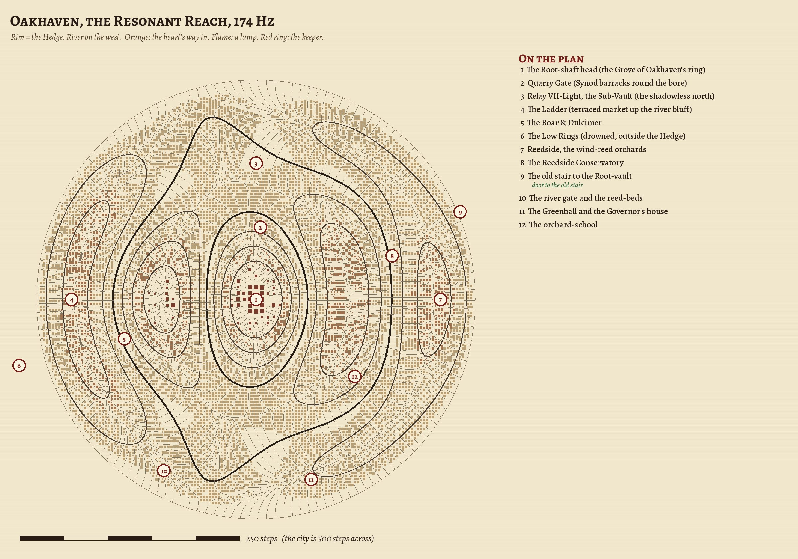

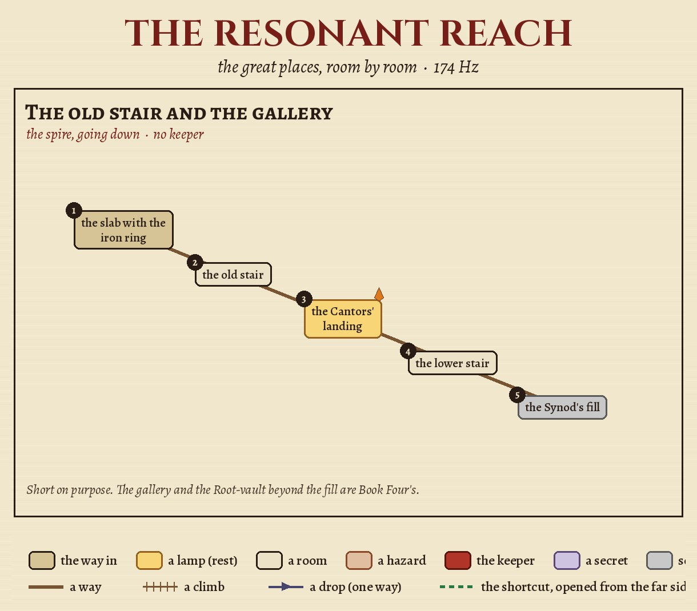

### The old stair and the gallery
*the spire, going down; keeper: none.* Short on purpose. The gallery and the Root-vault beyond the fill are Book Four's.

1. **the slab with the iron ring** (the way in): in the orchard wall's corner where the Hedge meets it, east side of town.
2. **the old stair**: narrow, spiral, older than the Conservatory; tending-marks cut at every turn.
3. **the Cantors' landing** (lamp): a hush-lamp in a niche; the five-note lullaby scratched above it.
4. **the lower stair**: colder at every turn; the walls sweat.
5. **the Synod's fill** (seen, not entered): packed earth and rubble; through it, faintly, one note held by a hundred thousand roots.

*Ways:* the slab with the iron ring to the old stair; the old stair to the Cantors' landing; the Cantors' landing to the lower stair; the lower stair to the Synod's fill.

---

## The Dawning Heights (528 Hz)

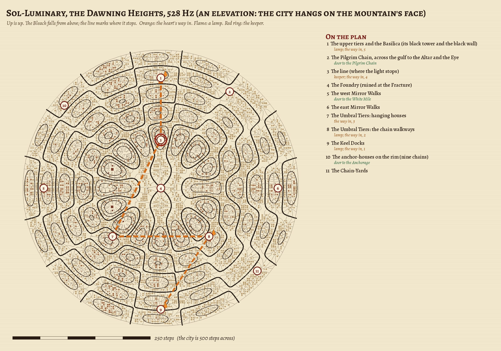

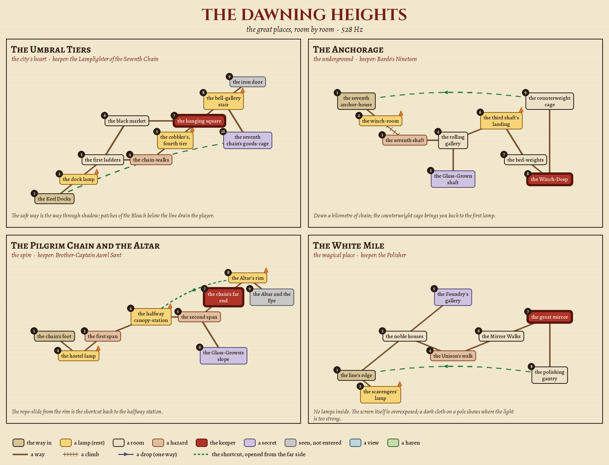

### The Umbral Tiers
*the city's heart; keeper: the Lamplighter of the Seventh Chain.* The safe way is the way through shadow; patches of the Bleach below the line drain the player.

1. **the Keel Docks** (the way in): the winch-boats come up through the cloud deck here.
2. **the dock lamp** (lamp): a shade-lamp in the harbour-master's doorway.
3. **the first ladders**: iron rungs up through the hanging houses; in by one window, out by another.
4. **the chain-walks** (hazard): walkways slung on chains over two thousand feet of air; a jerk throws you.
5. **the cobbler's, fourth tier** (lamp): a shade-lamp; the cobbler mends boots for the chain-walks.
6. **the black market**: stalls under black canvas; the only mirror in the Tiers, sold under a cloth.
7. **the hanging square** (the keeper): a square slung on four chains; the Lamplighter's glass-fire lets the Bleach in.
8. **the bell-gallery stair** (lamp): under the Basilica's black wall.
9. **the iron door** (seen, not entered): man-high, studded, in the middle of the black wall: the line.
10. **the seventh chain's goods-cage** (secret): winched from the anchor-house; the way back down.

*Ways:* the Keel Docks to the dock lamp; the dock lamp to the first ladders; the first ladders to the chain-walks; the chain-walks to the cobbler's, fourth tier; the first ladders to the black market; the black market to the hanging square; the cobbler's, fourth tier to the hanging square; the hanging square to the bell-gallery stair; the bell-gallery stair to the iron door; the bell-gallery stair to the seventh chain's goods-cage; the seventh chain's goods-cage to the Keel Docks (**the shortcut**, opened from the far side).

### The Anchorage
*the underground; keeper: Bardo's Nineteen.* Down a kilometre of chain; the counterweight cage brings you back to the first lamp.

1. **the seventh anchor-house** (the way in): on the city's rim; the chain goes into the mountain here.
2. **the winch-room** (lamp): Bardo's tally of nineteen cut in the housing.
3. **the seventh shaft** (hazard): down the chain itself, link by link; jerks throw you.
4. **the tolling gallery**: all nine chains heard at once, never together.
5. **the Glass-Grown shaft** (secret): conscious bells standing in the dark, facing up.
6. **the third shaft's landing** (lamp).
7. **the bed-weights**: blocks of mountain as big as churches, hung on the chains' ends.
8. **the Winch-Deep** (the keeper): where the nine shafts meet; the Nineteen still haul on a chain made fast.
9. **the counterweight cage**: rides a shaft straight up.

*Ways:* the seventh anchor-house to the winch-room; the winch-room to the seventh shaft (a climb); the seventh shaft to the tolling gallery; the tolling gallery to the Glass-Grown shaft; the tolling gallery to the third shaft's landing; the third shaft's landing to the bed-weights; the bed-weights to the Winch-Deep; the Winch-Deep to the counterweight cage; the counterweight cage to the seventh anchor-house (**the shortcut**, opened from the far side).

### The Pilgrim Chain and the Altar
*the spire; keeper: Brother-Captain Aurel Sant.* The rope-slide from the rim is the shortcut back to the halfway station.

1. **the chain's foot** (the way in): the pilgrims' hostel: white robes in rows, black canopies stacked.
2. **the hostel lamp** (lamp).
3. **the first span** (hazard): in the open, in the Bleach; cross canopy to canopy.
4. **the halfway canopy-station** (lamp): a shelter of black canvas on an iron platform.
5. **the second span** (hazard): the dead hour is the safe hour.
6. **the Glass-Grown's slope** (secret): they stand facing the Eye and do not move unless sung near.
7. **the chain's far end** (the keeper): the Brother-Captain holds the steps with glass-fire.
8. **the Altar's rim** (lamp): black canopies round the rim.
9. **the Altar and the Eye** (seen, not entered): the Rite is Book Two's.

*Ways:* the chain's foot to the hostel lamp; the hostel lamp to the first span; the first span to the halfway canopy-station; the halfway canopy-station to the second span; the second span to the Glass-Grown's slope; the second span to the chain's far end; the chain's far end to the Altar's rim; the Altar's rim to the Altar and the Eye; the Altar's rim to the halfway canopy-station (**the shortcut**, opened from the far side).

### The White Mile
*the magical place; keeper: the Polisher.* No lamps inside. The screen itself is overexposed; a dark cloth on a pole shows where the light is too strong.

1. **the line's edge** (the way in): the scavengers' shelf; the only rest is here, in the shade.
2. **the scavengers' lamp** (lamp).
3. **the noble houses**: Houses Sancterre and Valmont-Lune, white to the bone.
4. **the Unison's walk** (hazard): forty voices, one mind; hide, be silent, break their sight.
5. **the Foundry's gallery** (secret): the third platform, where it happened.
6. **the Mirror Walks**: abandoned arrays; polishing gantries on rails.
7. **the great mirror** (the keeper): the Polisher keeps one mirror bright; its beam crosses the Walk.
8. **the polishing gantry**: runs on rails round the Walk.

*Ways:* the line's edge to the scavengers' lamp; the line's edge to the noble houses; the noble houses to the Unison's walk; the noble houses to the Foundry's gallery; the Unison's walk to the Mirror Walks; the Mirror Walks to the great mirror; the great mirror to the polishing gantry; the polishing gantry to the line's edge (**the shortcut**, opened from the far side).

### Smaller places

- **Sun-Peak Vigil:** the gate-bell; the cloister of twelve; the Abbess's cell; the sealed under-stair (does not open); the dusk-bell tower.
- **The Chalk Cliffs:** the cliff path; three ledges; the Vigil's bell heard as the timer; the top before dark.
- **The Basilica school:** the bench under the east window; the roll with seven years crossed through; the treble's practice-room.
- **The Bell Yard:** the yard under the bell-gallery; the ropes through the vault; the ringers' bench.
- **The cloud deck:** the winch-boat stage; the descent through cloud; the gulls' rock.
- **The valley farms:** terraces under black netting; the seasonal huts; the chain-foot store.
- **The nine anchor-houses:** each: a winch-room, a crew-bunk, a tally-wall; the seventh is the Anchorage's gate.
- **The Glass-Grown's slope:** a walk between them; do not sing.
- **The pilgrims' hostel:** the dormitory; the robing-room; the canopy store.
- **The Tiers' scavenger camp:** the shelf under the black wall; the cloth-poles; the trade-table.

---

## Cinderhold (285 Hz)

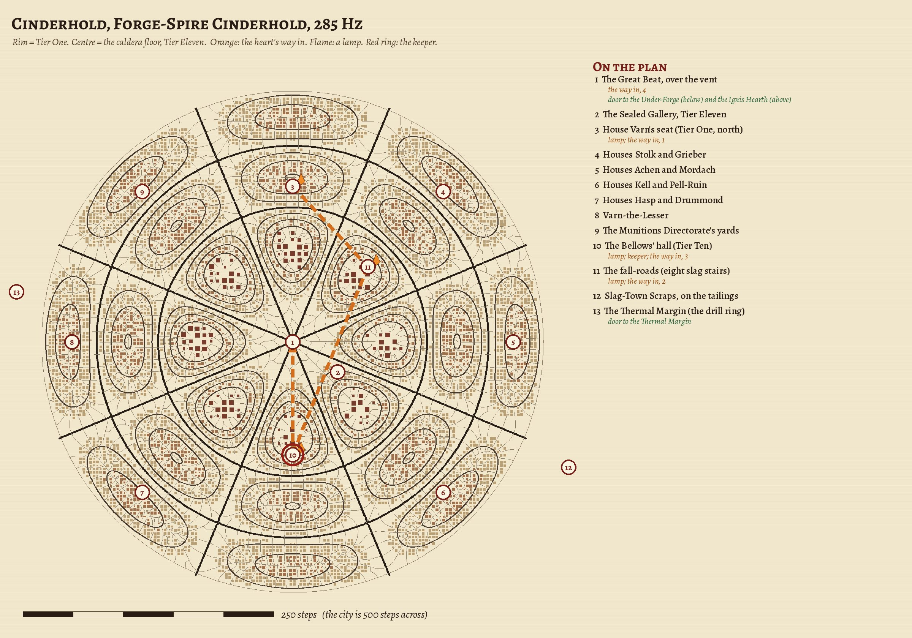

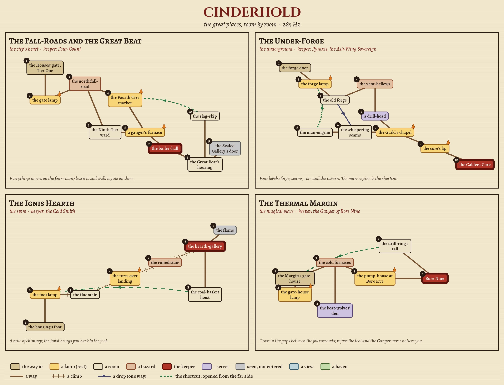

### The Fall-Roads and the Great Beat
*the city's heart; keeper: Four-Count.* Everything moves on the four-count; learn it and walk a gate on three.

1. **the Houses' gate, Tier One** (the way in): clean air; House Varn's seat above.
2. **the gate lamp** (lamp): a banked furnace-mouth.
3. **the north fall-road** (hazard): a slag surge blocks it on the count.
4. **the Fourth-Tier market** (lamp): the great ring road.
5. **the Ninth-Tier ward**: off the fall-road while the slag runs.
6. **a ganger's furnace** (lamp): Tier Nine.
7. **the boiler-hall** (the keeper): Four-Count's pack attacks on the beat; the Beat skips here.
8. **the Great Beat's housing**: the caldera floor.
9. **the Sealed Gallery's door** (seen, not entered): Thessa's mop and bucket; the engine heard through it.
10. **the slag-skip**: an ore-bucket on a cable.

*Ways:* the Houses' gate, Tier One to the gate lamp; the gate lamp to the north fall-road; the north fall-road to the Fourth-Tier market; the north fall-road to the Ninth-Tier ward; the Fourth-Tier market to a ganger's furnace; the Ninth-Tier ward to a ganger's furnace; a ganger's furnace to the boiler-hall; the boiler-hall to the Great Beat's housing; the Great Beat's housing to the Sealed Gallery's door; the Great Beat's housing to the slag-skip; the slag-skip to the Fourth-Tier market (**the shortcut**, opened from the far side).

### The Under-Forge
*the underground; keeper: Pyraxis, the Ash-Wing Sovereign.* Four levels: forge, seams, core and the cavern. The man-engine is the shortcut.

1. **the forge door** (the way in): under the caldera floor.
2. **the forge lamp** (lamp).
3. **the old forge**: golems of iron and basalt still at the anvils.
4. **the vent-bellows** (hazard): steam on the beat.
5. **a drill-head** (secret): break it and Pyraxis is calmer at the start.
6. **the whispering seams**: stand still against the glass and a pressed voice speaks.
7. **the Guild's chapel** (lamp): the Deep Guild's sign over the door.
8. **the man-engine**: a moving ladder of beams.
9. **the core's lip** (lamp).
10. **the Caldera Core** (the keeper): a cavern of lava-light; Pyraxis's nest.

*Ways:* the forge door to the forge lamp; the forge lamp to the old forge; the old forge to the vent-bellows; the vent-bellows to a drill-head; the old forge to the whispering seams (a drop, one way); the whispering seams to the Guild's chapel; a drill-head to the Guild's chapel; the Guild's chapel to the core's lip; the core's lip to the Caldera Core; the Guild's chapel to the man-engine; the man-engine to the forge lamp (**the shortcut**, opened from the far side).

### The Ignis Hearth
*the spire; keeper: the Cold Smith.* A mile of chimney; the hoist brings you back to the foot.

1. **the housing's foot** (the way in): the chimney rises from the Great Beat's housing.
2. **the foot lamp** (lamp).
3. **the flue stair**: iron, spiralling round the flue; hot.
4. **the turn-over landing** (lamp): halfway: here the heat turns over.
5. **the rimed stair** (hazard): fire is cold, frost blisters the hand.
6. **the hearth-gallery** (the keeper): the Cold Smith at a cold anvil; only the pale flame warms you.
7. **the flame** (seen, not entered): gone pale; Book Four's team will hear it ask.
8. **the coal-basket hoist**: a chain-hoist down the flue.

*Ways:* the housing's foot to the foot lamp; the foot lamp to the flue stair (a climb); the flue stair to the turn-over landing (a climb); the turn-over landing to the rimed stair (a climb); the rimed stair to the hearth-gallery (a climb); the hearth-gallery to the flame; the hearth-gallery to the coal-basket hoist; the coal-basket hoist to the foot lamp (**the shortcut**, opened from the far side).

### The Thermal Margin
*the magical place; keeper: the Ganger of Bore Nine.* Cross in the gaps between the four seconds; refuse the tool and the Ganger never notices you.

1. **the Margin's gate-house** (the way in): outside the caldera's rim.
2. **the gate-house lamp** (lamp).
3. **the cold furnaces** (hazard): holding heat to let it go later, somewhere else.
4. **the beat-wolves' den** (secret): a cold furnace where the pack sleeps.
5. **the pump-house at Bore Five** (lamp).
6. **Bore Nine** (the keeper): the F-sharp whistle on the hour; the nine hundred for four seconds; the Ganger offers a tool.
7. **the drill-ring's rail**: loops round the Margin.

*Ways:* the Margin's gate-house to the gate-house lamp; the Margin's gate-house to the cold furnaces; the cold furnaces to the beat-wolves' den; the cold furnaces to the pump-house at Bore Five; the pump-house at Bore Five to Bore Nine; Bore Nine to the drill-ring's rail; the drill-ring's rail to the Margin's gate-house (**the shortcut**, opened from the far side).

### Smaller places

- **Slag-Town Scraps:** the shanty lanes; the Bellows' soup-kitchen; the tailings edge.
- **The Tailings-Crawl:** the scrap-margin; the crawl's heart (a nest); what hunts it.
- **The Sealed Gallery:** the corridor; Thessa's bucket; the door (does not open).
- **The Bellows' hall:** the old boiler; the names on the wall; the vote-board.
- **Kell's chapel:** the furnace-mouth chapel; the debt-fire; Kell's pulpit.
- **House Varn's counting-house:** the front office; the munitions ledger; Edda Varn's room.
- **The Munitions Directorate's yards:** the casting halls; the shell store; the guard-house (a stronghold).
- **The beat-wolves' den:** the cold furnace; the pack's bones; the way out under the grate.
- **The First Stop's hammer:** the quarry under Tier Two; the cracked hammer-head; the inscription.
- **Pyraxis's old ledges:** the climb up the caldera wall; three ledges; the pulled drill-tooth.
- **The slag-wine cellars:** the tap-room; the barrel vaults; the listening-wall.

---

## The Iron Peaks (396 Hz)

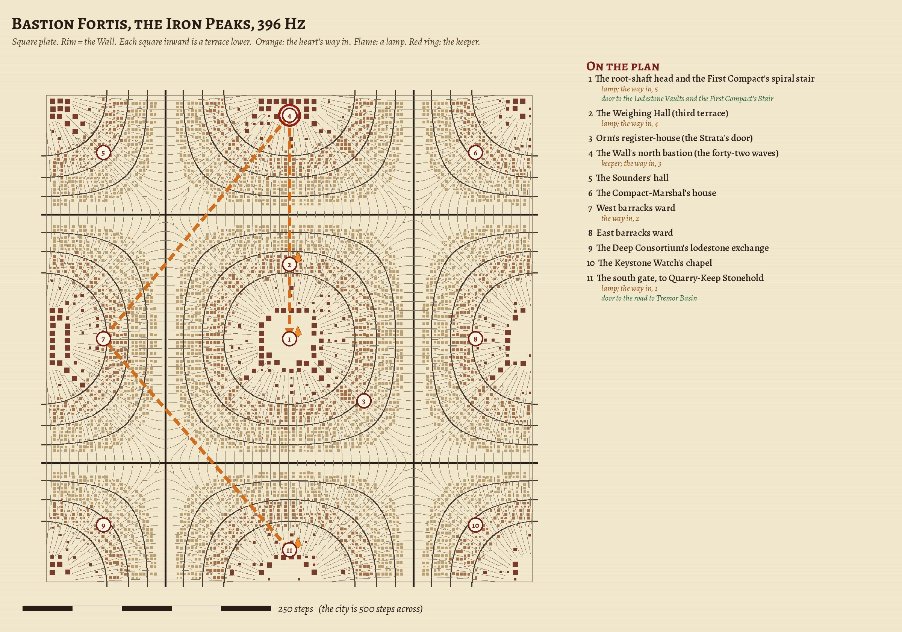

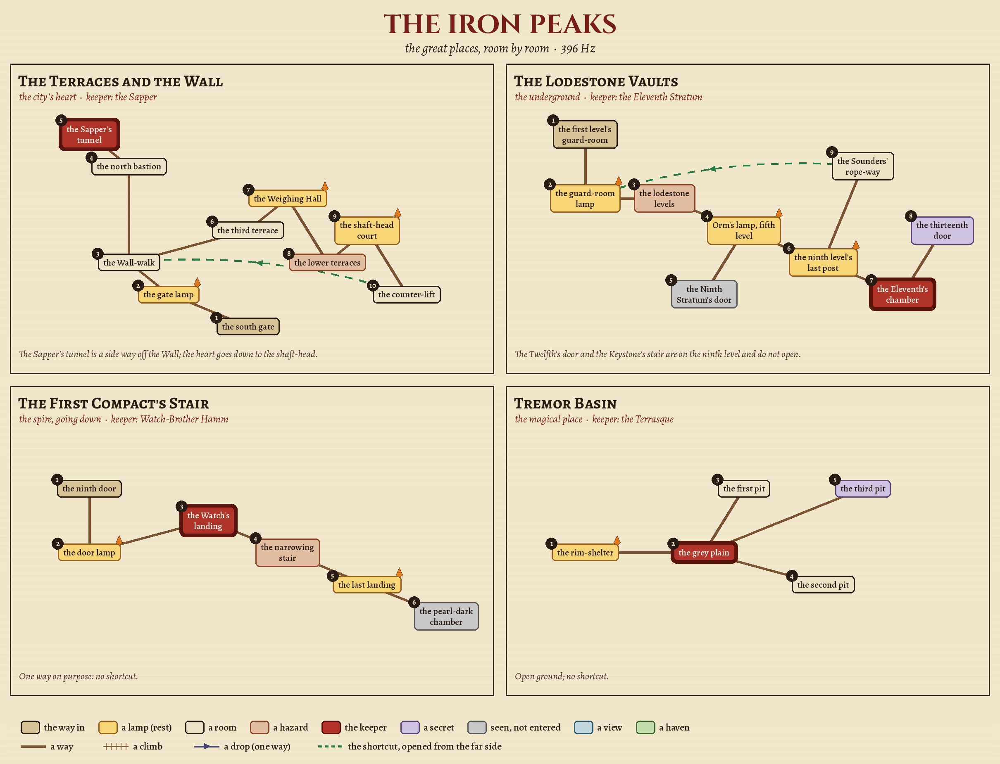

### The Terraces and the Wall
*the city's heart; keeper: the Sapper.* The Sapper's tunnel is a side way off the Wall; the heart goes down to the shaft-head.

1. **the south gate** (the way in): the mountain road from Quarry-Keep.
2. **the gate lamp** (lamp): a calibrated weight on a chain over a lamp.
3. **the Wall-walk**: rain-swept battlements; sentries tap the floor.
4. **the north bastion**: facing the passes.
5. **the Sapper's tunnel** (the keeper): under the north bastion; the roof comes down as it severs intervals.
6. **the third terrace**: the stairs between terraces are at the corners: a square spiral.
7. **the Weighing Hall** (lamp): tens of thousands of names and weights.
8. **the lower terraces** (hazard): heavier at every terrace.
9. **the shaft-head court** (lamp): the root-shaft and the First Compact's door.
10. **the counter-lift**: a cage balanced by a stone.

*Ways:* the south gate to the gate lamp; the gate lamp to the Wall-walk; the Wall-walk to the north bastion; the north bastion to the Sapper's tunnel; the Wall-walk to the third terrace; the third terrace to the Weighing Hall; the Weighing Hall to the lower terraces; the lower terraces to the shaft-head court; the shaft-head court to the counter-lift; the counter-lift to the Wall-walk (**the shortcut**, opened from the far side).

### The Lodestone Vaults
*the underground; keeper: the Eleventh Stratum.* The Twelfth's door and the Keystone's stair are on the ninth level and do not open.

1. **the first level's guard-room** (the way in): off the shaft-head court.
2. **the guard-room lamp** (lamp).
3. **the lodestone levels** (hazard): the floor is not always down; tap for soft floor.
4. **Orm's lamp, fifth level** (lamp): the Register of the Strata.
5. **the Ninth Stratum's door** (seen, not entered): 10,006 rows of tally-marks; Book Four's.
6. **the ninth level's last post** (lamp).
7. **the Eleventh's chamber** (the keeper): it walks its circle; stop it at the crack's pitch.
8. **the thirteenth door** (secret): a wall with the first Warden's mark and nothing behind it.
9. **the Sounders' rope-way**: up the root-shaft.

*Ways:* the first level's guard-room to the guard-room lamp; the guard-room lamp to the lodestone levels; the lodestone levels to Orm's lamp, fifth level; Orm's lamp, fifth level to the Ninth Stratum's door; Orm's lamp, fifth level to the ninth level's last post; the ninth level's last post to the Eleventh's chamber; the Eleventh's chamber to the thirteenth door; the ninth level's last post to the Sounders' rope-way; the Sounders' rope-way to the guard-room lamp (**the shortcut**, opened from the far side).

### The First Compact's Stair
*the spire, going down; keeper: Watch-Brother Hamm.* One way on purpose: no shortcut.

1. **the ninth door** (the way in): kept by the Keystone Watch.
2. **the door lamp** (lamp).
3. **the Watch's landing** (the keeper): in Hamm's circle nothing is pushed or thrown.
4. **the narrowing stair** (hazard): every step higher than the last; the pack heavier at each turn.
5. **the last landing** (lamp).
6. **the pearl-dark chamber** (seen, not entered): the Keystone, an inch off the floor.

*Ways:* the ninth door to the door lamp; the door lamp to the Watch's landing; the Watch's landing to the narrowing stair; the narrowing stair to the last landing; the last landing to the pearl-dark chamber.

### Tremor Basin
*the magical place; keeper: the Terrasque.* Open ground; no shortcut.

1. **the rim-shelter** (lamp): a drover's stone hut.
2. **the grey plain** (the keeper): it burrows every fifteen seconds and comes up under the hardest hitter.
3. **the first pit**: a village sunk to its bell-tower's top.
4. **the second pit**: the same depth, exactly.
5. **the third pit** (secret): lead it in here and it must come up the way it went down.

*Ways:* the rim-shelter to the grey plain; the grey plain to the first pit; the grey plain to the second pit; the grey plain to the third pit.

### Smaller places

- **Quarry-Keep Stonehold:** the hoist-yard (lodestone tied down); the pits; the fault edge; Dalla's post.
- **The floating fields:** the plank bridges; stones the size of houses in the mist; the miners' hut.
- **Coldharrow:** the Sounders' cottages; the rod-forge; the tap-board.
- **Greystairs:** the stair-street up the cliff; Greer's birth-house; the top well.
- **The standing dead of the Long Road:** the road; the niches; the last niche, empty.
- **The Weighing Hall:** the walls of names; the pan; the calibrated masses.
- **The Deep Consortium's exchange:** the weigh-floor; Factor Rike's office; the strong-room.
- **The Sounders' hall:** the rod-racks; the tap-board; the captain's table.
- **The fourteenth chamber:** a thirteenth door, behind the Strata, to nothing (Book Five's).

---

## The Shifting Dunes (417 Hz)

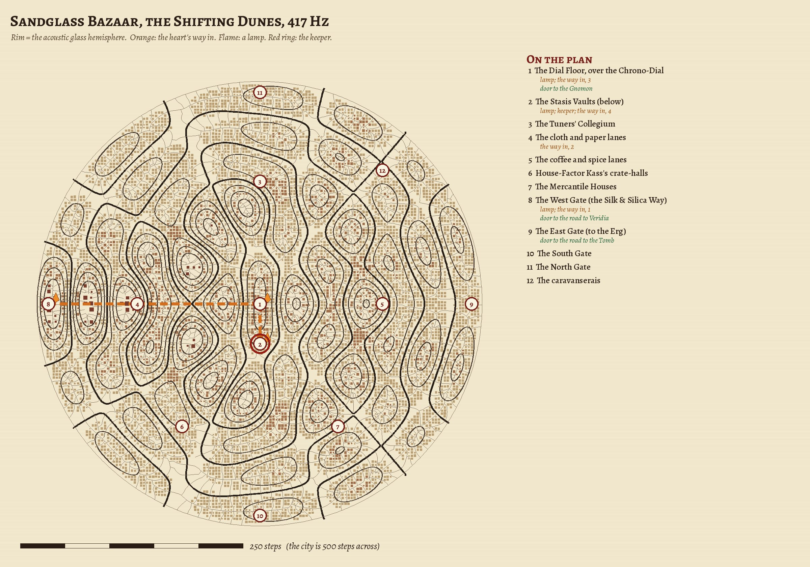

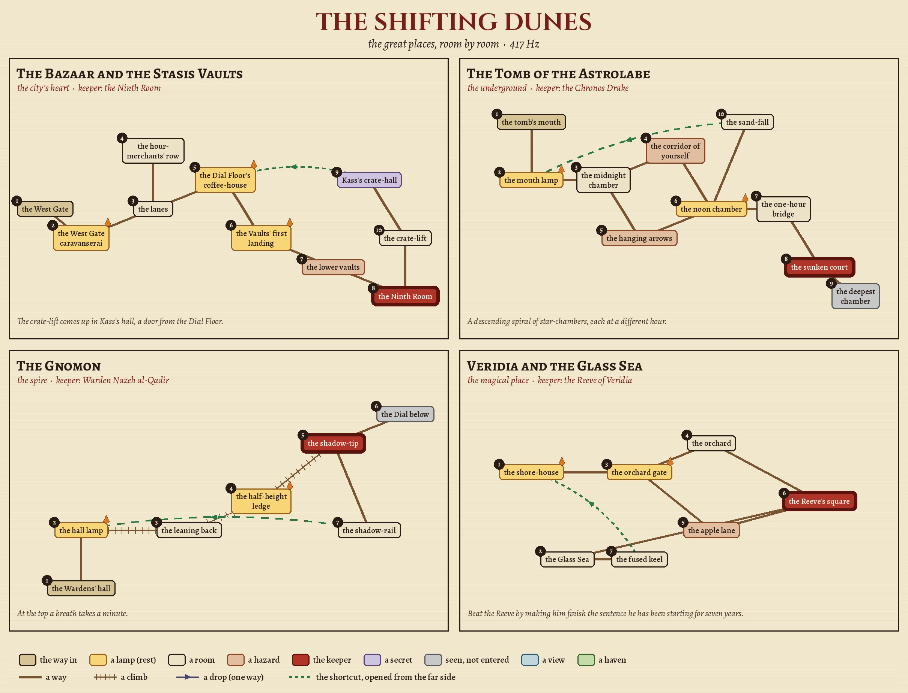

### The Bazaar and the Stasis Vaults
*the city's heart; keeper: the Ninth Room.* The crate-lift comes up in Kass's hall, a door from the Dial Floor.

1. **the West Gate** (the way in): with a caravan, on the Silk & Silica Way.
2. **the West Gate caravanserai** (lamp): an hourglass lamp.
3. **the lanes**: a lattice; struck and re-pitched on Dial Day.
4. **the hour-merchants' row**: red awnings; beads in trays.
5. **the Dial Floor's coffee-house** (lamp).
6. **the Vaults' first landing** (lamp): crates that hold a moment.
7. **the lower vaults** (hazard): stasis leaks: for a moment it is nine years ago.
8. **the Ninth Room** (the keeper): time runs backwards; open the far door first.
9. **Kass's crate-hall** (secret): her client list; a crate with a person in it.
10. **the crate-lift**.

*Ways:* the West Gate to the West Gate caravanserai; the West Gate caravanserai to the lanes; the lanes to the hour-merchants' row; the lanes to the Dial Floor's coffee-house; the Dial Floor's coffee-house to the Vaults' first landing; the Vaults' first landing to the lower vaults; the lower vaults to the Ninth Room; the Ninth Room to the crate-lift; the crate-lift to Kass's crate-hall; Kass's crate-hall to the Dial Floor's coffee-house (**the shortcut**, opened from the far side).

### The Tomb of the Astrolabe
*the underground; keeper: the Chronos Drake.* A descending spiral of star-chambers, each at a different hour.

1. **the tomb's mouth** (the way in): in the Hourglass Erg.
2. **the mouth lamp** (lamp).
3. **the midnight chamber**: stars set to midnight.
4. **the corridor of yourself** (hazard): you, a few seconds ahead, coming the other way.
5. **the hanging arrows** (hazard): they wait for you to step where they land.
6. **the noon chamber** (lamp).
7. **the one-hour bridge**: only there at one hour.
8. **the sunken court** (the keeper): the Drake rewinds its wounds; strike while it rewinds.
9. **the deepest chamber** (seen, not entered): the doctrine: Book Five's.
10. **the sand-fall**: the Erg's sand pours down a shaft.

*Ways:* the tomb's mouth to the mouth lamp; the mouth lamp to the midnight chamber; the midnight chamber to the corridor of yourself; the midnight chamber to the hanging arrows; the corridor of yourself to the noon chamber; the hanging arrows to the noon chamber; the noon chamber to the one-hour bridge; the one-hour bridge to the sunken court; the sunken court to the deepest chamber; the noon chamber to the sand-fall; the sand-fall to the mouth lamp (**the shortcut**, opened from the far side).

### The Gnomon
*the spire; keeper: Warden Nazeh al-Qadir.* At the top a breath takes a minute.

1. **the Wardens' hall** (the way in): looms of time, cut threads.
2. **the hall lamp** (lamp).
3. **the leaning back**: the Wardens' steps up the gnomon.
4. **the half-height ledge** (lamp): time thins.
5. **the shadow-tip** (the keeper): the Warden cuts seconds out of your swings.
6. **the Dial below** (seen, not entered): its hand moves backward a moment, and forward.
7. **the shadow-rail**: a rope down the shadow-line to the Dial Floor.

*Ways:* the Wardens' hall to the hall lamp; the hall lamp to the leaning back (a climb); the leaning back to the half-height ledge (a climb); the half-height ledge to the shadow-tip (a climb); the shadow-tip to the Dial below; the shadow-tip to the shadow-rail; the shadow-rail to the hall lamp (**the shortcut**, opened from the far side).

### Veridia and the Glass Sea
*the magical place; keeper: the Reeve of Veridia.* Beat the Reeve by making him finish the sentence he has been starting for seven years.

1. **the shore-house** (lamp): on the Glass Sea.
2. **the Glass Sea**: walkable green glass; ships fused in it.
3. **the orchard gate** (lamp).
4. **the orchard**: fruit falls and grows and falls again.
5. **the apple lane** (hazard): the same twenty-four seconds; nothing you change lasts.
6. **the Reeve's square** (the keeper): his fight repeats every twenty-four seconds.
7. **the fused keel**: a ship's keel bridges the glass back to the shore.

*Ways:* the shore-house to the orchard gate; the orchard gate to the orchard; the orchard gate to the apple lane; the orchard to the Reeve's square; the apple lane to the Reeve's square; the Reeve's square to the Glass Sea; the Glass Sea to the fused keel; the fused keel to the shore-house (**the shortcut**, opened from the far side).

### Smaller places

- **Mirage Rest:** the caravanserai; Hanne's room, kept as it was; the well.
- **The Collegium archive:** the reading-room; Hanne's journal in nine entries; the certifiers' desks.
- **The Silk & Silica Way:** wells a day apart, each with a singing glass marker.
- **The singing dunes:** the field of dunes; the fifth on still days, the tritone in storm.
- **The silica adders' nest:** glass growing out of sand like reeds; the nest-hollow.
- **The hour-merchants' row:** the stalls; the certifier's booth; the buyers' bench.
- **The Loom-Wardens' hall:** the looms; the cut-thread room; the Warden's door to the Gnomon.
- **The receipt-house:** shelves of effects that came before their causes; the clerk.
- **The stored house:** Kass's crate with a person in it; the term on the lid (a secret).

---

## The Rust Coast (639 Hz)

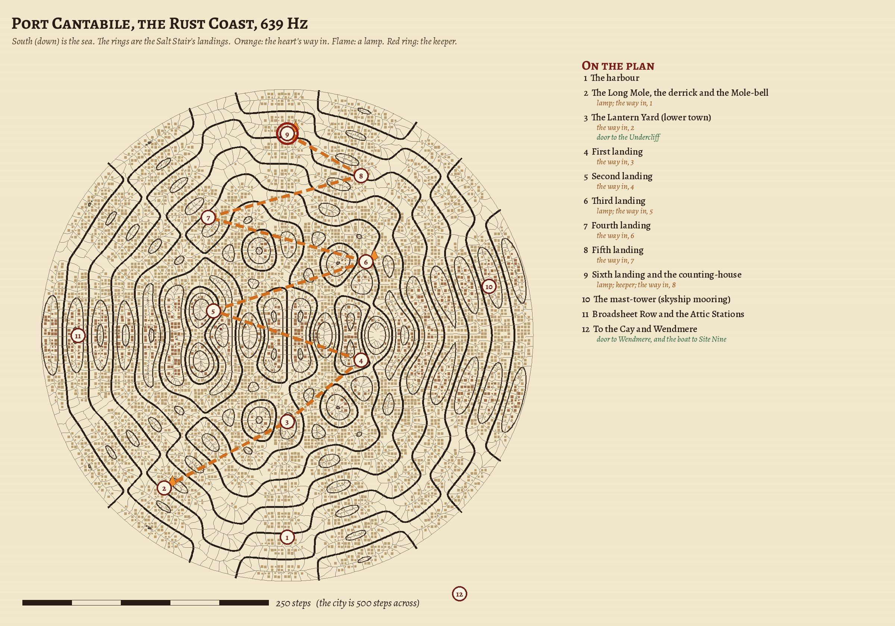

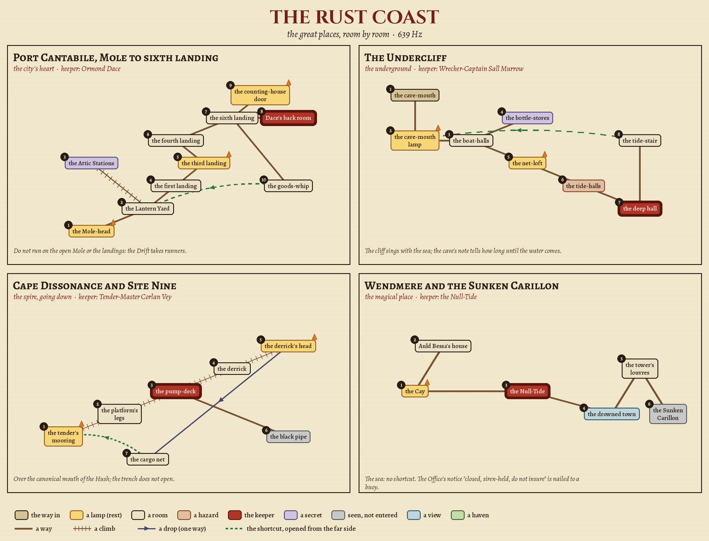

### Port Cantabile, Mole to sixth landing
*the city's heart; keeper: Ormond Dace.* Do not run on the open Mole or the landings: the Drift takes runners.

1. **the Mole-head** (lamp): the derrick and the Mole-bell; a lantern on a bell-hook.
2. **the Lantern Yard**: alleys, Hesper's four houses; safe to run here.
3. **the Attic Stations** (secret): over the roofs: Wren of the Attic's dial.
4. **the first landing**: the Salt Stair begins (built).
5. **the third landing** (lamp).
6. **the fourth landing**: the widow who will not sell (built).
7. **the sixth landing**: Dace's shop.
8. **Dace's back room** (the keeper): racks of unlabelled bottles: a real voice, a mimic, a quiet.
9. **the counting-house door** (lamp): (built).
10. **the goods-whip**: a rope-and-pulley hoist down the cliff.

*Ways:* the Mole-head to the Lantern Yard; the Lantern Yard to the Attic Stations (a climb); the Lantern Yard to the first landing; the first landing to the third landing; the third landing to the fourth landing; the fourth landing to the sixth landing; the sixth landing to Dace's back room; the sixth landing to the counting-house door; the sixth landing to the goods-whip; the goods-whip to the Lantern Yard (**the shortcut**, opened from the far side).

### The Undercliff
*the underground; keeper: Wrecker-Captain Sall Murrow.* The cliff sings with the sea; the cave's note tells how long until the water comes.

1. **the cave-mouth** (the way in): under the Lantern Yard.
2. **the cave-mouth lamp** (lamp).
3. **the boat-halls**: bottle-boats and salvors' boats.
4. **the bottle-stores** (secret): racks of bottles kept back from the trade.
5. **the net-loft** (lamp): bell-buoys stored; shriek-motes cluster on them.
6. **the tide-halls** (hazard): the tide fills them twice a day; listen to the cave's key.
7. **the deep hall** (the keeper): Murrow's boats; the water rises through the fight.
8. **the tide-stair**: barred from below; up to a trap in the Lantern Yard.

*Ways:* the cave-mouth to the cave-mouth lamp; the cave-mouth lamp to the boat-halls; the boat-halls to the bottle-stores; the boat-halls to the net-loft; the net-loft to the tide-halls; the tide-halls to the deep hall; the deep hall to the tide-stair; the tide-stair to the cave-mouth lamp (**the shortcut**, opened from the far side).

### Cape Dissonance and Site Nine
*the spire, going down; keeper: Tender-Master Corlan Vey.* Over the canonical mouth of the Hush; the trench does not open.

1. **the tender's mooring** (lamp): reached by boat from the Cape.
2. **the platform's legs**: four iron legs over the trench lip.
3. **the pump-deck** (the keeper): thirty-eight Hollows at the pumps; Vey ties up on the quarter-day; do not run.
4. **the derrick**: up in the wind, on the stutter.
5. **the derrick's head** (lamp).
6. **the black pipe** (seen, not entered): it draws; nobody cuts it (Book Four).
7. **the cargo net**: down from the head to the mooring.

*Ways:* the tender's mooring to the platform's legs (a climb); the platform's legs to the pump-deck (a climb); the pump-deck to the derrick (a climb); the derrick to the derrick's head (a climb); the pump-deck to the black pipe; the derrick's head to the cargo net (a drop, one way); the cargo net to the tender's mooring (**the shortcut**, opened from the far side).

### Wendmere and the Sunken Carillon
*the magical place; keeper: the Null-Tide.* The sea: no shortcut. The Office's notice "closed, siren-held, do not insure" is nailed to a buoy.

1. **the Cay** (lamp): a lantern on the children's bell-hooks.
2. **Auld Bessa's house**: on stilts; learn the reef's key from her.
3. **the Null-Tide** (the keeper): the sea forgets its surface; cross by ear.
4. **the drowned town** (a view): streets and a square under the water.
5. **the tower's louvres**: dive at slack tide; the bells forty feet down.
6. **the Sunken Carillon** (seen, not entered): siren-held; the Chime and Sirena are Book Two's.

*Ways:* the Cay to Auld Bessa's house; the Cay to the Null-Tide; the Null-Tide to the drowned town; the drowned town to the tower's louvres; the tower's louvres to the Sunken Carillon.

### Smaller places

- **Auld Bessa's house:** the stilt-house; the apprentices' loft; the listening-step over the water.
- **The Attic Stations:** over the roofs; the dial-room; the aerial wires.
- **Broadsheet Row:** four presses; Cosimo Pell's room; the libel-board.
- **The Siren Shallows:** sand-bars at low water; the readers' school-rock.
- **The Roaring Strait:** the cliff-top masts; the wreckers' look-out.
- **The jelly-shore:** the beach of blue jelly hulls; the salvors' huts.
- **The salvage-wrecks of the Strait:** three hulks on the rocks; one with its hold still sealed.
- **Site Nine's survey store:** under the counting-house; the Prior's papers (a secret).

---

## The Spectral Woods (741 Hz)

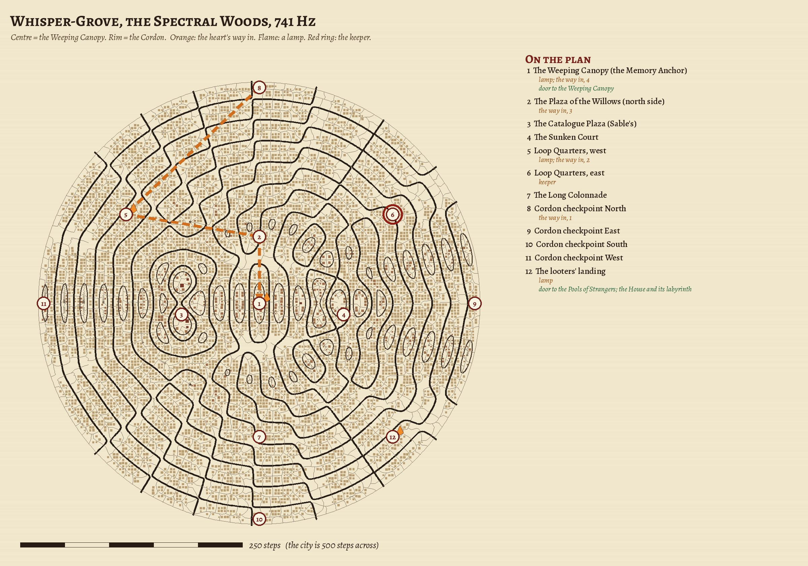

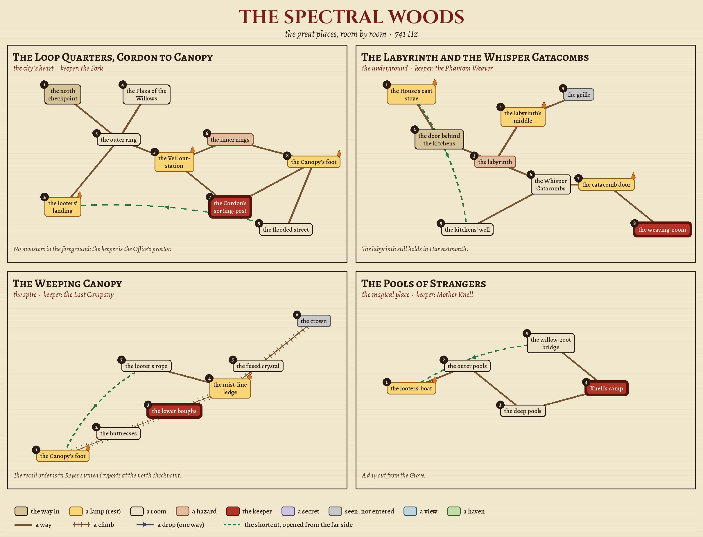

### The Loop Quarters, Cordon to Canopy
*the city's heart; keeper: the Fork.* No monsters in the foreground: the keeper is the Office's proctor.

1. **the north checkpoint** (the way in): Reyes's; papers, a bribe, or the looters' water-way.
2. **the looters' landing** (lamp): a scriptorium stove on a raft.
3. **the outer ring**: houses with open doors; meals three years old.
4. **the Plaza of the Willows**: the woman in the doorway; the boy by the fountain (planned, Phase 81).
5. **the Veil out-station** (lamp): a stove and a slate.
6. **the inner rings** (hazard): your map forgets what you have not written down.
7. **the Cordon's sorting-post** (the keeper): eight seconds of the fork takes a song.
8. **the Canopy's foot** (lamp).
9. **the flooded street**: a looters' punt-way.

*Ways:* the north checkpoint to the outer ring; the looters' landing to the outer ring; the outer ring to the Plaza of the Willows; the outer ring to the Veil out-station; the Veil out-station to the inner rings; the Veil out-station to the Cordon's sorting-post; the inner rings to the Canopy's foot; the Cordon's sorting-post to the Canopy's foot; the Canopy's foot to the flooded street; the flooded street to the looters' landing (**the shortcut**, opened from the far side).

### The Labyrinth and the Whisper Catacombs
*the underground; keeper: the Phantom Weaver.* The labyrinth still holds in Harvestmonth.

1. **the House's east stove** (lamp): the scriptorium (the Mausoleum, built).
2. **the door behind the kitchens** (the way in).
3. **the labyrinth** (hazard): cut to a silencing chord: no sound at all; find the way by where sound stops.
4. **the labyrinth's middle** (lamp).
5. **the grille** (seen, not entered): the stacks: the Canopy's roots and the archived dead; Book Four's.
6. **the Whisper Catacombs**: niches five deep; lilac thread across the skulls.
7. **the catacomb door** (lamp).
8. **the weaving-room** (the keeper): the catalogue, with your own name in it.
9. **the kitchens' well**: drops from the House into the catacombs.

*Ways:* the House's east stove to the door behind the kitchens; the door behind the kitchens to the labyrinth; the labyrinth to the labyrinth's middle; the labyrinth's middle to the grille; the labyrinth to the Whisper Catacombs; the Whisper Catacombs to the catacomb door; the catacomb door to the weaving-room; the Whisper Catacombs to the kitchens' well; the kitchens' well to the House's east stove (**the shortcut**, opened from the far side).

### The Weeping Canopy
*the spire; keeper: the Last Company.* The recall order is in Reyes's unread reports at the north checkpoint.

1. **the Canopy's foot** (lamp).
2. **the buttresses**: roots like towers; the climb begins.
3. **the lower boughs** (the keeper): Mourn-Echoes fighting three years; read them the recall order.
4. **the mist-line ledge** (lamp): out above the lilac mist.
5. **the fused crystal**: the names louder as you climb.
6. **the crown** (seen, not entered): the Chorister says a name, the next, and stops.
7. **the looter's rope**: from the ledge to the foot.

*Ways:* the Canopy's foot to the buttresses (a climb); the buttresses to the lower boughs (a climb); the lower boughs to the mist-line ledge (a climb); the mist-line ledge to the fused crystal (a climb); the fused crystal to the crown (a climb); the mist-line ledge to the looter's rope; the looter's rope to the Canopy's foot (**the shortcut**, opened from the far side).

### The Pools of Strangers
*the magical place; keeper: Mother Knell.* A day out from the Grove.

1. **the looters' boat** (lamp): at the garden's edge.
2. **the outer pools**: a kitchen, a wedding, a road: strangers' memories.
3. **the deep pools**: find the house a memory shows and its Hollow says a word more.
4. **Knell's camp** (the keeper): her chimes answer honestly, and then ask.
5. **the willow-root bridge**: across the central pool.

*Ways:* the looters' boat to the outer pools; the outer pools to the deep pools; the deep pools to Knell's camp; Knell's camp to the willow-root bridge; the willow-root bridge to the looters' boat (**the shortcut**, opened from the far side).

### Smaller places

- **The Cordon's four checkpoints:** each: a barrier, a tally-board, a mess-tent; Reyes's reports at the north.
- **The Cloister of the Lost Choir:** the stalls with names cut in; the sub-prior's cell; the bell-less tower.
- **The Fading at Ash Ford:** the ford; the field; the veterans' bench. No combat; only the scene.
- **The looters' landing and the bone-chime market:** the raft-camp; the chime-stall; the hand-cant board.
- **The House's out-buildings:** the barn; the scribes' hiding-loft; the ink-store.

---

## The Continental Rift (852 Hz)

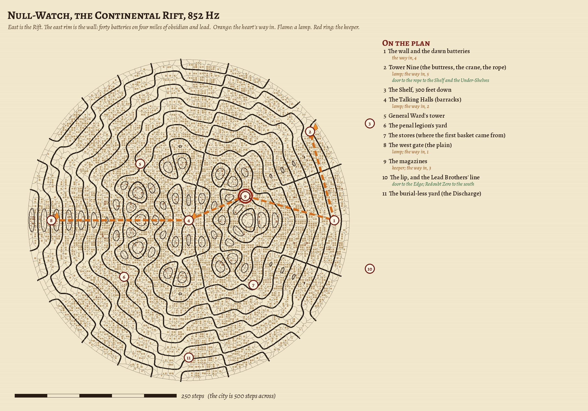

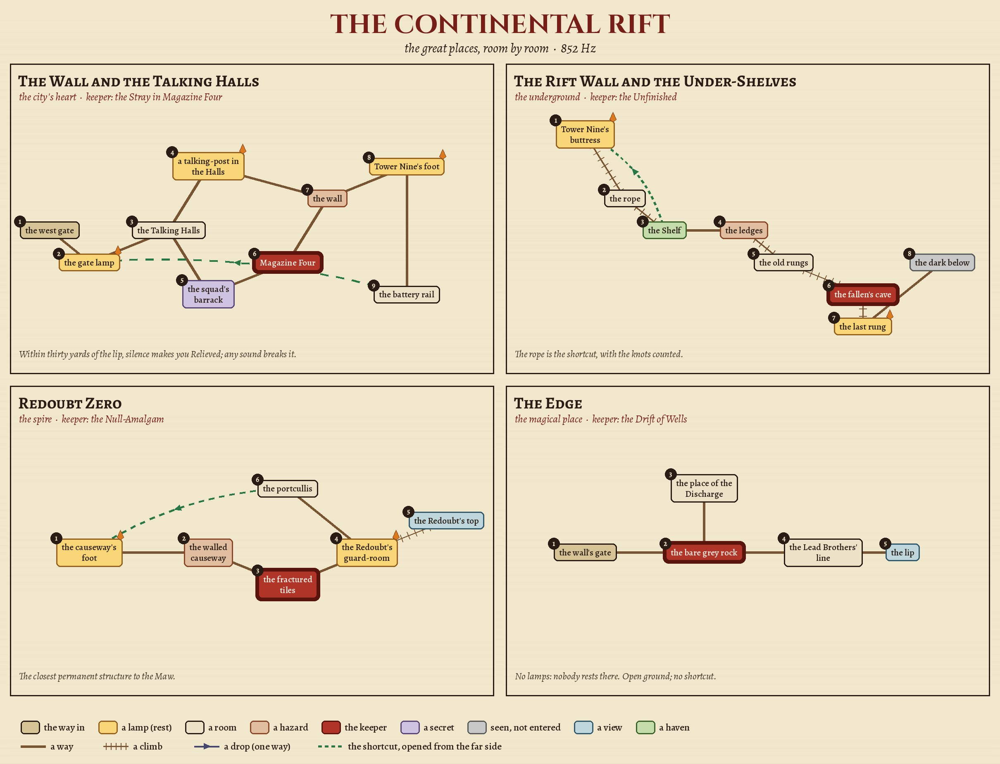

### The Wall and the Talking Halls
*the city's heart; keeper: the Stray in Magazine Four.* Within thirty yards of the lip, silence makes you Relieved; any sound breaks it.

1. **the west gate** (the way in): off the plain.
2. **the gate lamp** (lamp): a talking-post.
3. **the Talking Halls**: so loud your own sounds are lost.
4. **a talking-post in the Halls** (lamp).
5. **the squad's barrack** (secret): the lullaby's words in a footlocker.
6. **Magazine Four** (the keeper): the Stray says its lullaby among the powder.
7. **the wall** (hazard): battery to battery; within thirty yards, keep talking.
8. **Tower Nine's foot** (lamp): the buttress, the crane, the rope.
9. **the battery rail**: an ammunition trolley-line.

*Ways:* the west gate to the gate lamp; the gate lamp to the Talking Halls; the Talking Halls to a talking-post in the Halls; the Talking Halls to the squad's barrack; the squad's barrack to Magazine Four; a talking-post in the Halls to the wall; Magazine Four to the wall; the wall to Tower Nine's foot; Tower Nine's foot to the battery rail; the battery rail to the gate lamp (**the shortcut**, opened from the far side).

### The Rift Wall and the Under-Shelves
*the underground; keeper: the Unfinished.* The rope is the shortcut, with the knots counted.

1. **Tower Nine's buttress** (lamp).
2. **the rope**: one knot for each descent.
3. **the Shelf** (haven): the Rendered say their name and what was taken; the biscuit tin.
4. **the ledges** (hazard): gravewells drift; watch the moths.
5. **the old rungs**: iron rungs older than the Watch.
6. **the fallen's cave** (the keeper): unfinished sentences; finish each one.
7. **the last rung** (lamp).
8. **the dark below** (seen, not entered): what is growing there.

*Ways:* Tower Nine's buttress to the rope (a climb); the rope to the Shelf (a climb); the Shelf to the ledges; the ledges to the old rungs (a climb); the old rungs to the fallen's cave (a climb); the fallen's cave to the last rung (a climb); the last rung to the dark below; the Shelf to Tower Nine's buttress (**the shortcut**, opened from the far side).

### Redoubt Zero
*the spire; keeper: the Null-Amalgam.* The closest permanent structure to the Maw.

1. **the causeway's foot** (lamp): the ninety posts of the rotation road behind.
2. **the walled causeway** (hazard): along the southern lip; keep talking.
3. **the fractured tiles** (the keeper): it eats the floor's agreement to exist.
4. **the Redoubt's guard-room** (lamp).
5. **the Redoubt's top** (a view): you look at the Maw and forget that you were looking.
6. **the portcullis**: raised from inside.

*Ways:* the causeway's foot to the walled causeway; the walled causeway to the fractured tiles; the fractured tiles to the Redoubt's guard-room; the Redoubt's guard-room to the Redoubt's top (a climb); the Redoubt's guard-room to the portcullis; the portcullis to the causeway's foot (**the shortcut**, opened from the far side).

### The Edge
*the magical place; keeper: the Drift of Wells.* No lamps: nobody rests there. Open ground; no shortcut.

1. **the wall's gate** (the way in).
2. **the bare grey rock** (the keeper): gravewells wander; insects avoid the air above them.
3. **the place of the Discharge**: where the garrison stops talking for three breaths.
4. **the Lead Brothers' line**: they do not intervene for anyone not theirs.
5. **the lip** (a view): the land stops; Dawning glass is silent here; dawn: the Refusal over you.

*Ways:* the wall's gate to the bare grey rock; the bare grey rock to the place of the Discharge; the bare grey rock to the Lead Brothers' line; the Lead Brothers' line to the lip.

### Smaller places

- **The Shelf:** the fire; the biscuit tin; the rope's foot; the far end where the Hollows sit.
- **The Discharge yard:** the yard; the General's place; no graves.
- **The batteries:** forty posts on the wall; each with a talk-roster.
- **The Quartermaster's stores:** the store-room; the basket-shelf; the knot-book.
- **The Chaplain's cell:** under Tower Three; sealed since 318; the writing-table (a secret).
- **The plain's camp:** the mooring-field four miles out; a sutler's tent.
- **The rotation road:** ninety posts, one a day, to the Redoubt.

---

## The Middle Country (the Keynote)

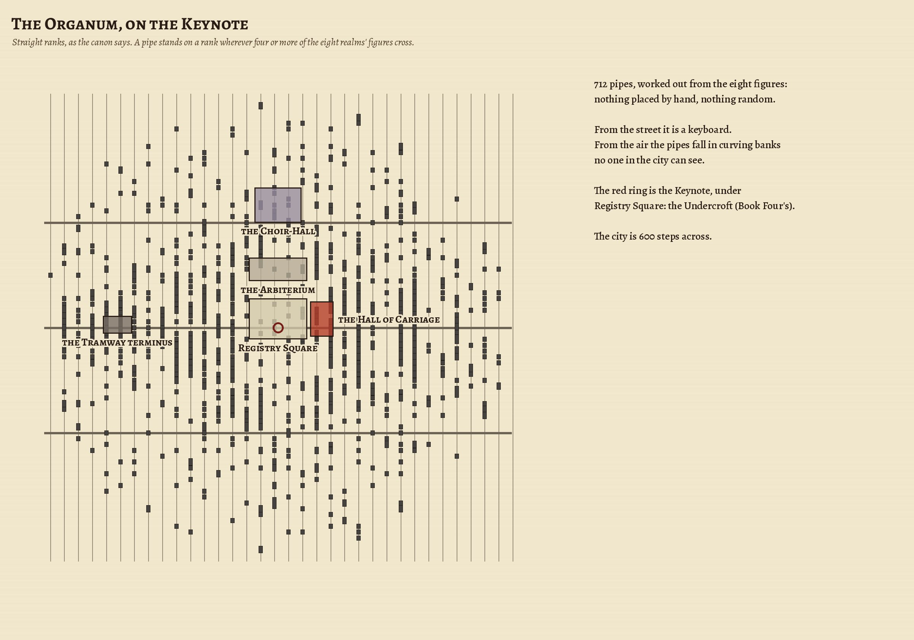

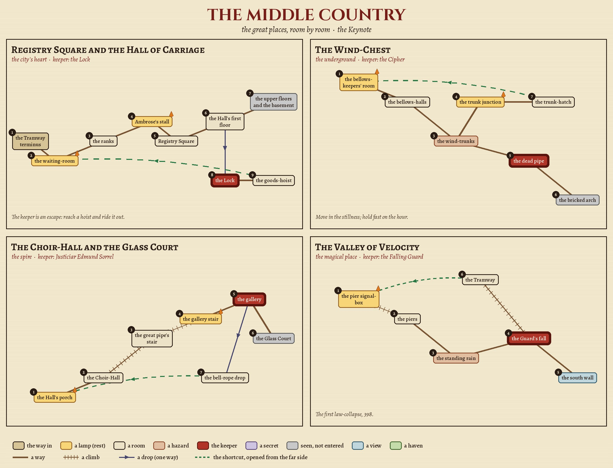

### Registry Square and the Hall of Carriage
*the city's heart; keeper: the Lock.* The keeper is an escape: reach a hoist and ride it out.

1. **the Tramway terminus** (the way in): green-lacquered cars.
2. **the waiting-room** (lamp).
3. **the ranks**: pipes 100 to 600 feet; streets like a keyboard.
4. **Ambrose's stall** (lamp): he has never asked anyone what they do.
5. **Registry Square**: grey, four storeys, brass plates.
6. **the Hall's first floor**: the public counter; red-wax receipts.
7. **the upper floors and the basement** (seen, not entered): Book Three's heist.
8. **the Lock** (the keeper): caught where you should not be: cold syrup, proctors free in it.
9. **the goods-hoist**: not keyed, because it is a winch.

*Ways:* the Tramway terminus to the waiting-room; the waiting-room to the ranks; the ranks to Ambrose's stall; Ambrose's stall to Registry Square; Registry Square to the Hall's first floor; the Hall's first floor to the upper floors and the basement; the Hall's first floor to the Lock (a drop, one way); the Lock to the goods-hoist; the goods-hoist to the waiting-room (**the shortcut**, opened from the far side).

### The Wind-Chest
*the underground; keeper: the Cipher.* Move in the stillness; hold fast on the hour.

1. **the bellows-keepers' room** (lamp): under the Choir-Hall.
2. **the bellows-halls**: leather bellows the size of barns, on water-wheels.
3. **the wind-trunks** (hazard): still between the hours; on the hour the trunks roar.
4. **the trunk junction** (lamp).
5. **the dead pipe** (the keeper): under the Arbiterium; it sounds without being played.
6. **the bricked arch** (seen, not entered): the Undercroft: Book Four's.
7. **the trunk-hatch**: into the Choir-Hall's yard.

*Ways:* the bellows-keepers' room to the bellows-halls; the bellows-halls to the wind-trunks; the wind-trunks to the trunk junction; the wind-trunks to the dead pipe; the dead pipe to the bricked arch; the trunk junction to the trunk-hatch; the trunk-hatch to the bellows-keepers' room (**the shortcut**, opened from the far side).

### The Choir-Hall and the Glass Court
*the spire; keeper: Justiciar Edmund Sorrel.*

1. **the Hall's porch** (lamp).
2. **the Choir-Hall**: the city's great chord heard from inside.
3. **the great pipe's stair**: a stair inside the wall of the largest pipe.
4. **the gallery stair** (lamp).
5. **the gallery** (the keeper): Sorrel reads the writ aloud as he fights.
6. **the Glass Court** (seen, not entered): nine monarchs signing; Orrin looks up.
7. **the bell-rope drop**: from the gallery to the porch.

*Ways:* the Hall's porch to the Choir-Hall; the Choir-Hall to the great pipe's stair (a climb); the great pipe's stair to the gallery stair (a climb); the gallery stair to the gallery; the gallery to the Glass Court; the gallery to the bell-rope drop (a drop, one way); the bell-rope drop to the Hall's porch (**the shortcut**, opened from the far side).

### The Valley of Velocity
*the magical place; keeper: the Falling Guard.* The first law-collapse, 398.

1. **the pier signal-box** (lamp): on the Tramway.
2. **the piers**: down the Tramway's piers into the Valley.
3. **the standing rain** (hazard): rain that never lands; you leave a tunnel of yourself.
4. **the Guard's fall** (the keeper): three seconds of his fall take a month; catch him.
5. **the south wall** (a view): what is thrown here goes on, faster, for ever.
6. **the Tramway**: back over the Valley.

*Ways:* the pier signal-box to the piers (a climb); the piers to the standing rain; the standing rain to the Guard's fall; the Guard's fall to the south wall; the Guard's fall to the Tramway (a climb); the Tramway to the pier signal-box (**the shortcut**, opened from the far side).

### Smaller places

- **The harvest-houses (Ebb Cross, the Malting, Hollin Ford):** the gate; the receiving room; no further, ever; a refugee's bundle in the Malting's yard.
- **The Tramway terminus and the embankment:** the platforms; the Company's office; the embankment walk.
- **Ambrose's coffee stall:** the awning; the chipped white cups; the blue one nobody takes now.
- **The Arbiterium:** the public gallery; the writ-room counter.
- **The White Room:** a door in a corridor; a man breathing slowly behind it; the player does not go in.
- **The pipe-banks of the lower town:** the lanes between the lowest ranks; the 389 plaque.

---

## Numbers for the owner

Phase 89 promised the numbers before anything is built. They are here, each with a recommendation; "approve all" takes them as written.

1. **The cities are 500 steps across** (the Organum 600), about as far as one stretch of the Greenroot road, or two minutes' walk from gate to centre. *Recommend: yes.*
2. **The Piece** holds all the coin the player carries and the experience toward the next level (never a level already gained). It waits where they fell, sounding their own note, until they reach it or die again. *Recommend: yes.*
3. **Lamps:** resting at a lamp heals in full, saves, and brings back the place's ordinary foes; keepers stay down for a week (the Phase 86 rule). Waking after a death is at the last lamp lit, at six-tenths health as now. *Recommend: yes.*
4. **The hour-bead** costs **120 sovereigns** (two of the roads' first bounties), and the player can carry **one** at a time. Swallowed, it undoes one death: no Piece is left, and the player stands up where they fell. *Recommend: yes.*
5. **Keepers' trophies** stay valuables only, as on the roads (Phase 86); each keeper also gives **one piece of gear in its realm's own look** (the owner's standing preference: every weapon and worn thing its own look from the world). The gear itself is designed with each realm when it is built. *Recommend: yes.*
6. **The building order:** first, the lamps, the Piece and shortcuts in the Reach's three built great places; then the Dawning Heights (Book Two), the Rift and the Middle Country (Book Three), Fortis, Cinderhold and the Dunes (Book Four); the Coast's and the Woods' new parts last. *Recommend: yes.*

## What comes next

**Phase 91: the Souls rules,** built in the Reach where they can be felt first: lamps in the Antler Galleries, the Dry Flume and the Deep Grove's gap; the Piece with its Options switch; the shortcuts in the two dungeons. Then the Dawning Heights, country by country.

